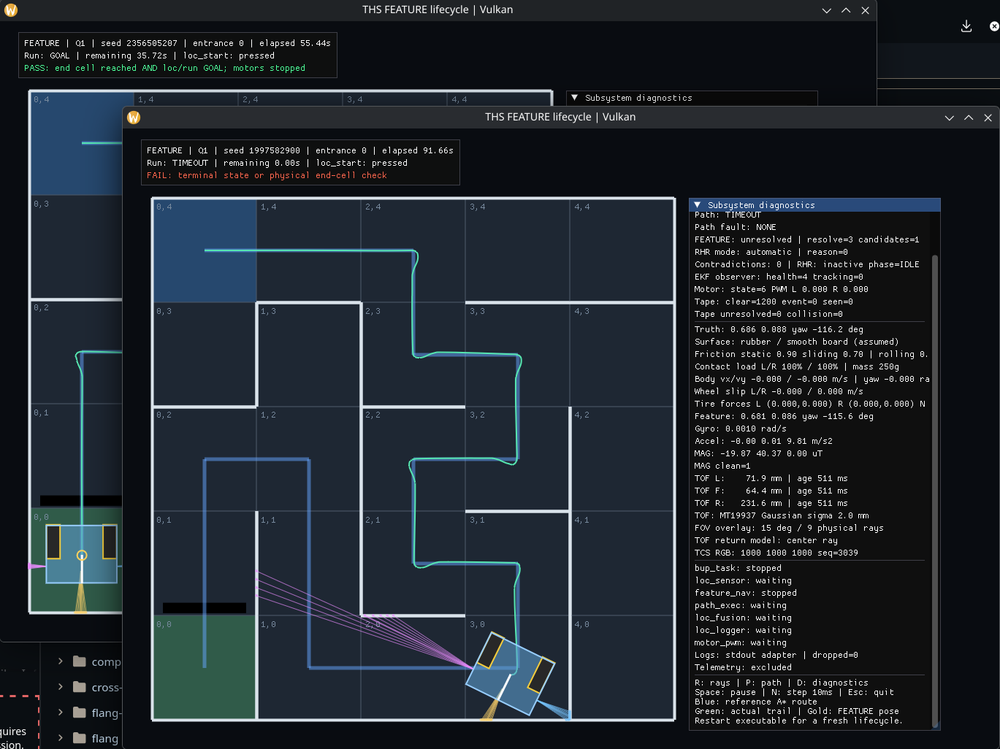

# CPRobot — RAI AXI robot firmware and field tools

*FEATURE E2E host simulation · seed 1234 · 4× playback · GOAL in 38.461 s,
with tape confirmed, no collision and stopped wheels.*

CPRobot brings together **THS**, an autonomous STM32F411CE maze robot, **ADR**,
a gamepad-controlled CyberPi/mBot2 robot running uPython, and a schema-driven
Android field toolkit with ESP32-C6 / LuatOS CORE ESP32-C3 BLE and WLAN bridges.
THS uses FEATURE navigation with right-hand-rule (RHR) fallback, a portable C++
core, and a FreeRTOS application with sensor and motor HALs.

End-to-end (E2E) host runs exercise startup, simulated sensors and motion,
navigation, goal-tape detection, deadlines, and final stopping. The interactive
Vulkan lifecycle viewer makes successful routes and failures inspectable:

*Illustrative host runs with different seeds. This screenshot is not a paired
benchmark or evidence of physical robot qualification.*

## E2E results and current status

The [2026-11-16 triangular-head replay](docs/validation/v2_triangular_head_2026-11-16.md)
reached GOAL **38.461 seconds after the start key**, with tape confirmed, no
collision, zero final PWM, stopped simulated wheels, and 12.6 mm final center
error. It used seed 1234, the supplied Q1 maze, fixed goal `(0,0)`, TurnGuard
and non-stop turns enabled, and full-output mode disabled.

This is one successful simulated mission. The
[2026-11-15 native results](docs/validation/v2_nonstop_turn_2026-11-15.md)
record **82/95 tests passing** with non-stop turns enabled, versus **91/95**
with them disabled: nine additional lifecycle regressions were recorded.
These counts precede the triangular-head update and are not a fresh test of
this checkout. A subsequent front-profile TurnGuard experiment was withdrawn;
the [restoration replay](docs/validation/v2_turnguard_front_profile_2026-11-16.md#restoration-validation)
again completed the seed-1234 mission in 38.461 seconds.

The project is being prepared for public source release. Broader navigation
qualification and physical deployment remain incomplete. See the
[release status and documentation errata](docs/public_release.md) for component
status, evidence availability, and outstanding release work.

## Repository map

| Location | Responsibility |
| --- | --- |
| [`fw/robot_sf`](fw/robot_sf) | Portable THS navigation, geometry, localization and motor-control core |
| [`fw/autonomous/STM32_TINYRCP`](fw/autonomous/STM32_TINYRCP) | STM32F411CE HAL, bring-up, FreeRTOS tasks and host lifecycle tests |
| [`fw/manual`](fw/manual) | ADR uPython application, samples, USB uploader, tests and firmware-owned field-tool provider |
| [`fw/robot_localization`](fw/robot_localization) | Localization library and retained validation material |
| [`fw/telemetry_bridge`](fw/telemetry_bridge) | Bridge protocol, Linux collector and transport checks |
| [`fw/tools/navigation_host`](fw/tools/navigation_host) | Standalone native navigation build |
| [`generic_field_tool`](generic_field_tool) | Generic Android app, shared protocol and ESP32 multiboard bridge firmware |
| [`proto`](proto) / [`host/tools`](host/tools) | Schemas, configuration catalog, generators and optional gRPC gateway |
| [`docs`](docs) | Architecture, hardware, operation, diagrams and dated validation records |

The generic field tool stays platform agnostic; robot-specific schemas, codecs
and providers belong to the owning firmware component. EKF development is frozen.

## Build and run

Start with the [build guide](docs/building.md) for prerequisites, profiles and
commands. It covers native tests, the interactive E2E viewer, randomized
qualification campaigns, STM32 and ESP32 compilation, Android, and ADR upload.
Build directly in this workspace; SMB workarounds apply only to SMB checkouts.
Build commands do not flash hardware unless explicitly documented as uploads.

The [interactive lifecycle guide](docs/building.md#interactive-feature-lifecycle-test-linux)
explains replay seeds, map rotations, GUI controls and headless runs. A campaign
requires at least five distinct seeds and retains failed missions; a single
successful replay does not qualify the campaign.

## Documentation

- [Architecture overview](docs/architecture.md) and component boundaries.
- [THS architecture](docs/fw_ths_architecture.md), [ADR architecture](docs/fw_adr_architecture.md), and [field-tool architecture](docs/field_tool_architecture.md).
- [Hardware wiring](docs/hardware_wiring.md), [tracing](docs/tracing.md), and [ADR USB serial](docs/adr_usb_serial.md).
- [Release status and errata](docs/public_release.md), including how to interpret historical validation evidence.

## Licensing

| Material | License / terms |
| --- | --- |
| Project-owned firmware, tests, host tools and `generic_field_tool` software | [GNU GPL version 3](LICENSE.software) (`GPL-3.0-only`) |
| Original hardware designs, including electrical and mounting drawings | [CERN-OHL-S-2.0](LICENSE.hardware) (strongly reciprocal) |
| Manufacturer firmware dumps and extracted contents | **Excluded from public licensing and distribution**; manufacturer terms restrict use to their devices |
| Third-party code and assets | Their respective licenses and notices |

See [LICENSING.md](LICENSING.md) for exact scope and exceptions. The software
license does not grant rights to manufacturer dumps or override third-party terms.
