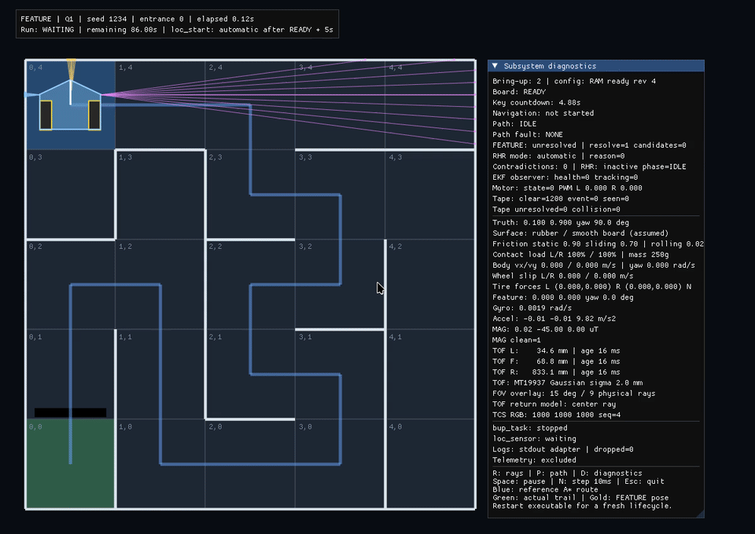

# CPRobot — RAI AXI core firmware

*FEATURE E2E host simulation · seed 1234 · 4× playback · GOAL in 38.461 s,
with tape confirmed, no collision and stopped wheels.*

CPRobot brings together **THS**, an autonomous STM32F411CE maze robot, **ADR**,
a gamepad-controlled CyberPi/mBot2 robot running uPython, and a schema-driven
Local robot firmware, diagnostics and native development tools.
THS uses FEATURE navigation with right-hand-rule (RHR) fallback, a portable C++
core, and a FreeRTOS application with sensor and motor HALs.

End-to-end (E2E) host runs exercise startup, simulated sensors and motion,
navigation, goal-tape detection, deadlines, and final stopping. The interactive
Vulkan lifecycle viewer makes successful routes and failures inspectable:

*Illustrative host runs with different seeds. This screenshot is not a paired
benchmark or evidence of physical robot qualification.*

## E2E demonstration

The teaser shows a FEATURE host-simulation run reaching GOAL. The lifecycle
viewer supports replayable seeds, map rotations and headless runs; see the
[interactive lifecycle guide](docs/building.md#interactive-feature-lifecycle-test-linux).
Simulation demonstrations do not qualify physical robot behavior. Broader
navigation qualification and physical deployment remain incomplete.

Validation reports, raw evidence and analysis notebooks are maintained privately
and are excluded from the public source tree and release bundles.

## Repository map

| Location | Responsibility |
| --- | --- |
| [`fw/robot_sf`](fw/robot_sf) | Portable THS navigation, geometry, localization and motor-control core |
| [`fw/autonomous/STM32_TINYRCP`](fw/autonomous/STM32_TINYRCP) | STM32F411CE HAL, bring-up, FreeRTOS tasks and host lifecycle tests |
| [`fw/manual`](fw/manual) | ADR uPython application, samples, USB uploader, tests |
| [`fw/robot_localization`](fw/robot_localization) | Localization library and compatibility entry point |
| [`fw/tools/navigation_host`](fw/tools/navigation_host) | Standalone native navigation build |
| [`docs`](docs) | Architecture, hardware, operation and diagrams |

This branch contains the THS and ADR core firmware. Field tools and telemetry utilities are removed; local diagnostics remain. See [removal scope and validation](docs/core_fw.md).

## Build and run

Start with the [build guide](docs/building.md) for prerequisites, profiles and
commands. It covers native tests, the interactive E2E viewer, randomized
qualification campaigns, STM32 compilation and ADR upload.
Build directly in this workspace; SMB workarounds apply only to SMB checkouts.
Build commands do not flash hardware unless explicitly documented as uploads.

The [interactive lifecycle guide](docs/building.md#interactive-feature-lifecycle-test-linux)
explains replay seeds, map rotations, GUI controls and headless runs. A campaign
requires at least five distinct seeds and retains failed missions; a single
successful replay does not qualify the campaign.

## Documentation

- [Architecture overview](docs/architecture.md) and component boundaries.
- [THS architecture](docs/fw_ths_architecture.md), [ADR architecture](docs/fw_adr_architecture.md).
- [Hardware wiring](docs/hardware_wiring.md), [tracing](docs/tracing.md), and [ADR USB serial](docs/adr_usb_serial.md).

## Licensing

| Material | License / terms |
| --- | --- |
| Project-owned firmware, tests, host tools software | [GNU GPL version 3](LICENSE.software) (`GPL-3.0-only`) |
| Original hardware designs, including electrical and mounting drawings | [CERN-OHL-S-2.0](LICENSE.hardware) (strongly reciprocal) |
| Manufacturer firmware dumps and extracted contents | **Excluded from public licensing and distribution**; manufacturer terms restrict use to their devices |
| Third-party code and assets | Their respective licenses and notices |

See [LICENSING.md](LICENSING.md) for exact scope and exceptions. The software
license does not grant rights to manufacturer dumps or override third-party terms.
