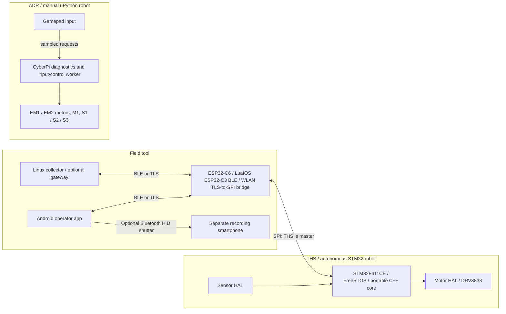

# Architecture

CPRobot contains two robot firmware components and a field-tool component.
**THS** is the autonomous STM32 robot; **ADR** is the manual robot's uPython
firmware. The field tool provides the Android operator app, ESP32-C6 / LuatOS ESP32-C3 bridge,
shared protocol, and Linux/host utilities used with THS.

This page is the project overview and component index. Each component document
owns its implementation layers, initialization, operation, state diagrams, source
evidence, and limits.

## Components

| Component | Scope and source locations | Architecture |
| --- | --- | --- |
| THS | STM32F411CE HAL and FreeRTOS application in `fw/autonomous/STM32_TINYRCP`; portable navigation, localization, and motor core in `fw/robot_sf` | [THS firmware](fw_ths_architecture.md) |
| ADR | Manual gamepad-driven CyberPi/mBot2 uPython sketch in `fw/manual` | [ADR firmware](fw_adr_architecture.md) |
| Field tool | Android app and ESP32-C6 / LuatOS ESP32-C3 bridge in `generic_field_tool`; framing and Linux collector in `fw/telemetry_bridge`; schemas in `proto`; generators and optional gateway in `host/tools` | [Field tool](field_tool_architecture.md) |

## System overview

The ADR branch shows the source-level input-to-worker-to-actuator path. See the
[ADR firmware architecture](fw_adr_architecture.md) for its safety gates,
thread ownership, and unverified runtime assumptions.

## Ownership and integration boundaries

THS owns sensor acquisition, localization, path execution, run deadlines, and
motor output. FEATURE is its default navigation engine; the frozen EKF remains
an observer or an explicitly selected startup mode. After FEATURE acquires a
pose, sustained feature contradictions latch RHR fallback for active goals.
The ESP32-C6 / LuatOS ESP32-C3 transports
commands and telemetry while local control remains on the STM32. Task ownership,
startup gates, and terminal behavior live in
[THS firmware architecture](fw_ths_architecture.md).

The field tool owns operator workflows, schema-driven commands, transport
framing, provisioning, configuration interaction, and live log presentation.
Its optional HID shutter correlates a recording attempt with an incoming robot
log; camera state is not observable. Protocol boundaries, bridge task states,
and Android/host behavior live in [field-tool architecture](field_tool_architecture.md).

ADR is a separate manually controlled robot program. Its control worker polls
board-provided gamepad APIs and owns actuator outputs; main handles diagnostics. Its firmware-owned transport provider is retained for the generic Android
field tool, with ADR field-tool runtime currently commented out; it remains separate from THS runtime. Its source
status and runtime assumptions live in [ADR firmware architecture](fw_adr_architecture.md).

## Current integration status

The maintained autonomous hardware path uses STM32F411CE and ESP32-C6 / LuatOS ESP32-C3 with BLE
and WLAN station IPv6/TLS. THS board configuration, sensor qualification, and
physical stopping behavior still require board validation. Remote configuration
is required in every THS build; physical flash power-loss behavior and first-time
bridge pairing still require qualification in their owning component pages. ADR's checked-in
application is documented separately from the THS deployment path; its board
runtime and physical behavior are not qualified here.

No diagram or retained validation report establishes a working full-system or
physical deployment. Component pages distinguish current source behavior from
intended behavior and historical validation.

## Supporting documentation

- [Build and compilation](building.md): canonical prerequisites, commands, profiles, and workspace workarounds.
- [Hardware wiring](hardware_wiring.md): THS/bridge source defaults and unverified pin examples.
- [Tracing and collection](tracing.md): THS deferred logging and current collector paths.
- [Frozen EKF references](ekf/README.md): retained algorithm studies and historical results.
- [Validation records](validation/white_field_end_tape.md): results for specific revisions.
- [Competition objectives](objectives.md): robot tasks and competition context.

