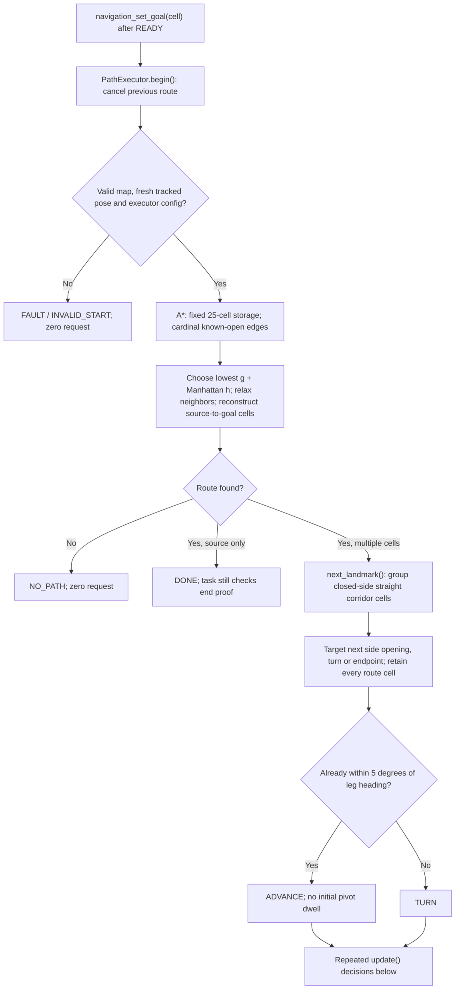
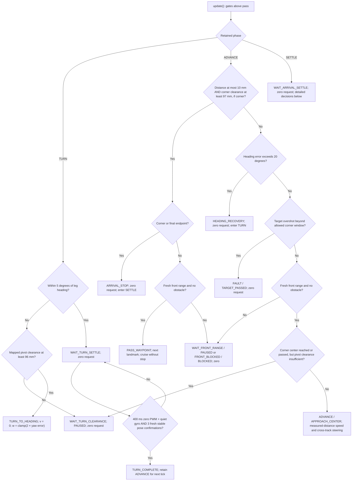
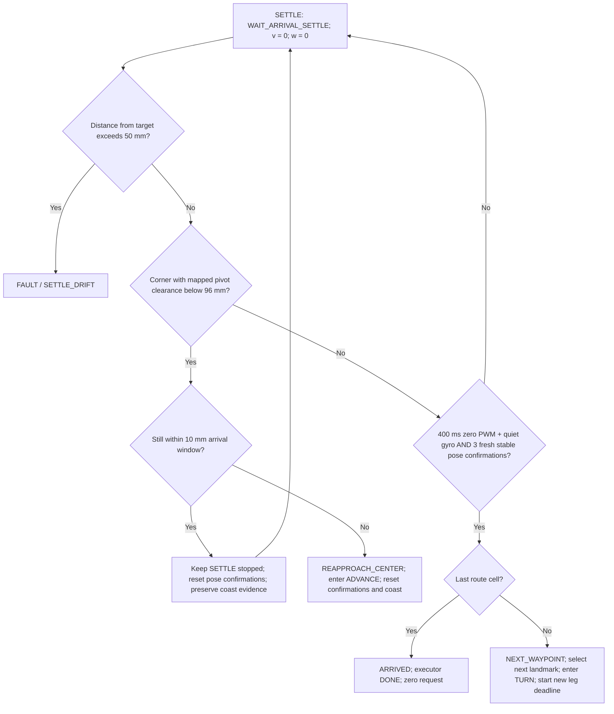
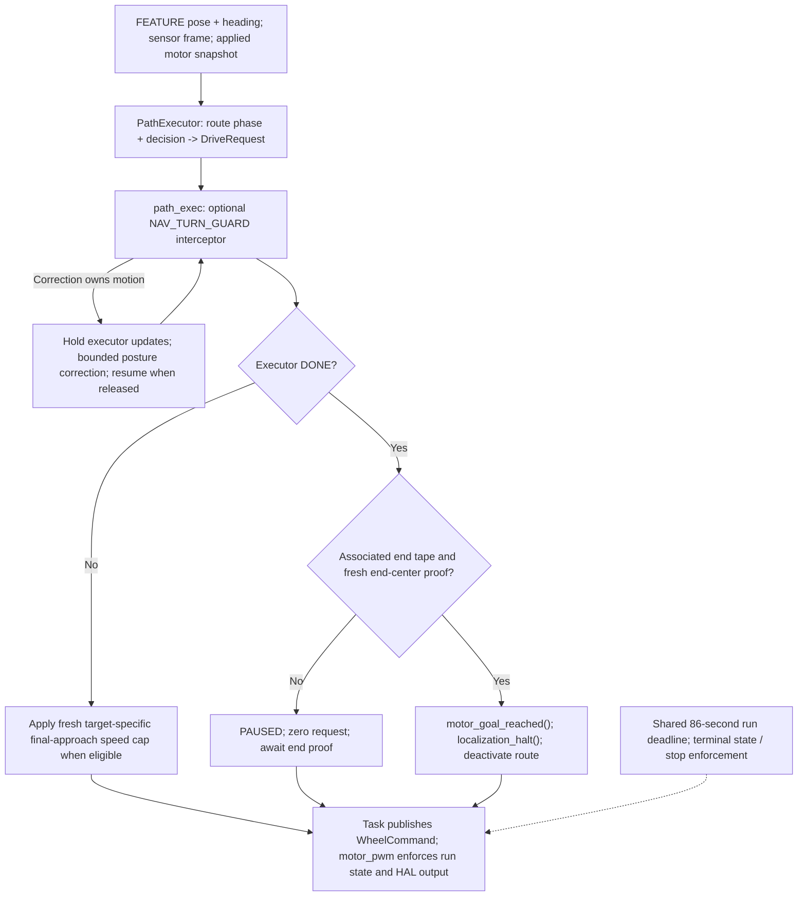

# FEATURE path micro-operations

This is the projected view of **A-star → turn / advance / settle** in the
[THS initialization flow](fw_ths_architecture.md#initialization-flow).
It expands the FEATURE path engine after a resolved map, trusted pose, READY,
and an explicit goal. FEATURE matching supplies observations; A* selects cells;
`PathExecutor` computes body-velocity requests; `path_exec` owns command delivery.
The diagrams describe current source behavior, using the THS application settings.

An editable [Draw.io copy](diagrams/feature_path_micro_ops.drawio) contains these
four diagrams and a linked projection overview. The standalone
[HTML preview](diagrams/feature_path_micro_ops.html) supports page navigation,
pan, zoom and node search. Open the `.drawio` file in Draw.io / diagrams.net to edit.

## Plan a route and select a leg

A* uses cost 10 per edge and `10 × Manhattan distance` as its heuristic;
equal total scores prefer the smaller heuristic. It searches at most 25 nodes.
`begin()` returns a route without commanding hardware. Corridor grouping changes
the observation target, while every traversed edge remains subject to validation.

## Decide one micro-operation per update

`phase_` retains TURN, ADVANCE or SETTLE. `DriveRequest.status` can temporarily
report PAUSED while retaining that phase for the next update. The diagnostic
`ExecuteDecision` names the branch taken; it does not authorize actuation.
Each new tick starts with zero linear and angular velocity, then checks these gates
before entering the phase diagram:

| Check, in source order | Decision / result |
| --- | --- |
| IDLE, DONE, NO_PATH, BLOCKED or FAULT | Return zero; DONE reports `ARRIVED`, others `INACTIVE` |
| Clock before leg start or more than 30 seconds on the leg | `FAULT` / `LEG_TIMEOUT` |
| Driver, motor timing, invalid command or command timeout | `FAULT` / `MOTOR_FAULT` |
| Invalid or stale pose / motor snapshot | `WAIT_POSE` / `WAIT_MOTOR`; PAUSED, zero request |
| Any leg edge no longer known-open | `CLOSED_EDGE`; BLOCKED |
| Observed grid cell outside the current leg | `FAULT` / `UNEXPECTED_CELL` |
| Gates pass | Measure target distance, forward distance, heading error, cross-track error and swept pivot clearance |

Pose age is bounded by 150 ms and motor age by 50 ms. TURN can use a fresh
independent heading (100 ms) with three valid fresh ranges (150 ms) when
translation is unobservable. That exception cannot establish forward motion or
settled arrival without fresh tracked pose evidence.

The arrows describe decisions across ticks, including waits; they are not a
blocking loop inside `update()`. A clear front range is at least 25 mm and no
older than 100 ms. Pivot clearance measures distance to finite mapped wall
segments; unknown edges count as walls. The swept radius is 95 mm, with a 2 mm
arrival margin and 1 mm hold margin.

During translation, the request is capped at 0.18 m/s. A stopping leg uses
`min(cruise, max(0.003, 4 × forward_distance))` in m/s; a collinear observation
waypoint retains cruise speed. `APPROACH_CENTER` identifies a corner already
within position tolerance but still needing pivot clearance. Steering adds
`atan2(cross_track, max(forward_distance, 0.080))`, limited to ±10 degrees,
to the cardinal heading. Angular requests use twice the heading error, capped
at ±1 rad/s. No nominal velocity is integrated into pose.

## Settle, advance the route, or finish

Coast dwell and pose confirmation count are independent. Gyro must be fresh
(100 ms) and quiet (at most 0.05 rad/s); each confirmation needs a distinct fresh
pose, a new motor snapshot and pose displacement at most 5 mm. Pose jitter resets
confirmations without restarting coast dwell. Nonzero PWM or nonquiet/stale gyro
revokes coast evidence. Low clearance while arrival remains inside tolerance
holds zero output rather than restarting creep; this is the
seed-1485012174 livelock fix (internal record).
Reapproach is specifically the low-clearance corner branch outside that window;
other drift up to 50 mm follows the normal settle proof. Waits consume the
original 30-second leg budget. `PASS_WAYPOINT` and `NEXT_WAYPOINT` start a new
leg deadline; neither extends the shared run budget.

## Project the request into the task and motor boundary

An unresolved end cue forces zero output and cancels the guard before this
completion check. With the guard enabled, its bounded correction owns motion
and holds FEATURE executor updates; the 30-second leg clock and shared run
deadline continue to elapse. See the
[THS navigation and turn-guard description](fw_ths_architecture.md#geometry-resolution-and-navigation-lifecycle)
for correction details. Executor `v=0` pivot requests pass through this guard:
with a fresh measured pose, it may add at most ±8 mm/s to hold the rear axle
midpoint after proving the remaining mapped arc. The rear-axle geometry and
single-run limitation are recorded in mount validation (internal record).
The final speed cap is
`max(0.005, 2 × (stop_distance − coast_allowance))` m/s when a fresh stop
observation matches the final target. DONE alone cannot declare GOAL; the
deadline wins an arrival at or after 86 seconds. FAULT, BLOCKED and NO_PATH
stop the motor and deactivate the route.

Source evidence:

- [A* search](../fw/robot_sf/src/navigation/AStar.cpp): bounded search, tie-break and route reconstruction.
- [PathExecutor implementation](../fw/robot_sf/src/navigation/path_executor.cpp): `begin`, `next_landmark`, `update`, decisions and geometry.
- [Executor types](../fw/robot_sf/include/navigation/path_executor.hpp): phase/status, faults, decisions and diagnostics.
- [Navigation task](../fw/autonomous/STM32_TINYRCP/src/tasks/navigation_tasks.cpp): application settings, guard ownership, end proof, stop cap and command publication.
- [Turn guard](../fw/robot_sf/include/navigation/turn_guard.hpp): intercepted pivot and correction decisions.
