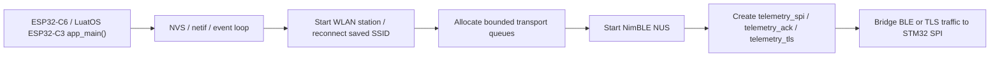
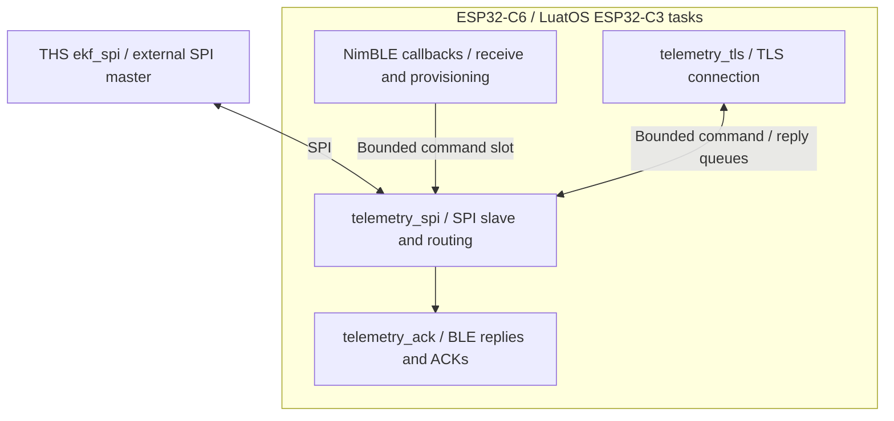

# Field-tool architecture

The field-tool component contains the Android operator app, the ESP32-C6 / LuatOS ESP32-C3 BLE/WLAN
bridge, shared protocol codecs, Linux collection, and optional host gateway tools.
It connects operators to THS and provides configuration, commands, telemetry,
logs, and video tracing. THS retains ownership of localization and motor control.
There is no field-tool transport integration in the current ADR manual sketch.

Return to the [project overview](architecture.md). Robot behavior belongs to
[THS firmware architecture](fw_ths_architecture.md) or
[ADR firmware architecture](fw_adr_architecture.md). Build prerequisites,
commands, profiles, and workspace workarounds remain in [building.md](building.md).

## Layers and runtime components

| Layer | Responsibility | Source location |
| --- | --- | --- |
| Operator UI | Projects, imported schemas, command forms, calibration/configuration UI, telemetry/log views | `generic_field_tool/android/app`, `generic_field_tool/android/protocol` |
| Host tools | BLE/TLS collector, JSONL output, schema generators, optional gRPC gateway | `fw/telemetry_bridge/host`, `host/tools` |
| Bridge transport | NVS Wi-Fi provisioning, NimBLE NUS, TLS server, SPI slave, bounded command/reply queues | `generic_field_tool/esp32_multiboard/src` |
| Shared protocol | Protobuf descriptors, typed frames and bounded command/response/sample envelopes | `proto`, `generic_field_tool/protocol.proto`, `generic_field_tool/common`, `fw/telemetry_bridge/common` |

The bridge uses one ESP-IDF application for both board profiles. PlatformIO selects
SPI GPIOs and the board; target defaults select flash size/mode. Both profiles
currently use MOSI=7, MISO=6, SCLK=5, CS=4 and READY=3. They share SPI2 slave,
mode 0, 256-byte DMA cells, BLE NUS and WLAN station IPv6/TLS. These pins are
source defaults requiring assembled-board validation; see [hardware wiring](hardware_wiring.md).
The 2 MiB factory partition fits both targets. C3 does not use the C6 generated
`sdkconfig`; ESP-IDF generates configuration separately for each environment.

## Bridge initialization flow



Source evidence: [ESP32-C6 / LuatOS ESP32-C3 entry](../generic_field_tool/esp32_multiboard/src/main.c).

## Bridge RTOS task ownership and data flow



| Bridge task | Priority | Requested stack, bytes | Work |
| --- | --- | --- | --- |
| `telemetry_spi` | 8 | 4096 | SPI slave transactions and packet routing |
| `telemetry_ack` | 5 | 2048 | BLE replies and ACKs; up to 10 ms ACK wait |
| `telemetry_tls` | 5 | 12288 | IPv6 listener, TLS handshake and connected client loop |

ESP-IDF stack arguments are **bytes**, unlike the THS STM32 word counts. NimBLE
and ESP-IDF also own framework tasks.

These are requested stack sizes, not measured usage. NimBLE, ESP-IDF, TLS state
and bounded queues also consume memory. THS task stacks and mailboxes belong to
the [THS RTOS description](fw_ths_architecture.md#rtos-task-ownership-and-data-flow).

### Task lifecycle states

The concurrent regions show application states within bridge tasks, rather than
FreeRTOS scheduler states. They begin after ESP32-C6 / LuatOS ESP32-C3 `app_main()` initialization.

```mermaid
stateDiagram-v2
  state "ESP32-C6 / LuatOS ESP32-C3 bridge tasks (concurrent after app_main initialization)" as BridgeTasks {
    state "telemetry_spi" as BridgeSPI {
      [*] --> SPIService
      SPIService: Serve SPI transactions and route packets continuously
    }
    --
    state "telemetry_ack" as BridgeACK {
      [*] --> ACKService
      ACKService: Drain BLE replies and wait up to 10 ms for ACKs
    }
    --
    state "telemetry_tls" as BridgeTLS {
      [*] --> TLSInit
      TLSInit --> WaitingIPv6: TLS context and IPv6 listener ready
      TLSInit --> TLSDeleted: initialization fails
      WaitingIPv6 --> Listening: IPv6 ready
      Listening --> WaitingIPv6: IPv6 unavailable
      Listening --> Handshake: client accepted
      Handshake --> Connected: handshake succeeds
      Handshake --> Listening: setup or handshake fails; close client
      Connected: Exchange telemetry, commands, replies, and ACKs
      Connected --> Listening: disconnect, I/O failure, invalid command, or IPv6 loss
      TLSDeleted: Free TLS resources; vTaskDelete
    }
  }
```



Bridge transport tasks operate independently of the THS run state. TLS client
failures return to the accept loop; fatal TLS initialization failure deletes only
`telemetry_tls`. Wi-Fi reconnection belongs to ESP-IDF event handlers, and BLE
connection handling belongs to NimBLE callbacks.

Source evidence: [bridge task loops](../generic_field_tool/esp32_multiboard/src/main.c)
and [NimBLE service](../generic_field_tool/esp32_multiboard/src/ble_nus.c).

## Communication and command lifecycle

THS owns SPI master scheduling, deferred log draining, and control execution.
Its [telemetry boundary](fw_ths_architecture.md#telemetry-boundary) specifies SPI
parameters and the currently exported pose. The bridge forwards the bounded
messages between that interface and Android or Linux clients. Boot IDs and
sequences expose gaps without synchronizing clocks.

```mermaid
sequenceDiagram
  autonumber
  participant Tool as Android or Linux tool
  participant C6 as ESP32-C6 / LuatOS ESP32-C3 BLE/TLS bridge
  participant SPI as STM32 ekf_spi
  participant Nav as Navigation API/tasks
  Tool->>C6: Framed command with request ID
  C6->>C6: Validate length/type; reserve bounded command slot
  SPI->>C6: Next master transaction while READY
  C6-->>SPI: Queued command / typed payload
  SPI->>Nav: Start / halt or gated configuration handler
  Nav-->>SPI: Accepted or denied
  SPI->>C6: Subsequent transaction carries correlated ACK/reply
  C6-->>Tool: Correlated result; timeout remains unconfirmed
```

BLE/TLS framing is LE16 length plus kind. SPI cells use the existing magic/CRC
contract; legacy control ACKs occupy the final ten bytes. Typed kinds 4/5 carry
remote configuration, 7 logs, 8 color calibration; generic kinds 9/10/11 carry
command/response/sample envelopes. A complete generic envelope must fit 238 bytes,
including fully qualified type name. There is no application fragmentation or
command replay. The bridge validates and forwards generic messages, but the
current STM32 adapter has no arbitrary generic-command dispatcher or remote goal
command. Starting localization is not setting a navigation goal.

ESP32-C6 / LuatOS ESP32-C3 has a one-packet remote transmit queue, four-packet reply queues for BLE
and TLS, latest-state mailboxes and separate ACK slots. An in-flight remote
request times out after four seconds. Congestion, disconnect, CRC failure or
missing ACK cannot establish target execution. See the retained
[wire protocol specification](../fw/telemetry_bridge/docs/PROTOCOL.md) for field
layouts and status values.

WLAN uses station mode on a common AP with IPv6 link-local connectivity and client
isolation disabled. TLS pins the supplied server certificate; it is not mutual
client authentication. BLE provisioning writes credentials through an encrypted
GATT connection with Just Works pairing. Wi-Fi credentials persist in default
NVS without NVS encryption in this implementation. Neither transport provides
synchronized Wi-Fi Aware/NAN operation. The C6 accepts new BLE peers only during
its pairing window and supports bonded reconnects. However, the current STM32
key handler only starts navigation; it does not send the pairing-window event
expected by the C6. The older triple-press instructions therefore do not describe
this checkout. First-time pairing authorization still needs integration; existing
bonds or an explicitly supplied authorization path are required.

## Operator workflows and configuration

The Android setup UI uses only app-local adapted welcome/content/header/footer
views. `OnboardingViewModel` owns progress and the draft through `SavedStateHandle`;
Kotlin view binding dispatches actions, and `RemoteModel` / `ProjectStore` own
project creation and persistence. The AOSP setupdesign/setupcompat vendor trees
and modules are removed; provenance lives in
[SETUP_UI_SOURCES.md](../generic_field_tool/android/app/SETUP_UI_SOURCES.md).

The Android app creates a project during onboarding, retains project selection,
and imports binary protobuf `FileDescriptorSet` files up to 64 KiB through the
schema picker. Include dependencies in the descriptor. Invalid imports leave the
previous schema intact. Commands are generated from schema `*Command` messages;
matching fully qualified `*Response` types and request IDs complete requests.
Repeated values use JSON arrays, enums use names and bytes use base64. Pending
commands become unconfirmed on link loss and are never automatically replayed.
Sensor and log pause controls affect their respective displayed streams. Logs
can be searched/exported offline; project switches disconnect and clear live data.

### Video tracing

Settings → **Tools** (collapsible) → **Video tracing** configures an optional
Bluetooth HID shutter on Android 9 or later, when the phone exposes the HID Device
profile. The dialog persists **Use Video Tracing**, a glob or regex pattern, and
the armed state. Regex searches incoming robot log message text; glob matches the
whole message using `*` and `?` (for example `*map variant latched*`). Invalid or
empty enabled patterns cannot be saved. Matching uses newly received kind-7
`LogRecord` messages, including while log display is paused; local console output,
trace markers, and log replay do not trigger it.

Enabling video tracing starts a `connectedDevice` foreground service and arms one
shutter attempt. The service registers `BluetoothHidDevice` Consumer Control with
a volume-up input report. Pairing stays in AOSP system Bluetooth settings, opened
by the dialog's **Open Bluetooth settings** link; already paired phones can be
connected from the dialog. Bluetooth connection permission is requested before
starting the service. The recording phone must have its camera open in video mode
and support volume-key recording. Its camera state is unknown: HID report
submission cannot confirm recording started or distinguish start from stop.

The first matching log while HID is connected consumes and saves the arm before
attempting a key press, then schedules key release after 100 ms. A trace entry
records the UTC send-attempt time, local log ID/time/tag, robot uptime timestamp,
message excerpt and unconfirmed camera state in the normal searchable/exportable
log buffer. A failed submission is also logged and is never automatically retried. Disconnection,
unchanged settings saves, and process restarts do not rearm a consumed trigger;
**Arm next recording** explicitly arms another attempt after the operator checks
the camera. Disabling tracing releases the key and unregisters HID. No stop
recording command or camera state toggle loop is implemented.

Source evidence: [video tracing settings and matcher](../generic_field_tool/android/app/src/main/java/dev/ra/remote/VideoTracing.kt),
[HID service and trace markers](../generic_field_tool/android/app/src/main/java/dev/ra/remote/VideoTracingService.kt),
[settings dialog](../generic_field_tool/android/app/src/main/java/dev/ra/remote/VideoTracingUi.kt),
and [incoming log dispatch](../generic_field_tool/android/app/src/main/java/dev/ra/remote/RemoteModel.kt).

## Remote configuration workflow

The existing remote-configuration UI fetches a snapshot, edits a field, and
commits with a revision check, write, readback and correlated result. This is a
per-field operation, not a multi-field transaction. Backup restore validates the
format, target, descriptor hash, keys and bounds before mutation, then sequentially
reads, compares, writes changed values with the expected revision, and verifies.
Changed mapped references are disabled while their components are updated. An
identical backup writes nothing; partial failure reports progress and leaves
already successful changes in place without hidden rollback or retry.

THS provides the service in every standard build and owns flash layout, mutation
gates, and fail-closed persistence. The descriptor includes the generated
`FlashSettings` message whose field numbers are the settings keys; `FieldSpec`
also advertises factory values and source-page IDs. The frozen EKF is not an
editable settings group. Legacy color slots remain storage-only and do not
restore mapped color navigation. See
[remote configuration and storage](fw_ths_architecture.md#remote-configuration-and-storage).

Android uses the advertised source-page IDs for its source buttons and shows a
field's factory default separately from its fetched saved value. The generated
descriptor, catalog, and source pages are checked together; the latest automated
results are in [required remote configuration validation](validation/required_remote_config.md).

## Linux collector and host tools

For Linux operation, install the collector requirements, provision through BLE,
then use `collector.py shell` or `collect` with the C6 IPv6 link-local address and
interface scope, pinned certificate, and BLE address as appropriate. `start-loc`
starts resolution, `halt` latches stop, and `log on`, `log off`, `status`, `quit`
control the collector session. The host/gateway does not move EKF or path ownership
off the STM32. Run these collector commands from the repository root after the bridge has been
built/configured. Supply the actual BLE address, AP SSID, IPv6 address and interface:

```sh
python3 -m pip install -r fw/telemetry_bridge/host/requirements.txt
python3 fw/telemetry_bridge/host/collector.py provision --ble <BLE_ADDRESS> --ssid <SSID>
python3 fw/telemetry_bridge/host/collector.py shell --mode auto --address 'fe80::...%wlan0' --cert generic_field_tool/esp32_multiboard/certs/server.crt --ble <BLE_ADDRESS> --output ekf.jsonl
```

Provisioning prompts privately for the password. Replace `shell` with `collect`
for a stream without stdin controls. Compilation and generation commands remain
in [building.md](building.md).

The collector's JSONL path currently decodes EKF pose and ACK traffic. It ignores
kind-7 `LogRecord` payloads; Android handles those logs and optional shutter
triggers. Detailed sink behavior lives in [tracing.md](tracing.md).

Source evidence: [Android session/UI](../generic_field_tool/android/app/src/main/java/dev/ra/remote),
[collector](../fw/telemetry_bridge/host/collector.py),
[optional gateway](../host/tools/grpc_gateway.py),
and [schema generators](../host/tools).

## Imported transport providers and custom controls

The generic Android project owns a versioned `transport-api` ABI and file import
through `TransportPlugins`. Providers execute from an app-private read-only
DEX/JAR after SHA-256 verification and supply their own descriptor sets and
blocking connections. Their kind-9 command/kind-10 response packets reuse the
generic correlation envelope. Imported providers do not require the built-in
robot descriptor or remote-configuration handshake. Target-specific implementations,
schemas and generators belong under their owning `fw/` component, with dependencies
pointing from provider to generic ABI.

The Control tab binds schema-defined `*Request` messages to project-owned HUD
buttons. Its model stores physical horizontal/vertical anchor sides and dp offsets,
shape, size, parameters and optional hold/release parameters. Long presses open
creation/edit dialogs, anchor tooltips accept exact numeric offsets, and versioned
JSON import validates the complete layout before replacing it. Repeating sends
stop on release, background, editing, tab/project change and connection failure.
Responses remain in Events. See [Android operation](../generic_field_tool/android/README.md).
