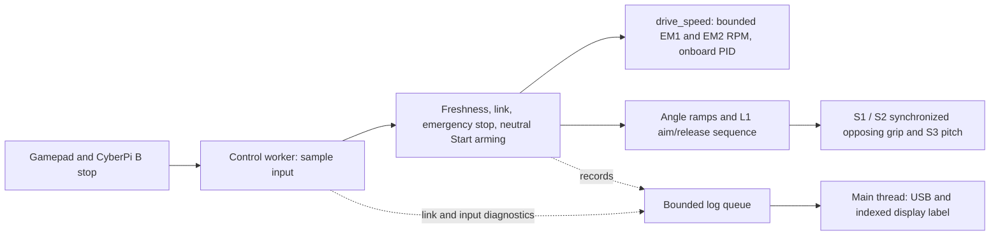
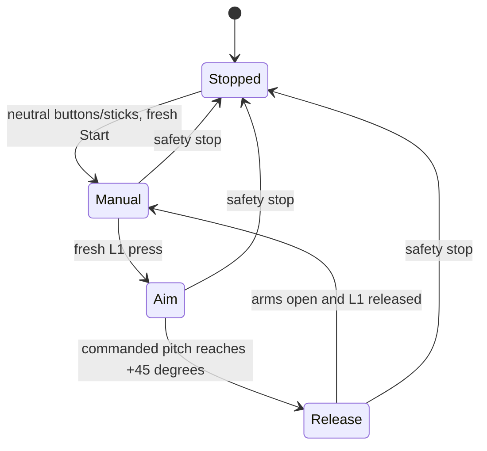

# ADR firmware architecture

**ADR** is the manual robot's CyberPi/mBot2 upload-mode MicroPython application
in [`fw/manual/main.py`](../fw/manual/main.py). The single uploaded file uses
`cyberpi`, `gamepad`, `mbot2`, `time` and `_thread`; no third-party Python runtime
packages are required. Host USB tooling lives under `fw/manual/tools`.

Return to the [project overview](architecture.md). THS and the generic field tool
are described in their [firmware](fw_ths_architecture.md) and
[field-tool](field_tool_architecture.md) architecture documents.

**Current profile:** onboard encoder PID regulates wheel speed through
`mbot2.drive_speed()` commands capped at ±100 RPM. Catapult and field-tool runtime
are commented out; gripper, pitch and safety gates remain active.
The manipulators use timed angle ramps without an application PID loop. L1
performs a gripper-based shoot sequence; it does not run the disabled catapult.

Set `PID_BYPASS` at the top of `main.py` before upload/restart: `False` (default)
uses onboard PID with `MAX_RPM`; `True` uses `mbot2.drive_power()` with
`MAX_DRIVE_POWER` (default ±100%). This is a startup configuration, not a live
mode switch. Input scaling, dispatcher/hardware clamps, capability checks,
boot zeros and stop/finalizer zeros all follow the selected mode. Startup and
drive logs identify the mode and its units. No wheel host ramp is enabled in
either drive mode; manipulator angle ramps are independent of this setting.

Build, generation, host validation and upload commands belong in
[building](building.md#adr-usb-serial-cli).

## Runtime ownership

| Part | Responsibility | Source |
| --- | --- | --- |
| Main thread | Boot zero outputs, validate APIs, render USB/LCD diagnostics, supervise shutdown | `main`, `KernelLog.pump` |
| Input/control worker | Sample gamepad input, enforce safety gates, command wheel speeds and gripper/pitch | `dispatch_loop`, `Dispatcher` |
| `CyberPiHardware` | Adapt validated gamepad and mBot2 calls; exclusively owned by the control worker after boot | `CyberPiHardware` |
| `WorkerState` | One-way shutdown and worker-completion flags | `close`, `done`, `is_done` |
| `KernelLog` | Bounded record queue shared with main; console I/O outside its queue lock | `emit`, `pump` |

The control worker requests a 20 ms cycle, samples the gamepad, checks the
request, and by default calls `mbot2.drive_speed(left_rpm, right_rpm)`. This uses the
working upstream gamepad movement example: the vendor firmware regulates
encoder speed, with no additional host PID loop. Requests retain dead-zone/exponential
input shaping; speed targets change immediately without the parked host slew ramp. Gamepad and
actuator APIs have one owner; USB/LCD rendering stays on main.

This remains a MicroPython `_thread` application, not the THS FreeRTOS task graph.
It requests timing intervals but makes no real-time scheduling guarantee. Native
CyberOS calls must yield the VM for other threads to run. A native call that
blocks the VM cannot be interrupted or killed by this application.

Before creating the control worker, main requests a 32 KiB stack using
`_thread.stack_size(CONTROL_STACK_BYTES)`, then restores the previous setting for
subsequently created vendor threads. Failure to configure/create the worker
attempts zero outputs and aborts startup. MicroPython's
[stack check](https://github.com/micropython/micropython/blob/master/py/stackctrl.c)
raises the recursion-depth error on stack exhaustion; it does not necessarily
mean application functions call themselves. The larger request provides headroom
for nested vendor calls. The reported device recursion error contained no
traceback, so stack exhaustion remains a hypothesis; the actual CyberOS stack
allocation and this mitigation have not been validated on hardware.

## Startup, waiting and shutdown

CyberOS imports uploads as `mainN` (`main1` observed on hardware). The entry guard
accepts these MicroPython program slots and `__main__`; host imports under another
name define classes without launching the app.

Boot independently attempts the selected wheel API with `(0, 0)` and
`motor_set(0, "m1")` before
screen initialization, validation or worker creation. Both are attempted even
if one raises; an error aborts startup. Required methods are the selected wheel API,
`motor_set` and `servo_set`. The app starts the mandatory input/control worker,
then main pumps diagnostics. Field-tool creation, startup and shutdown wiring
are commented out. A control-worker start
failure attempts zero outputs and raises.

A missing/disconnected gamepad, unavailable module/link method, invalid link
status, or link-query exception enters the waiting state. The worker keeps
polling and publishing stopped/disarmed decisions, while main shows
`WAITING / FOR / GAMEPAD` at 16 points. Repeated log frames do not replace that
message. Input exceptions likewise request a stop and continue polling; identical
consecutive errors are logged once. Link restoration clears the waiting screen
and requires fresh neutral/Start arming. An initially unavailable gamepad import
requires restarting once the module becomes available.

`gamepad.is_online()` is the verified link method. Its public value is cached by
a firmware task that sleeps one second between updates; request freshness does
not promise a 200 ms physical link-loss response. See [API evidence](adr_gamepad_api.md).

Local gamepad input is the sole active source. The field-tool mailbox,
transport classes and startup factory are retained as commented source. The
generated codec/provider remains in the component for restoration, without
active transport objects, remote ownership or native communication calls.

Main shutdown sets the worker's one-way shutdown flag. It waits up to 1000 ms for control completion. The control
worker attempts wheel and M1 zero writes in its finalizer, then publishes
completion. Main never writes actuators concurrently with a running worker. A
blocked worker is reported; there is no thread-kill API. No optional transport thread is started in this profile.

## Driving and safety

Default `DRIVE_MODE = "tank"` maps Ly/Ry to the two wheels. Arcade uses Ly/Rx.
Axes use scale ±100, a 10% dead zone and 0.35 exponential shaping. Targets
are **RPM** by default, clamped to ±100 RPM by both the dispatcher and hardware
adapter. This replaces the earlier 100% raw-power profile; motor power is now
adjusted automatically by onboard PID. E1/EM1 drives the left rear
wheel and E2/EM2 drives the right rear wheel: these are the first and second
`drive_speed` arguments respectively. Ly therefore controls E1 and Ry controls
E2 in tank mode. The existing left +1/right −1 polarity is retained; RWD alone
does not establish motor polarity. The adapter rounds to integers and calls
`drive_speed`. Encoder feedback and PID computation belong to the vendor
firmware; the application does not read encoders or compute PID gains/output.
With `PID_BYPASS = True`, both wheel arguments are percent power, clamped by
`MAX_DRIVE_POWER` and sent through `drive_power`; encoder speed regulation is
bypassed. The same wheel mapping and signs apply. There is no host slew delay.
Centering a stick commands zero in the selected units immediately.

Neutral input followed by a fresh Start press arms. Grip, pitch and shoot
requests must also be neutral for arming. The sticks then directly
control wheel speeds, and gripper/pitch buttons work without holding R2. There
is no deadman switch: R2 is not polled and releasing it does not stop the robot.
Centering the sticks commands zero. Select or CyberPi B stops/disarms. Disconnect,
invalid input, stale connected requests over 200 ms, negative request age, and
control gaps over 150 ms also stop/disarm. Timestamps precede native input reads;
sampling time counts toward freshness and the cycle deadline before any motion
write. A sampling exception or overrun cannot turn a delayed sample into fresh
motion. Reconnect/fault recovery requires another release/neutral/Start sequence.
A retained disconnected/e-stop state does not alternate with misleading timeout
records between samples. Native-call stalls remain subject to the VM limitation
above; there is no independent hardware watchdog in this code.

## Manipulators

`Manipulators` runs inside the existing input/control worker, after the same
arming, freshness and stop gates as the wheels. It sends rate-limited
`servo_set` angle commands; it adds no PID loop or encoder reads. Requested
movement uses elapsed control time, with degree rounding only at output and
unchanged output angles suppressed.

| Button | Operation while armed |
| --- | --- |
| N1 / N2 | Hold to open / close both gripper arms |
| N3 / N4 | Hold to lower / raise gripper pitch |
| L1 | Press to aim at forward +45°, then open both gripper arms |

Releasing a manual control holds its last commanded pose. Pressing both
directions of a manual control also holds that mechanism. Grip and pitch can
move together.

The two grip servos have their rotating faces mounted in the same direction,
so their angles move oppositely to contract/expand the mirrored arms. S1 moves
between 30° open and 90° closed; S2 moves between 150° open and 90° closed.
Both derive from one shared closure position on every update. The default
`GRIP_SLEW_DEG_PER_SECOND` is 90°/s measured at S1, and S2 follows the same
closure fraction through its calibrated endpoints. Both port writes happen in
the same control cycle; the vendor API writes ports sequentially and does not
provide an atomic or measured synchronization guarantee. Endpoints remain
configurable geometry assumptions.

Pitch uses a robot angle measured from +Z (straight up), positive toward the
front, with the mount's rotating face pointing forward. Its envelope is
−45°..+135° and `PITCH_SLEW_DEG_PER_SECOND` defaults to 60°/s. N3 increases
the angle to lower; N4 decreases it to raise. S3 takes 0°..180° commands:

| Robot pitch | S3 angle | Direction |
| --- | --- | --- |
| −45° | 0° | Rearward/up limit |
| 0° | 45° | Straight up (+Z) |
| +45° | 90° | Forward/up shoot pose |
| +90° | 135° | Forward horizontal |
| +135° | 180° | Forward/down limit |

The first neutral/Start arming commands both arms open and pitch straight up.
This establishes the software reference; the API supplies no measured starting
position, so this initial positioning is not ramped from the unknown physical
pose. Subsequent motion ramps from the last commanded angles, retained across
stop/re-arm. No manipulator commands run while unarmed.

A fresh L1 press latches the shoot sequence even if the button is released
early. It holds the current grip closure while ramping pitch to +45°. Once the
commanded pitch reaches that target, the next cycle starts ramping both arms
open. Manual manipulator inputs are ignored during the sequence; wheel controls
remain available. Holding L1 keeps the release pose and cannot retrigger. After
opening and L1 release, manual controls resume. This is command-based sequencing;
there is no feedback confirming physical arrival at +45° or release.

Stop, disconnect, stale/future input and control overruns cancel the shoot
sequence and stop issuing angle increments immediately. Servos retain their
last angle command; this does not disable servo holding torque or stop motion
already being performed by the vendor servo. Re-arming does not resume a
cancelled sequence.

The catapult controller, actuator method, input polls and dispatcher handler
are commented out. L2 and Up/Down are ignored and cannot block arming; L1 is
owned by the gripper shoot sequence.
Only zero-output `motor_set(0, "m1")` writes remain at boot and in the common
stop/finalizer path, keeping the disabled motor inert. Nonzero M1 commands are
absent from executable code. The old power configuration/controller source is
retained in comments for restoration.

## API evidence and validation

The source follows the supplied [PerfecXX/mBot2 examples](https://github.com/PerfecXX/mBot2)
and [scoped references](../fw/manual/AGENTS.md). The working
[gamepad movement example](https://github.com/PerfecXX/mBot2/blob/main/project/01-mBot2_bluetooth_control/01-basic_movement.py)
uses top-level `mbot2` and `drive_speed(left, right)` with target RPM maintained
by the encoder motors. ADR uses zero speed targets for stopping.
The [servo sample](https://github.com/PerfecXX/mBot2/blob/main/example/micropython/mBot2/02-mBot2%20Extension%20Port/01-Servo%20Motor/02-set_angle.py)
uses `servo_set(angle, "s1")`; the
[DC sample](https://github.com/PerfecXX/mBot2/blob/main/example/micropython/mBot2/02-mBot2%20Extension%20Port/02-DC%20Motor/02-set_dc_power.py)
uses `motor_set(power, selector)`. ADR selects `s1`/`s2`/`s3` and `m1` explicitly.
The controller examples and LoaderStub's official controller extension use
`get_joystick` and `is_key_pressed`. Loader dependencies, uploader framing and
firmware signatures are recorded in [USB evidence](adr_usb_serial.md).

The unchanged upstream joystick-display sample was uploaded and observed working
by the user. A minimal `drive_speed(rpm, 0)` EM1 loop then accepted both directions,
zero commands and a ±20 RPM cap; the user confirmed it operational. The retained
[samples](../fw/manual/samples/README.md) form the baseline for this integration.
Earlier host-PID/queue revisions produced real timing warnings even while unarmed;
their historical captures do not validate the integrated design.

Current host checks cover native speed/sign/clamp calls, immediate target reversal
without a ramp, neutral/Start arming without a deadman, stop/freshness rules, input error recovery, shutdown
zeroing, blocked-display isolation, synchronized grip ramps, hold/reverse pitch,
robot/servo envelope mapping, shoot from both sides of +45°, manual-input
priority, held/tapped shoot, stop/re-arm cancellation, ignored catapult controls,
absent field-tool runtime, generated codec and USB/upload tooling. Legacy tests
for the parked catapult/transport behavior are retained as comments. The native
speed integration [capture](validation/adr_native_drive_2026-11-13.md) describes
the previous profile. See [power-bypass validation](validation/adr_power_bypass_2026-11-13.md)
for the initial 20% bypass-profile checks and deployment limitation. The later
user-requested 100% cap and E1-left/E2-right RWD mapping pass the 21 active ADR
host checks; the subsequent deadman removal passes 22 active ADR host checks.
Full-power physical operation was not tested by those checks. Restoring native
PID at ±100 RPM passes the 22 active ADR host checks; physical operation of this
speed profile has not been tested or uploaded as part of this change.

## Diagnostics and parked field tool

`KernelLog` bounds its queue at 32 records and messages at 160 characters, drops
old records with a count, and wraps seven 24-character diagnostic rows. Main drains
at most one record per requested 250 ms runtime flush, using the working sample's
small multi-argument USB `print` style. Forced boot/shutdown flushes can drain all
records. This keeps runtime record bursts bounded. `LOG_SERIAL_ENABLED` and `LOG_SCREEN_ENABLED`
control USB and LCD output. LCD rendering uses the sample's
`display.show_label(text, size, 0, 0, index=0)` to replace one label in one call.
Runtime LCD output changes only between the 16-point waiting message and a
compact ready/controls screen, so log traffic cannot trigger repeated blocking
redraws. Detailed runtime records go to USB; forced boot/final diagnostic output
can show the wrapped records on screen. Worker calls only enqueue; native output
occurs after releasing the log lock. Screen/serial exceptions remain diagnostic
failures.

The worker publishes best-effort read-only diagnostics in `app_state`: cycle
count, maximum cycle interval, timing-fault transitions, current armed state and
reason. USB execution can inspect these fields without changing control state.
They are diagnostic snapshots, not a transactional telemetry protocol.

An uncaught worker exception is retained as `app_state.failure` together with
`failure_stage` (initial stop, input sampling, output dispatch or diagnostics).
The worker attempts output zeroing before recording the fatal error and marking
completion. Main prints the preserved exception with `sys.print_exception` only
after worker completion, keeping traceback I/O outside active control. There is
no automatic restart or re-arm. Host checks exercise a simulated recursion
error during output dispatch, stop-before-trace ordering, stack setup before
creation/restoration and stack-configuration failure. Bypass checks also cover
independent percent/RPM limits, API selection and boot/stop zeros with only the
power API available. The manipulator changes pass all 33 current ADR host checks;
their servo mounting, physical ramp response and release timing have not been
tested on a robot or uploaded as part of this change.

Numbered `[ADL boot]` markers use built-in `print` independently of screen and
Bluetooth: 01 precedes runtime imports, 03 CyberPi import, 05 each zero attempt,
06 screen attachment, 08 gamepad import, 09 API validation, 10 control startup,
and 12 main diagnostic-loop readiness. A top-level exception prints `FAILED`
and re-raises. Parse errors before execution cannot emit markers.

The field-tool subsystem is commented out rather than merely disabled by a
runtime flag. Restoring it requires restoring the commented implementation,
startup/worker wiring and its request units; toggling a flag alone does not
activate it. Provider/schema/generator files remain under
`fw/manual/field_tool_provider`, keeping the generic Android app platform agnostic.
See the provider's [guide](../fw/manual/field_tool_provider/README.md) and
[Bluetooth evidence](../fw/manual/field_tool_provider/bluetooth-evidence.md).
