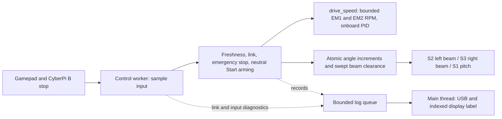
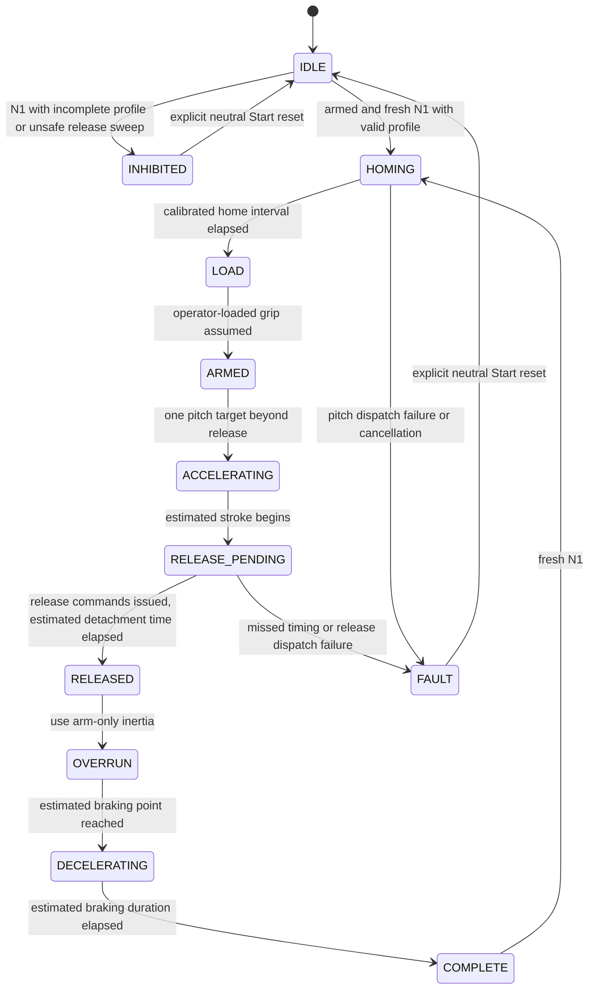

# ADR firmware architecture

**ADR** is the manual robot's CyberPi/mBot2 upload-mode MicroPython application
in [`fw/manual/main.py`](../fw/manual/main.py). The single uploaded file uses
`cyberpi`, `gamepad`, `mbot2`, `time`, `math` and `_thread`; no third-party Python runtime
packages are required. Host USB tooling lives under `fw/manual/tools`.

Return to the [project overview](architecture.md). THS and the generic field tool
are described in their [firmware](fw_ths_architecture.md) and
[field-tool](field_tool_architecture.md) architecture documents.

**Current profile:** onboard encoder PID regulates wheel speed through
`mbot2.drive_speed()` commands bounded by `MAX_RPM`. Catapult and field-tool runtime
are commented out; gripper, pitch and safety gates remain active.
All three manipulator servos use independent, atomic angle increments without
an application PID loop. Lx/Rx control the left/right direct-drive beams from
their configured forward-parallel neutral poses (currently 90°); L1/R1
raise/lower pitch. L2/R2 cycle the displayed step through 1°, 2°, 5°, 15°, 30°,
60°. Servo commands are fire-and-forget: there are no angle reads, completion
checks, timeouts or automatic retries. Beam interference protection uses the
last commanded angles and the configured geometry. N1 starts a coordinated
pitch/grip shot; N2 selects vertical or last-manual-angle release. Automatic
shots are inhibited until experimental motion and release calibration is supplied.
The legacy M1 catapult and immediate gripping hotkey remain parked.

Set `PID_BYPASS` at the top of `main.py` before upload/restart: `False` (default)
uses onboard PID with `MAX_RPM`; `True` uses `mbot2.drive_power()` with
`MAX_DRIVE_POWER` (default ±100%). This is a startup configuration, not a live
mode switch. Input scaling, dispatcher/hardware clamps, capability checks,
boot zeros and stop/finalizer zeros all follow the selected mode. Startup and
drive logs identify the mode and its units. No wheel host ramp is enabled in
either drive mode; manipulator angle increments are independent of this setting.

Build, generation, host validation and upload commands belong in
[building](building.md#adr-usb-serial-cli).

## Runtime ownership

| Part | Responsibility | Source |
| --- | --- | --- |
| Main thread | Boot zero outputs, validate APIs, render USB/LCD diagnostics, supervise shutdown | `main`, `KernelLog.pump` |
| Input/control worker | Sample gamepad input, enforce safety gates, command wheel speeds and gripper/pitch | `dispatch_loop`, `Dispatcher` |
| `CyberPiHardware` | Adapt validated gamepad and mBot2 calls; exclusively owned by the control worker after boot | `CyberPiHardware` |
| `Launcher` / `LaunchModel` | Timestamped shot sequence, release scheduler and estimated loaded/unloaded motion | `Launcher.service`, `LaunchModel.plan` |
| `WorkerState` | One-way shutdown and worker-completion flags | `close`, `done`, `is_done` |
| `KernelLog` | Bounded record queue shared with main; console I/O outside its queue lock | `emit`, `pump` |

The control worker requests a 20 ms cycle, samples the gamepad, checks the
request, and by default calls `mbot2.drive_speed(left_rpm, right_rpm)`. This uses the
working upstream gamepad movement example: the vendor firmware regulates
encoder speed, with no additional host PID loop. Requests retain dead-zone/exponential
input shaping; speed targets change immediately without the parked host slew ramp. Gamepad and
actuator APIs have one owner; USB/LCD rendering stays on main. During a shot,
the same worker services `Launcher` at a requested 1 ms interval between its
existing 20 ms gamepad/wheel cycles. It does not increase wheel API traffic to
1 kHz or introduce another actuator-writing thread. Input sampling and native
calls can interrupt that cadence; measured device timing is still required.

This remains a MicroPython `_thread` application, not the THS FreeRTOS task graph.
It requests timing intervals but makes no real-time scheduling guarantee. Native
CyberOS calls must yield the VM for other threads to run. A native call that
blocks the VM cannot be interrupted or killed by this application.

Before creating the control worker, main requests a 32 KiB stack using
`_thread.stack_size(CONTROL_STACK_BYTES)`, then restores the previous setting for
subsequently created vendor threads. Failure to configure/create the worker
attempts zero outputs and aborts startup. MicroPython's
[stack check](https://github.com/micropython/micropython/blob/master/py/stackctrl.c)
raises the recursion-depth error on stack exhaustion; it does not necessarily
mean application functions call themselves. The larger request provides headroom
for nested vendor calls. The reported device recursion error contained no
traceback, so stack exhaustion remains a hypothesis; the actual CyberOS stack
allocation and this mitigation have not been validated on hardware.

## Startup, waiting and shutdown

CyberOS imports uploads as `mainN` (`main1` observed on hardware). The entry guard
accepts these MicroPython program slots and `__main__`; host imports under another
name define classes without launching the app.

Boot independently attempts the selected wheel API with `(0, 0)` and
`motor_set(0, "m1")` before
screen initialization, validation or worker creation. Both are attempted even
if one raises; an error aborts startup. Required methods are the selected wheel API,
`motor_set` on top-level `mbot2`, and `servo_set` / `servo_add` on
`cyberpi.mbot2` (`cpi.mbot2` in the hardware adapter). No servo getter is
required or called. The app starts the mandatory input/control worker,
then main pumps diagnostics. Field-tool creation, startup and shutdown wiring
are commented out. A control-worker start
failure attempts zero outputs and raises.

A missing/disconnected gamepad, unavailable module/link method, invalid link
status, or link-query exception enters the waiting state. The worker keeps
polling and publishing stopped/disarmed decisions, while main shows
`WAITING / FOR / GAMEPAD` at 16 points. Repeated log frames do not replace that
message. Input exceptions likewise request a stop and continue polling; identical
consecutive errors are logged once. Link restoration clears the waiting screen
and requires fresh neutral/Start arming. An initially unavailable gamepad import
requires restarting once the module becomes available.

`gamepad.is_online()` is the verified link method. Its public value is cached by
a firmware task that sleeps one second between updates; request freshness does
not promise a 200 ms physical link-loss response. See [API evidence](adr_gamepad_api.md).

Local gamepad input is the sole active source. The field-tool mailbox,
transport classes and startup factory are retained as commented source. The
generated codec/provider remains in the component for restoration, without
active transport objects, remote ownership or native communication calls.

Main shutdown sets the worker's one-way shutdown flag. It waits up to 1000 ms for control completion. The control
worker attempts wheel and M1 zero writes in its finalizer, then publishes
completion. Main never writes actuators concurrently with a running worker. A
blocked worker is reported; there is no thread-kill API. No optional transport thread is started in this profile.

## Driving and safety

Default `DRIVE_MODE = "tank"` maps Ly/Ry to the two wheels. Arcade uses Ly/Rx.
Axes use scale ±100, a 10% dead zone and 0.35 exponential shaping. Targets
are **RPM** by default, bounded by `MAX_RPM` in both the dispatcher and hardware
adapter. This replaces the earlier raw-power profile; motor power is now
adjusted automatically by onboard PID. E1/EM1 drives the left rear
wheel and E2/EM2 drives the right rear wheel: these are the first and second
`drive_speed` arguments respectively. Ly therefore controls E1 and Ry controls
E2 in tank mode. The existing left +1/right −1 polarity is retained; RWD alone
does not establish motor polarity. The adapter rounds to integers and calls
`drive_speed`. Encoder feedback and PID computation belong to the vendor
firmware; the application does not read encoders or compute PID gains/output.
With `PID_BYPASS = True`, both wheel arguments are percent power, clamped by
`MAX_DRIVE_POWER` and sent through `drive_power`; encoder speed regulation is
bypassed. The same wheel mapping and signs apply. There is no host slew delay.
Centering a stick commands zero in the selected units immediately.

Neutral input followed by a fresh Start press arms. Grip and pitch requests
must also be neutral for arming. The sticks then directly
control wheel speeds, and gripper/pitch buttons work without holding R2. There
is no drive deadman switch: R2 selects the servo step size. Horizontal stick axes control
the beams independently of vertical stick wheel requests in tank mode.
Centering the sticks commands zero. Select or CyberPi B stops/disarms. Disconnect,
invalid input, stale connected requests over 200 ms and negative request age
also stop/disarm. The current workspace has the 150 ms control-gap guard
commented out; this change preserves that setting. Timestamps precede native
input reads, so sampling time counts toward freshness before any motion write.
A sampling exception or stale sample cannot issue motion. Reconnect/fault recovery requires another release/neutral/Start sequence.
A retained disconnected/e-stop state does not alternate with misleading timeout
records between samples. Native-call stalls remain subject to the VM limitation
above; there is no independent hardware watchdog in this code.

## Manipulators

`Manipulators` runs inside the existing input/control worker, after the same
arming, freshness and stop gates as the wheels. Each `ServoMotion` stores only
its latest commanded angle and input-release latch. Servo output has no
application PID, feedback read, arrival monitor or command queue. Wheel encoder
PID remains controlled by `PID_BYPASS` as described above.

| Control | Operation |
| --- | --- |
| Lx | Left beam on S2, independently, while armed |
| Rx | Right beam on S3, independently, while armed |
| L1 / R1 | Raise / lower pitch on S1, while armed |
| L2 / R2 | Previous / next step size: 1°, 2°, 5°, 15°, 30°, 60°, wrapping |
| Ly / Ry | Existing left/right wheel requests in default tank mode |

L2/R2 work with fresh connected input even before arming. Each selection changes
once per press; both must release before another selection. Pressing both
changes nothing. The selected size defaults to 1° and appears on the ready
screen; the worker publishes the value and main alone updates the display.
Changing the selection never issues a servo command by itself.

A fresh beam-axis deflection beyond the existing dead zone, or a pitch-button
press, issues one whole increment using `cpi.mbot2.servo_add(delta, port)`.
Axis magnitude and elapsed hold time do not change the increment. Center/release
that input before another move; holding it or reversing without centering sends
no additional command. With `GRIP1_AXIS_SIGN = 1` and `GRIP2_AXIS_SIGN = -1`,
Lx and Rx retain their existing independent signs. Each axis affects only its
own beam. The optional arcade drive configuration also uses Rx for turning,
sharing that axis with the right beam; default tank mode uses Ly/Ry for driving.
N1 starts the shot sequence below; N2 toggles its release-angle mode once per
press. Stick clicks and N3/N4 remain unused; the immediate-grip hotkey is deferred.

The beams attach directly to their servo outputs. Their current neutral
calibration is 90° each, pointing forward and parallel; native command limits
remain 0°..180°. Calibration lives in `GRIP1_NEUTRAL_DEG`,
`GRIP2_NEUTRAL_DEG`, axis signs and angle limits near the top of `main.py`.
Both servo rotating faces point in the same direction, so both geometry mount
signs are +1. No shared closure variable or software synchronization is used.
Changing one beam never issues a movement command for the other.

Pitch is measured from +Z (straight up), positive toward the front, with
the mount's rotating face pointing forward and envelope −45°..+135°:

| Robot pitch | S1 angle | Direction |
| --- | --- | --- |
| −45° | 0° | Rearward/up limit |
| 0° | 45° | Straight up (+Z) |
| +45° | 90° | Forward/up |
| +90° | 135° | Forward horizontal |
| +135° | 180° | Forward/down limit |

Targets are clamped to the mechanism's absolute limits before calculating the
relative delta; a zero delta sends nothing. For example, a 60° pitch-up request
from robot 0° sends −45°, reaching native 0° without exceeding the envelope.
There is no fine raster or elapsed-time ramp.

First neutral/Start arming issues one absolute `cpi.mbot2.servo_set` reference
per servo: both beams at their configured neutral, pitch straight up. The
physical startup pose is unknown, so this reference write has no protected
startup trajectory. Manual movement thereafter requires fresh user gestures;
N1 explicitly authorizes the timed shot sequence below. Idle cycles, a held
input, step selection, stop/disconnect and re-arming issue no additional servo
angle commands. Re-arming preserves the last commanded poses.

### Fire-and-forget dispatch and interference protection

There is no servo feedback API in the selected runtime. All three servo paths
assume dispatched commands execute: no getters, progress/arrival checks,
three-second timeout, delayed retry, rollback or automatic angle correction.
Native write exceptions produce a local warning and drop the attempted command;
only a new user gesture can retry. An initialization write error likewise waits
for explicit user input before trying that reference again. A servo exception
does not stop the other beam, pitch or wheels.

`BeamGuard` uses these dimensions:

| Parameter | Value |
| --- | --- |
| Each beam length / thickness | 170 mm / 10 mm |
| Pivot position | Center of the beam's endpoint |
| Left-to-right pivot spacing | 173.5 mm |
| Forward pivot offset | 0 mm |
| Minimum beam surface clearance | 10 mm |

The model uses +Y forward and +X right. Each centerline runs 170 mm from its
pivot and is surrounded by a conservative radius-5 mm capsule. The two
centerlines must remain at least 20 mm apart: both beam half-thicknesses plus
10 mm free space. Capsule endcaps conservatively cover the beam corners.

Before dispatching a beam increment, the guard checks its entire commanded
sweep against the other beam at its latest issued angle. Samples are at most
1° apart, with an additional displacement bound
`2 * length * sin(sample_interval / 4)` to cover the motion between samples.
These geometry samples never issue intermediate servo commands. An unsafe
sweep drops the whole increment and logs `WARN servo`; it does not shorten,
queue or automatically retry it. The command model changes only after a native
write returns without an exception. Rejected candidates never become the
reference for the other beam. Both beam reference writes must have been issued
before relative beam motion is allowed. In a cycle requesting both beams,
left is evaluated first; right sees the latest issued left target.

The protection is a commanded-pose geometric model. It cannot detect stalls,
manual displacement, overshoot, startup motion or overlapping physical motion
while another command is still travelling. Servo completion is never observed;
there is no scheduling or settling wait. Stops suppress future writes but do
not revoke a target already accepted by the vendor or disable holding torque.

### N1 shoot sequence

N1 is edge-triggered and requires the existing neutral/Start drive arming first.
The operator loads and closes the grip manually before firing. N1 requests one
sequence; holding or pressing it during a shot cannot queue another launch.
N2 defaults to vertical (+Z, robot pitch 0°); toggling it selects the last
successfully dispatched **manual** pitch angle. That angle is captured before
homing, so automatic homing/overtravel targets never replace the selected manual
reference. Conflicting N1/N2 presses do not launch. The screen shows mode and
`IDLE`, `RUN`, `INHIBITED`, `FAULT` or `COMPLETE`; intermediate shot transitions
stay on USB to avoid repeated LCD calls during the release window.

Any active state can fault on stop, disconnect, stale input, manual servo
override or worker shutdown. `INHIBITED` performs no shot writes. `FAULT`
suppresses the remaining sequence and subsequent launches until an explicit
neutral Start reset; it does not automatically retry. Resetting does not fire a
shot. Manual controls and wheel PID remain available under their existing gates.
A manual override aborts that shot, then requires centering/releasing before a
new manual servo gesture. Stop/fault cannot revoke a pitch target already in
the servo; no automatic rollback or pitch-stop command is issued.

HOMING issues one S1 target at −35° from +Z and waits a calibrated preparation
interval. There is no measured home/ball-loaded/armed confirmation: LOAD and
ARMED are timestamped transient software states. ACCELERATING issues one S1
target at `release_angle + overtravel_deg`. Release opens S2 and S3 to **90°
each**, independently of S1. No S1 command is sent at the release angle or at
modeled braking/completion; internal servo positioning performs the braking.
The native API's dispatch duration and physical response must be qualified on
the actual device; Python contains no intentional blocking motion wait.

#### Ratings, mechanics and calibration

The MECDS-150 profile is fixed firmware data in `PITCH_HARDWARE_PROFILE`, an
immutable tuple. Manufacturer values are excluded from both mechanical and
calibration dictionaries and have no runtime setter:

| Fixed constant | Value |
| --- | --- |
| `PITCH_MOTOR_MODEL` | MECDS-150 |
| `PITCH_SERVO_VOLTAGE_V` | 6.0 V |
| `PITCH_STALL_TORQUE_KGFCM` | 16.5 kgf·cm |
| `PITCH_STALL_TORQUE_NM` | 1.61809725 N·m |
| `PITCH_NOLOAD_SEC_PER_60DEG` | 0.19 s / 60° |
| `PITCH_NOLOAD_SPEED_RAD_S` | 5.5116 rad/s |

These fixed values follow the design handoff. The
[official MakeX equipment specification](https://www.makex.cc/wp-content/uploads/2025/01/English2024-2025-MakeX-Explorer-Digital-Pioneer-Rules-Guide-V2.0.pdf)
independently lists 6 V and 16.5 kg·cm peak torque. Peak stall torque is a
zero-speed reference, not continuous torque; no torque–speed curve is supplied
or synthesized. No-load speed is a rating, never an operating speed command or
proof that the loaded arm reaches it.

`LAUNCH_MECHANICS` contains design assumptions: 170 mm initial arm length from
the existing firmware geometry, 0.025 kg arm mass, 0.015 kg ball mass and −35°
starting pitch. `overtravel_deg` and experimentally validated `travel_max_deg`
start unset. Loaded inertia is computed as
`I = (m_arm / 3 + m_ball) * L**2`; arm-only inertia removes the ball term.
At 170 mm these are 0.0006743333 and 0.0002408333 kg·m². The handoff's
0.0010786 kg·m² loaded example instead corresponds to approximately 215 mm;
it is not copied as a constant. The length remains a configurable assumption,
which must match the actual pitch pivot-to-ball geometry.

`net_acceleration` is a separate theoretical diagnostic using SI torque,
signed gravity from +Z, calibrated friction and computed inertia. Its caller
must supply operating torque; `peak_zero_speed_reference` explicitly uses the
fixed stall value as a theoretical reference only. Neither calculation chooses
shot acceleration, timing or speed.

The motion predictor is an empirical constant-acceleration/speed-cap fit using
separate loaded and unloaded measurements. It includes a calibrated native
pitch-response delay. Release timing inverts that fit to find the vertical or
selected-angle crossing, then subtracts grip-opening latency **plus** subsequent
ball-detachment delay. In a constant-acceleration interval this is equivalent
to predicting `theta_trigger + omega_trigger * latency + alpha * latency**2 / 2`;
speed-cap crossings are integrated piecewise in radians. Geometry/native angles
are converted at the boundary. No acceleration or release timing is derived
from manufacturer stall torque or no-load speed.

Required `LAUNCH_CALIBRATION` entries, all unset in production defaults:

| Entries | Meaning |
| --- | --- |
| `home_duration_us` | Measured preparation interval covering the return to −35° and settling |
| `response_delay_us` | Pitch-command dispatch to stroke response |
| `loaded_speed_rad_s`, `loaded_accel_rad_s2` | Loaded motion fit |
| `unloaded_speed_rad_s`, `unloaded_accel_rad_s2` | Motion fit after estimated ball separation |
| `grip_latency_us` | Grip-command invocation to latch opening, including native dispatch |
| `ball_detach_delay_us` | Additional latch-open to ball-detachment latency |
| `braking_distance_deg`, `braking_duration_us` | Actual internal-servo stopping response |
| `release_tolerance_deg` | Experimentally accepted physical angular tolerance |
| `friction_nm` | Optional for empirical timing; required for theoretical torque calculations |

The scheduler shares `time.ticks_us()` across pitch and grip and uses wrap-safe
`time.ticks_diff()` intervals, following the
[MicroPython timer contract](https://docs.micropython.org/en/v1.16/library/utime.html).
The retained CyberOS dump contains `ticks_us` at `0x10d232` and `ticks_diff`
at `0x10d218`; name evidence does not qualify device scheduling performance.
It records software release-command timestamps separately from estimated
latch-open and ball-detachment timestamps. No physical event is reported as
measured. At estimated detachment, the model switches to arm-only inertia and
the unloaded motion fit. The remaining overtravel must exceed measured stopping
distance, and the final target must be strictly inside the validated mechanical
limit and existing S1 envelope. Profiles longer than a 10-second scheduling
horizon are inhibited.

Before release, estimated angular lateness beyond the configured tolerance
faults without opening the grip. Native release-call duration is checked too;
a late/partial dispatch can only inhibit future launches, as already-issued
commands cannot be undone. Both release sweeps are preflighted with the existing
10 mm clearance guard. No feedback, physical-detachment sensing, servo arrival
confirmation or hardware timer interrupt is introduced. Logical scheduler tests
do not establish physical release accuracy, nonblocking native calls, stopping
distance or a guaranteed 1 kHz service rate. Those remain experimental acceptance
requirements, so the checked-in automatic shot profile stays inhibited.

The catapult controller and field-tool runtime remain commented out. Only
zero-output `motor_set(0, "m1")` writes remain at boot and in the common stop /
finalizer path. Restoring the parked field tool also requires mapping its former
paired-grip requests to the independent beam controls.

## API evidence and validation

The source follows the supplied [PerfecXX/mBot2 examples](https://github.com/PerfecXX/mBot2)
and [scoped references](../fw/manual/AGENTS.md). The working
[gamepad movement example](https://github.com/PerfecXX/mBot2/blob/main/project/01-mBot2_bluetooth_control/01-basic_movement.py)
uses top-level `mbot2` and `drive_speed(left, right)` with target RPM maintained
by the encoder motors. ADR uses zero speed targets for stopping.
The [servo sample](https://github.com/PerfecXX/mBot2/blob/main/example/micropython/mBot2/02-mBot2%20Extension%20Port/01-Servo%20Motor/02-set_angle.py)
uses `servo_set(angle, "s1")`. The user-selected incremental API is
`cpi.mbot2.servo_add(delta, port)`; the retained firmware artifact contains the
`servo_add` symbol at `0x12efe4`, which identifies the name without qualifying
physical completion or feedback. The
[DC sample](https://github.com/PerfecXX/mBot2/blob/main/example/micropython/mBot2/02-mBot2%20Extension%20Port/02-DC%20Motor/02-set_dc_power.py)
uses `motor_set(power, selector)`. ADR selects `s1`/`s2`/`s3` and `m1` explicitly.
The controller examples and LoaderStub's official controller extension use
`get_joystick` and `is_key_pressed`. Loader dependencies, uploader framing and
firmware signatures are recorded in [USB evidence](adr_usb_serial.md).

The unchanged upstream joystick-display sample was uploaded and observed working
by the user. A minimal `drive_speed(rpm, 0)` EM1 loop then accepted both directions,
zero commands and a ±20 RPM cap; the user confirmed it operational. The retained
[samples](../fw/manual/samples/README.md) form the baseline for this integration.
Earlier host-PID/queue revisions produced real timing warnings even while unarmed;
their historical captures do not validate the integrated design.

Current host checks cover native speed/sign/clamp calls, immediate wheel target
reversal, neutral/Start arming, stop/freshness rules, input error recovery,
shutdown zeroing, blocked-display isolation, independent atomic beam commands,
all six step sizes, trigger edges, displayed selection, clamped S1 pitch,
whole-sweep clearance rejection, latest-issued pose bookkeeping and local native
write errors without retries. Shot checks also cover state timestamps, SI
conversion/inertia, release compensation, +Z gravity signs, speed-cap/coasting
fits, one uninterrupted pitch target, unloaded inertia, mode capture, 1 ms
cooperative servicing, clock wrap, inhibition and latched timing/dispatch faults.
Fakes deliberately provide no servo getter.
The suite also covers ignored catapult controls, absent field-tool runtime and
the generated codec. Legacy catapult/transport tests remain commented out.

The native speed integration capture (internal record)
and power-bypass validation (internal record) describe
previous profiles. The current servo/launcher changes pass 63 ADR host checks;
they have not been uploaded or physically tested. Current workspace wheel
limits and servo-neutral calibration are preserved by this change.

## Diagnostics and parked field tool

`KernelLog` bounds its queue at 32 records and messages at 160 characters, drops
old records with a count, and wraps seven 24-character diagnostic rows. Main drains
at most one record per requested 250 ms runtime flush, using the working sample's
small multi-argument USB `print` style. Forced boot/shutdown flushes can drain all
records. This keeps runtime record bursts bounded. `LOG_SERIAL_ENABLED` and `LOG_SCREEN_ENABLED`
control USB and LCD output. LCD rendering uses the sample's
`display.show_label(text, size, 0, 0, index=0)` to replace one label in one call.
Runtime LCD output changes only between the 16-point waiting message and a
compact ready/controls screen, or when the selected step, shot mode or coarse
shot status changes. Intermediate active shot states share `RUN`, so log
traffic cannot trigger repeated blocking redraws. Detailed runtime records go
to USB; forced boot/final diagnostic output can show the wrapped records on screen. Worker calls only enqueue; native output
occurs after releasing the log lock. Screen/serial exceptions remain diagnostic
failures.

The worker publishes best-effort read-only diagnostics in `app_state`: cycle
count, maximum cycle interval, timing-fault transitions, current armed state and
reason, plus launcher state and launch-inhibit/fault reason. USB execution can
inspect these fields without changing control state.
They are diagnostic snapshots, not a transactional telemetry protocol.

An uncaught worker exception is retained as `app_state.failure` together with
`failure_stage` (initial stop, input sampling, output dispatch, launch service or
diagnostics).
The worker attempts output zeroing before recording the fatal error and marking
completion. Main prints the preserved exception with `sys.print_exception` only
after worker completion, keeping traceback I/O outside active control. There is
no automatic restart or re-arm. Host checks exercise a simulated recursion
error during output dispatch, stop-before-trace ordering, stack setup before
creation/restoration and stack-configuration failure. Bypass checks also cover
independent percent/RPM limits, API selection and boot/stop zeros with only the
power API available.

Numbered `[ADL boot]` markers use built-in `print` independently of screen and
Bluetooth: 01 precedes runtime imports, 03 CyberPi import, 05 each zero attempt,
06 screen attachment, 08 gamepad import, 09 API validation, 10 control startup,
and 12 main diagnostic-loop readiness. A top-level exception prints `FAILED`
and re-raises. Parse errors before execution cannot emit markers.

The field-tool subsystem is commented out rather than merely disabled by a
runtime flag. Restoring it requires restoring the commented implementation,
startup/worker wiring and its request units; toggling a flag alone does not
activate it. Provider/schema/generator files remain under
`fw/manual/field_tool_provider`, keeping the generic Android app platform agnostic.
See the provider's [guide](../fw/manual/field_tool_provider/README.md) and
[Bluetooth evidence](../fw/manual/field_tool_provider/bluetooth-evidence.md).
