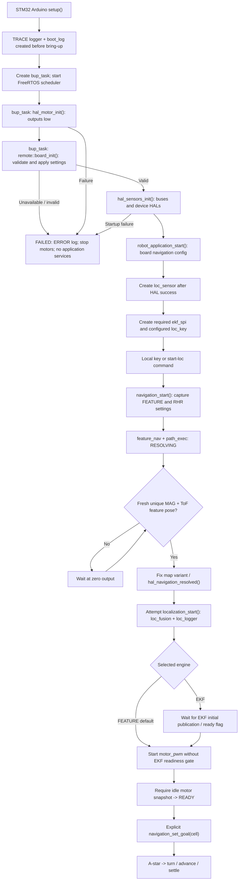
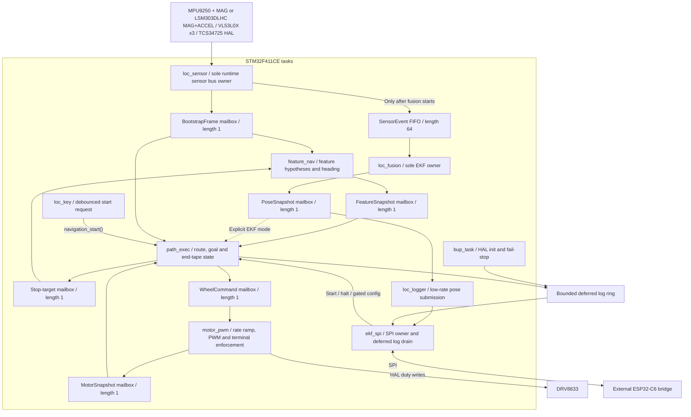

# THS firmware architecture

**THS** is the STM32 autonomous robot firmware. It runs on the STM32F411CE
Black Pill with STM32duino FreeRTOS and shares its portable C++ core with native
tests. This page owns the THS layers, startup, RTOS tasks, navigation, motor
control, and board integration limits.

Return to the [project overview](architecture.md). Android, the ESP32-C6 bridge,
and host tools are documented in [field-tool architecture](field_tool_architecture.md).
ADR's manual uPython firmware has a separate [architecture](fw_adr_architecture.md).

## Operational summary

- **FEATURE is the default navigation engine.** Calibrated magnetic bearing and
  three ToF wall ranges establish and continuously remeasure pose against a fixed maze.
  Repeated contradictions after pose acquisition latch a right-hand-rule (RHR)
  fallback for active goals; stale or ambiguous observations alone do not.
- **EKF development is currently frozen.** Its four-state implementation remains
  compiled, observes alongside FEATURE, and can be explicitly selected at startup.
  Frozen means no ongoing redesign; it does not mean disabled or removed.
  Preserve it unless an EKF change is explicitly requested. Reference material
  and historical studies live in [ekf/](ekf/README.md).
- **The motor driver is TI DRV8833, with open-loop PWM and no encoder feedback.**
  Pose feedback closes the navigation loop; nominal wheel rates do not measure speed.
- **All floor tiles are white.** A debounced black entrance tape and a fresh
  independent feature pose are required to confirm arrival at the end-cell center.
- **One 86-second production motion budget applies per boot.** Pauses, cancellation, and new
  goals cannot extend it. Terminal GOAL, TIMEOUT, or HALTED requires a reset.

Build prerequisites and commands live in [building.md](building.md). Pin defaults,
bus isolation requirements, and the source-configured v2 wiring sketch live in
[hardware_wiring.md](hardware_wiring.md).

## Layers and runtime components

| Layer | Responsibility | Source location |
| --- | --- | --- |
| STM32 application | Required settings mount, HAL startup, service/task creation and engine selection | `fw/autonomous/STM32_TINYRCP/src/main.cpp` |
| RTOS services | Sensor ownership, feature matching, fusion, path execution, motor guard, bring-up and telemetry tasks | `fw/autonomous/STM32_TINYRCP/src/tasks`, `src/telemetry` |
| Portable algorithms | Maze geometry, raycasting, A*, feature hypotheses, end-tape detector, executor, right-hand fallback, four-state EKF, nominal PWM conversion | `fw/robot_sf/include`, `fw/robot_sf/src` |
| HAL and board configuration | Sensor acquisition, clocks, motor GPIO/PWM, calibration hooks, flash access | `fw/autonomous/STM32_TINYRCP/src/hal`, `include/hal`, `include/board_motor_pins.hpp`, `src/remote` |
| Embedded vendor code | Bundled ST ToF driver behind a facade and polling port; bus I/O stays behind HAL | `fw/autonomous/STM32_TINYRCP/src/hal/vendor` |

The portable layer has no Arduino or FreeRTOS dependency. Tasks consume snapshots
and issue HAL/API calls; they must not become extra sensor-register clients.
The host simulation uses production portable classes and independent synthetic
sensor/plant doubles, not the STM32 scheduler or its interrupt implementation.

## Initialization flow

STM32 currently enters through Arduino `setup()`, not ESP-IDF `app_main()`.
It configures TRACE logging and the early USB CDC serial drain task, creates `bup_task`,
then starts FreeRTOS. Bring-up alone inventories and prepares both sensor buses,
initializes motor outputs, validates the
required remote store, initializes sensor HALs, and starts application services
only after every hardware step succeeds. The existing Arduino entry point
creates startup tasks and starts the scheduler; hardware initialization runs
inside the bring-up task.

Before logger/task startup, `hal_time_init()` reserves TIM5 as a free-running
32-bit counter at 1 MHz. STM32 RCC HAL queries select the APB1 timer frequency,
including TIMPRE, and STM32 LL configures/reads TIM5 directly. This path uses
no Arduino `micros()`, `HardwareTimer`, MSP callback or SysTick-derived phase.
TIM5 has no GPIO or interrupt, does not share motor PWM's TIM1/TIM4, and must
not be assigned to another feature. Initialization is idempotent and rejects
clock trees that cannot generate exact microsecond ticks; startup stops on
failure. Counter reads and 64-bit extension run in a brief CMSIS interrupt-mask
section that preserves the incoming PRIMASK. TIM5 freezes during debugger
halts, so paused CPU time does not consume sensor deadlines. These register
operations belong to the [clock HAL](../fw/autonomous/STM32_TINYRCP/src/hal/hal_platform.cpp).
Timer characteristics and clock multipliers are specified in
[STM32F411 RM0383](https://www.st.com/resource/en/reference_manual/dm00119316.pdf),
the RCC and TIM2–TIM5 chapters.

This replaces a SysTick/`micros()` wrap-extension failure observed while tracing
the ToF vendor HAL: RTOS time was about 822 ms, but the extended clock had
gained 2^32 microseconds (about 71.6 minutes). A small backward source-clock
sample was interpreted as a full wrap, putting the clock beyond the ToF
initialization deadline. The captured failure propagated `-7` from
`VL53L0X_device_read_strobe()` through `StaticInit` with no retained I2C error.
Using one free-running hardware counter removes the SysTick/sub-tick sampling
dependency; actual counter rollover still uses unsigned 32-bit deltas. It does
not change vendor polling limits or suppress genuine I2C/deadline timeouts.



Project the **A-star → turn / advance / settle** node into the
[FEATURE path micro-operation view](feature_path_micro_ops.md) for planning,
per-update decisions, arrival waits, and the task-to-motor command boundary.

Every supported profile creates navigation tasks only after a start request;
configuration/calibration remain available beforehand. `bup_task`
is the one-shot HAL initialization owner. It stops at the first failing motor,
settings, IMU/magnetometer, ToF, or TCS initialization/health step, latches FAILED,
stops motor outputs, and logs ERROR without starting application services. It
emits INFO milestones such as `tof: hw ready`. These are device initialization
checks, not a measured electrical BIST. DRV8833 has no power-on feedback; its
milestone only reports configured, stopped outputs. The motor task never
reinitializes the driver. `boot_log` drains USB serial diagnostics before telemetry
attaches its sink, including failed bring-up; telemetry owns draining afterward.
The task reports a DEBUG box-drawn step/result table.
Immediately after the sensor HAL initialization attempt, and before creating
application services, BUP captures one diagnostic sample set through the HALs
with a 500 ms overall polling deadline (plus in-flight bounded calls and task
scheduling). It prints that retained set after the BUP summary at INFO under
`bup.sample`, then deletes itself. Thus the sample printer never becomes a
second sensor-bus owner after service startup. Failed/skipped/unavailable
sensors print `N/A`; initialization and application-start gates are unchanged.
The [snapshot HAL](../fw/autonomous/STM32_TINYRCP/src/hal/boot_sensor_sample.cpp)
owns polling and formatting; [tracing](tracing.md#bup-sensor-snapshot) defines
units and ToF `Inf` semantics.
The temporary trace-profile `AXI_BUP_IMU_DIAGNOSTIC=1` exception defers
IMU/magnetometer failure so ToF and TCS diagnostics can run. Other HAL failures
still halt sensor setup. When diagnostics finish, Sensors says `diagnostic`,
Services stays `skipped`, BUP remains FAILED and motors are stopped. The
application-start callback is never called in this mode, even with a healthy
IMU: localization, navigation, sensor polling, telemetry and motor service tasks
remain blocked. The [build guide](building.md#stm32f411ce-firmware) owns the flag
and restoration instructions.
Before motor, settings or sensor device HAL initialization, BUP inventories both
buses using an open-drain GPIO address probe, before either `Wire.begin()`.
It then prepares and inventories the main and isolated ToF hardware controllers.
GPIO probing sends only a write address and STOP, uses external pull-ups,
bounds clock stretching, and leaves a stuck bus unrecovered for diagnosis.
Bus preparation is idempotent: sensor HAL startup does not restart controllers.
Separate INFO
tables and log sources identify the actual I2C controller (`i2c1`/`i2c2` with
default wiring), logical bus and scan phase. Tables show
configured device bindings, ACK/no-ACK results and unknown responders, so an IMU
failure still leaves both bus inventories when bus setup succeeds. The main bus
is scanned again after the IMU attempt when startup continues, and the ToF bus after its
initialization attempt. An ACK is not an identity check: AK8963 may be hidden
until MPU bypass is enabled; multiple unassigned ToFs can share boot address
0x29. Device HAL initialization remains authoritative and scan results do not
override bring-up gates. Invalid isolated-bus wiring fails before probing.
Line levels, reset-cause flags and STM32 controller status are logged around
controller setup, motor/settings startup and device initialization. These
snapshots distinguish missing responders from stuck lines or BUSY controllers;
they do not establish electrical integrity. Both inventories run even when the
first bus is stuck. Bus-setup failure still configures stopped motor outputs
before halting BUP.
The [I2C diagnostics HAL](../fw/autonomous/STM32_TINYRCP/src/hal/i2c_diagnostics.cpp)
owns probes and table formatting; no service task reads sensor registers for
diagnostics. Probe bounds and log interpretation live in [tracing](tracing.md).
Both navigation engines bootstrap from the feature task. Initial ambiguity does
not cause autonomous scanning or motion. Motor task readiness and selected EKF
initialization stages have a two-second timeout. No goal is selected at boot.

Source evidence: [THS entry](../fw/autonomous/STM32_TINYRCP/src/main.cpp),
[navigation startup and state machine](../fw/autonomous/STM32_TINYRCP/src/tasks/navigation_tasks.cpp),
[bring-up](../fw/autonomous/STM32_TINYRCP/src/tasks/bup_tasks.cpp),
and [telemetry start/key](../fw/autonomous/STM32_TINYRCP/src/telemetry/adapter.cpp).

## Selectable motion sensor HAL

The sourcing rationale for the LSM303DLHC alternative is the MPU9250's EOL and
difficulty obtaining parts. The base profile retains MPU9250/AK8963; the LSM,
trace and production profiles select LSM303DLHC MAG + ACCEL exclusively.
Trace and production inherit the LSM profile's backend flag and MPU library
exclusion. Build flags and commands live in the
[build guide](building.md#mutually-exclusive-ths-sensor-backends).
The LSM303DLHC contains no gyro. Its HAL provides real acceleration and magnetic
measurements, then adapts magnetic heading changes to the existing planar
yaw-rate input. FEATURE, RHR and the frozen EKF algorithms are unchanged; the
EKF's existing gyro-oriented noise model has not been retuned for compass rate.

[`imu_hal.hpp`](../fw/autonomous/STM32_TINYRCP/include/hal/imu_hal.hpp) owns the
common interface; `mpu9250_hal.hpp` remains a compatibility include. Exactly one
backend defines the common functions and sensor-task hooks. The existing BUP
owner initializes the bus/HAL and captures raw boot readings, then the existing
100 Hz sensor task owns all reads. This adds no tasks, interrupts or heap
allocation. The LSM backend reports Gyroscope as N/A at boot and rejects the
remote gyro-zero calibration operation; stored MPU gyro-zero settings do not
affect compass-derived rate.

[`lsm303dlhc_hal.cpp`](../fw/autonomous/STM32_TINYRCP/src/hal/lsm303dlhc_hal.cpp)
uses the unmodified [ST BSP driver](https://github.com/STMicroelectronics/stm32-lsm303dlhc)
for acceleration identity/initialization and preserves its IO callback signatures.
The pinned common BSP supplies its required `accelero.h` ABI. Relative links
expose both through the HAL's `vendor/` directory; pins/provenance live in
[`third_party/README.md`](../third_party/README.md). The BSP has no magnetic
acquisition API, no transfer-status return in its IO callbacks, and reads
acceleration bytes separately. HAL extensions therefore latch callback errors,
check all three magnetic identity bytes (`H43`), verify configuration readbacks,
and use coherent bounded bursts for acquisition/conversion. No service task
accesses registers.

The implementation follows the [LSM303DLHC datasheet, DocID018771 Rev 2](https://www.st.com/resource/en/datasheet/lsm303dlhc.pdf),
sections 5 and 7: fixed 7-bit addresses `0x19` (ACCEL) / `0x1E` (MAG), left-shifted
once for STM32 HAL; 100 Hz high-resolution acceleration at ±4 g with BDU,
little-endian signed 12-bit output at 2 mg/LSB; and continuous 220 Hz magnetic
conversion at ±1.3 gauss. The magnetic burst is big-endian X/Z/Y and converts
using 1100 LSB/gauss for X/Y and 980 for Z. The HAL checks ready status, drains
locked magnetic output, rejects clipping/overflow, and disables FIFO, interrupt
and high-pass paths. Polling may skip magnetic conversions; it never waits for
one or replays a consumed frame. Timestamps are monotonic read completion,
not hardware sample instants or a hard transfer-time guarantee.

Independent LSM mounting, body acceleration bias and native hard/soft-iron
calibration live in
[`lsm303dlhc_config.hpp`](../fw/autonomous/STM32_TINYRCP/include/hal/lsm303dlhc_config.hpp).
The configured mount has native +X facing left, +Y facing back and +Z facing up.
Both axis maps are `{-2, 1, 3}`: body forward is native −Y, body left is native
+X, and body up is native +Z.
The HAL validates proper axis rotations and finite calibration, applies
hard/soft-iron correction before magnetic axis mapping, then uses acceleration
for quasi-static tilt compensation. [ST AN3192](https://www.st.com/resource/en/application_note/an3192-using-lsm303dlh-for-a-tilt-compensated-electronic-compass-stmicroelectronics.pdf)
provides the calibration/tilt method; its older LSM303DLH register settings are
not used for DLHC. Acceleration must be at most 30 ms old and near gravity;
field magnitude and horizontal projection must be usable. Acceleration alone
cannot distinguish gravity from all translational acceleration, and magnetic
norm checks cannot detect every heading disturbance.

Two qualified fields establish a wrapped heading difference. The HAL divides
that difference by elapsed time and applies a first-order 40 ms rate filter.
The legacy `gz_rps` channel carries this MAG-derived planar rate;
`gx_rps`/`gy_rps` are zero placeholders, never physical gyro observations. The
pending calibrated, levelled magnetic field is delivered once after the rate
read. Gaps over 50 ms, bad data, implausible heading changes or transfer failures
invalidate heading history; recovery needs two valid fields, rather than a
fabricated zero-rate sample. False reads leave caller outputs unchanged.

Both `SENSORS_LSM303DLHC_CALIBRATED` and
`SENSORS_LSM303DLHC_MAGNETIC_ENVIRONMENT_VERIFIED` default to false. Until the
installed axes/calibration and magnetic environment with operating motors are
verified, the HAL permits raw diagnostics but publishes no navigation rate or
heading. When explicitly qualified, `hal_magnetic_clean()` accepts a fresh
usable LSM field, including during motion: gyro-free heading depends on that
verification. A zero motor command does not establish it. The MPU backend
retains its existing tilt/cleanliness gates.

The optional native lifecycle mode feeds quantized independent ACCEL/MAG
samples through a register model, the real ST BSP, and the production HAL before
the normal sensor, FEATURE/RHR and motor tasks. Simulated gyro is excluded from
this path. Driver fixtures cover byte order, distinct gains, signed conversion,
tilt, heading wrap/rate, readiness/one-time delivery, every initialization
transfer failure, lock/overflow, timestamps and qualification gates. Full
lifecycle campaigns remain required validation; the source option alone is not
a claim of navigation or hardware qualification.

Implementation checks on 2026-11-18 compiled both STM32 profiles and confirmed
by linked symbols that each contains only its selected driver. All six LSM
driver/boot fixtures and eight source-selection checks passed. The complete
Debug host suite passed 97/127 with LSM register processing and 109/127 with the
existing simulated gyro path. Both passed the six fixed open-arena goal runs;
both failed the supplied-map and open-arena campaigns. LSM added twelve failures:
the four `robot_lifecycle_q*` routes, four feature-boundary prefixes, resolver
E2E, and the tape/Q1-alias/unconfigured-alias evidence cases. The other eighteen
failures also occurred with the existing path (turn/clearance, stale wiring
drawing and lifecycle cases). Thus the driver/build contract is tested, but the
gyro-free navigation integration remains experimental and is not qualified by
this full lifecycle run. The qualification flags remain disabled by default.

## Compile-time open-loop demo

`AXI_OPENLOOP_DEMO=1` replaces the production application at compilation. The
separate tracing-derived build profile and validation commands live in the
[build guide](building.md#open-loop-motor-demo). Production profiles default to
the normal application described elsewhere on this page.

The application creates `openloop_demo` independently before requesting BUP.
The demo task runs at motor priority 4 with 768 stack words; it alone initializes
DRV8833 and writes outputs. It samples the active-low LOC key every 20 ms and
requires three consecutive low samples. One press starts repeated nominal 1 m
straight legs at 0.20 m/s followed by clockwise 90-degree pivots lasting 1 second.
It stops sampling the key after that trigger, so later presses cannot restart it.

The task reuses the production `WheelController` through an explicit factory
configuration, retaining PWM calibration, polarity, caps, request slew and timing
checks without a remote-store dependency. Straight distance integrates the last
issued nominal ramped wheel rates using the physical wheel radius. Pivot rate
uses the track width and compensates the request acceleration ramp for a nominal
quarter turn in 1 second. A zero-output control tick separates motion phases.
These are open-loop estimates, with no measured travel/angle, slip correction or
active braking. A driver/converter fault stops the task until reset. The demo
repeats without the production navigation/run-deadline state machine.

BUP still exists and logs its inert mode, then deletes itself. It performs no
sensor initialization, I2C probes, HAL reads, settings mount or boot snapshot,
does not invoke the production service callback, and never touches DRV. BUP
allocation failure, pending state or completion cannot gate or stop the demo.
The demo source graph omits all sensor drivers and production localization,
FEATURE/EKF/path/motor tasks, SPI telemetry and remote/LittleFS/protobuf sources;
they are absent from the resulting image. Only DRV, key GPIO, clock and logging
are used. The deferred boot logger remains the USB/RTT log drain owner.

Source evidence: [demo task](../fw/autonomous/STM32_TINYRCP/src/tasks/openloop_demo.cpp),
[entry](../fw/autonomous/STM32_TINYRCP/src/main.cpp),
[inert BUP branch](../fw/autonomous/STM32_TINYRCP/src/tasks/bup_tasks.cpp),
[source selection](../fw/autonomous/STM32_TINYRCP/scripts/platformio_sources.py),
and [native isolation/motion checks](../fw/autonomous/STM32_TINYRCP/test/test_openloop_demo.cpp).
Native checks and target compilation do not qualify physical distance or angle.

## RTOS task ownership and data flow

View the [standalone SVG](diagrams/ths_rtos_data_flow.svg), with explicit queue
symbols and capacities. Its [editable source and editing guide](diagrams/README.md#ths-rtos-task-ownership-and-io-data-flow)
support reproducible regeneration; commands live in the [build guide](building.md#architecture-diagrams).



| STM32 task | Priority | Requested stack, words | Cadence / ownership |
| --- | --- | --- | --- |
| `bup_task` | 1 | 1024 | Sole HAL initialization owner; fail-stop; deletes itself |
| `boot_log` | 2 | 512 | Early USB serial drain; waits after telemetry sink attachment |
| `loc_sensor` | 2 | 1024 | 10 ms loop; IMU/MAG, 50 ms ToF polling, TCS conversion polling |
| `feature_nav` | 1 | 2048 | 50 ms; measured pose, heading, bounded hypotheses and stop estimate |
| `path_exec` | 2 | 2048 | 20 ms; goal/route/end-cell state and nominal twist producer |
| `loc_fusion` | 3 | 2048 | Event FIFO; publishes pose nominally every 20 ms |
| `loc_logger` | 1 | 768 | 200 ms; consumes latest EKF pose without blocking fusion |
| `motor_pwm` | 4 | 1024 | 10 ms; final run-state guard and PWM conversion |
| `ekf_spi` | 1 | 2048 | 50 ms SPI transactions, required remote configuration, control handling and deferred logs |
| `loc_key` (optional) | 2 | 512 | 20 ms key sampling; three low samples trigger start |

STM32 persistent task requests including SPI total 11,520 words (45 KiB at four
bytes per word), plus 1,024 transient bring-up words. A configured key adds 512
words (2 KiB).
These are requested stacks, not measured usage; TCBs, queues, the static feature
buffers, newlib, idle/timer tasks and other data also consume the F411's RAM.
Measure remaining heap and stack high-water marks on target before deployment.

The feature task keeps fixed hypothesis buffers in static storage. Single-slot
mailboxes use overwrite/peek for latest state; the sensor-event FIFO preserves
order and counts drops when full. Sensor batches are timestamp-sorted before
nonblocking enqueue. Stopping fusion leaves sensor acquisition available for
fallback; terminal halt also stops further acquisition cooperatively. Terminal
motor-stop helpers may write zero through the HAL under a critical section from
caller tasks; ordinary nonzero actuation belongs to the motor task.

Successful public motor-command mailbox overwrites emit a TRACE record with
requested wheel rates and the command timestamp after leaving the motor critical
section. The existing deferred logger handles delivery; see
[motor command enqueue events](tracing.md#motor-command-enqueue-events).

The current bench setup leaves DRV8833 nFAULT disconnected. The motor HAL's
`driver_fault_clear()` therefore returns `true` immediately; its original
read/latch/shutdown logic is retained in a comment for restoration. This bypass
applies to initialization and duty writes in every profile. Pin assignments
and nFAULT input-pullup configuration remain unchanged, as do initialization,
finite/range checks and zero-output stopping. Physical driver faults are not
observed or latched by this software path while the bypass is present.

The motor's provisional TT 1:90 reference uses a 32.5 mm wheel radius and 6 V
at DRV8833 VM. Its nominal PWM conversion includes a 0.106 running-duty offset
and a 0.07162 duty/(rad/s) slope, with a 12.483 rad/s request ceiling at the
100% duty cap. The factory 20 rad/s^2 request slew corresponds to
0.65 m/s^2 for equal wheel requests. These are open-loop starting values,
not measured load-dependent speeds. The [drive calculation](tt90_drive_model.md)
records the user-supplied 250 g mass, published reference motors, torque and
acceleration estimates, and their limits.

Source evidence: [sensor/fusion queues](../fw/autonomous/STM32_TINYRCP/src/tasks/localization_tasks.cpp),
[feature mailboxes](../fw/autonomous/STM32_TINYRCP/src/tasks/feature_navigation_tasks.cpp),
[motor ownership](../fw/autonomous/STM32_TINYRCP/src/tasks/motor_tasks.cpp),
[localization settings](../fw/robot_sf/include/motor_control/localization/config.hpp),
[motor settings](../fw/robot_sf/include/motor_control/config.hpp),
[log ring](../fw/autonomous/STM32_TINYRCP/src/logging/log.cpp).


### Task lifecycle states

This diagram shows application states inside the RTOS tasks. Concurrent regions
run independently; arrows describe task work and stop conditions, rather than
FreeRTOS scheduler states such as Running, Ready, or Blocked. Task creation before
the STM32 scheduler starts does not execute task bodies. A terminal run is
`GOAL`, `TIMEOUT`, or `HALTED`; returning to startup requires a reset.

```mermaid
stateDiagram-v2
  state "STM32 application tasks (concurrent)" as STM32Tasks {
    state "bup_task" as Bringup {
      [*] --> BringupRunning
      BringupRunning: Initialize HALs in order; fail-stop or start services
      BringupRunning --> BringupDeleted: success or failure
      BringupDeleted: vTaskDelete
    }
    --
    state "loc_sensor" as Sensor {
      [*] --> SensorGate
      SensorGate: Wait for kStart
      SensorGate --> Polling: sensor startup committed
      Polling: Poll HAL and publish bootstrap frames
      Polling --> SensorQuiet: localization_halt
      SensorQuiet: Keep delaying; no acquisition
    }
    --
    state "feature_nav" as Feature {
      [*] --> Matching
      Matching: Resolve and remeasure feature pose every 50 ms
      Matching --> FeatureDeleted: halt flag or terminal run
      FeatureDeleted: Publish invalid snapshot; vTaskDelete
    }
    --
    state "path_exec" as Path {
      [*] --> Resolving
      Resolving: RESOLVING; wait at zero output
      Resolving --> StartingMotor: fresh unique pose; FEATURE selected
      Resolving --> InitializingEKF: fresh unique pose; EKF selected
      InitializingEKF: INITIALIZING_EKF; wait for ready flag
      InitializingEKF --> StartingMotor: initial EKF snapshot published
      StartingMotor: STARTING_MOTOR; wait for IDLE snapshot
      StartingMotor --> Ready: motor reports IDLE
      Ready: READY; accept goals, execute A* or latched RHR, enforce tape guards
      Ready --> Ready: goal replacement or cancel; deadline retained
      Resolving --> StartupFault: invalid resolver configuration
      Resolving --> StartupFault: required service startup fails
      InitializingEKF --> StartupFault: motor startup fails or 2 s timeout
      StartingMotor --> StartupFault: motor fault or 2 s timeout
      StartupFault: FAULT; keep stopping motors
      Resolving --> PathTerminal: halt or terminal run
      InitializingEKF --> PathTerminal: halt or terminal run
      StartingMotor --> PathTerminal: halt or terminal run
      Ready --> PathTerminal: halt or terminal run
      StartupFault --> PathTerminal: halt or terminal run
      PathTerminal: Cancel motion; discard goals; publish terminal status
    }
    --
    state "loc_fusion / loc_logger (created after pose resolution)" as Fusion {
      [*] --> FusionGate
      FusionGate: Wait for kFusionStart
      FusionGate --> Observing: localization_start commits both tasks
      Observing: Fusion initializes and processes events; logger samples poses
      Observing --> FusionQuiet: stop_fusion or localization_halt
      FusionQuiet: Keep delaying; no processing or logging
      Observing --> FusionDeleted: fusion initialization fails or stops during init
      FusionDeleted: loc_fusion deletes itself; logger remains alive
    }
    --
    state "motor_pwm (created after navigation startup gates)" as Motor {
      [*] --> MotorLoop
      MotorLoop: Initialize driver; ramp requests and publish status every 10 ms
      MotorLoop --> MotorTerminal: GOAL, TIMEOUT, or HALTED
      MotorTerminal: Keep forcing zero output and halting localization
    }
    --
    state "ekf_spi / configured loc_key (production profiles)" as Telemetry {
      [*] --> TransportLoop
      TransportLoop: SPI worker and optional key polling continue after navigation halt
    }
  }
```

`localization_stop_fusion()` leaves `loc_sensor` polling for right-hand fallback;
`localization_halt()` also quiets acquisition. Fusion initialization failure
publishes a FAILED pose before deleting `loc_fusion`; FEATURE navigation can
continue independently. In explicit EKF mode, readiness must arrive before the
two-second startup timeout. The motor task reports a driver fault and holds zero
output if initialization or a duty write fails; it continues running. Localization
and telemetry startup failure paths delete any tasks they created. Navigation
startup failure signals any created feature task to exit.

Source evidence: [task startup](../fw/autonomous/STM32_TINYRCP/src/main.cpp),
[bring-up completion](../fw/autonomous/STM32_TINYRCP/src/tasks/bup_tasks.cpp),
[sensor/fusion gates and stop flags](../fw/autonomous/STM32_TINYRCP/src/tasks/localization_tasks.cpp),
[feature exit](../fw/autonomous/STM32_TINYRCP/src/tasks/feature_navigation_tasks.cpp),
[path startup and terminal loop](../fw/autonomous/STM32_TINYRCP/src/tasks/navigation_tasks.cpp),
[motor terminal loop](../fw/autonomous/STM32_TINYRCP/src/tasks/motor_tasks.cpp),
and [THS telemetry startup](../fw/autonomous/STM32_TINYRCP/src/telemetry/adapter.cpp).

The bridge has its own [task lifecycle](field_tool_architecture.md#task-lifecycle-states).

## Geometry, resolution and navigation lifecycle

The maze has 5 × 5 cells of 0.20 m, covering a one-meter square. World cell `(0,0)`
is southwest; matrix row zero is north. Body axes are X forward, Y left, Z up;
yaw is counterclockwise from world +X. Wall bits are N=1, E=2, S=4, W=8.
A shared edge is closed if either known side is closed, open only when both sides
are known-open, otherwise unknown. Unknown edges block planning. The supplied Q1
map has five shared-edge contradictions after correcting the open passage
between world `(1,1)` and `(1,0)`; conservative closure preserves the remaining
input disagreements. Q2–Q4 quarter-turns are configurable hypotheses,
not proof of the assembled field's geometry.

Startup entrance POIs for Q1 (TopRight) use these ordered zero-based world
cells: POI 0 `(0,4)`, POI 1 `(4,4)`, POI 2 `(4,0)`. Q2–Q4 apply the existing
counterclockwise cell rotations to that same ordered list. The former `(0,0)`
POI is retired. The FEATURE startup search still permits all four headings.
POI reconfiguration and archive (internal record) records
the new validation and preserves the old configuration/results.
The deprecated prototype platform used a 190 mm diagonal (134.35 mm side). Mounting
coordinates use **+X right, +Y forward/up**, with the origin at platform center.
Both wheel centers have **Y=-24 mm**, at X=±54.175 mm (108.35 mm track).
Left/right ToFs have **Y=+22.5 mm**, at X=∓67.175 mm; the front ToF stays at
X=0, Y=+67.175 mm. See the [mounting-axis drawing](diagrams/mount_axes.svg).

The v2 platform is **135 mm wide (X) × 110 mm long (Y)**, centered at the
same original origin. Its front ToF moves to absolute mounting coordinates
**(+2.2, +31.6) mm**; the two side ToFs and both wheel mounts retain the
prototype coordinates above. The front sensor's navigation body position is
therefore `(x=+31.6, y=−2.2) mm`. See the
[v2 mounting drawing](diagrams/mount_axes_v2_proposal.svg).
Its head is a three-point triangle at absolute mounting coordinates
**L `(−67.175, +23)`, tip `(0, +55)`, R `(+67.175, +23)` mm**.
The shoulder Y value is measured from the original origin, 0.5 mm ahead of the
side ToFs. The lower body retains its full 135 mm width; short 0.325 mm ledges
join it to the triangle. All sensor and wheel mounting coordinates are unchanged.
V2 is now the default and sole supported platform. Explicit v1/prototype
selection stops compilation with a deprecation error; see the
[build guide](building.md#platform-geometry-selection).
`fw/robot_sf/include/platform_geometry.hpp` owns the dimensions and mounts.
Footprint checks clip against the lower body plus triangular head and
conservatively include the unchanged tires, whose rear edges reach Y=−56.5 mm, 1.5 mm beyond
the v2 platform. Axle-sweep clearance, lifecycle collision clipping, and GUI
rendering consume the selected geometry. Front obstacle margins are measured
from the platform edge, accounting for the v2 sensor's 23.4 mm recess;
localization continues to consume the raw range at the actual sensor origin.
Surface inertia uses the selected platform diagonal. EKF algorithms are unchanged.
V2 turn-posture planning also checks every ToF ray at each sampled axle-arc
heading, retaining a 2 mm reserve above the 15 mm minimum range. A clear chassis
footprint alone does not prove optical visibility. Applied half-turn commands
retain the direction of the proved arc across heading wrap at ±π. Runtime
freshness and minimum-range gates still stop invalid measurements.
For long front rays, the executor checks candidate steering courses against the
map and favors one retaining X- and Y-normal returns. Short-wall/corridor
corrections keep the existing 10° bound. Straight waypoint crossings tolerate
separate longitudinal/lateral errors within the configured arrival bound;
corner and final-stop qualification remains separate.
A stale FEATURE partial fit may reacquire after quiet gyro evidence only when
two opposing wall returns and a second wall normal agree with all three ranges
and the bounded measured history. A near-normal endpoint return must retain
independent support; three truly parallel rays remain unobservable. No EKF
code or behavior changes are part of this v2 work.


The navigation body frame remains +x forward, +y left. Shared geometry converts
mount coordinates using `x_body=Y_mount`, `y_body=-X_mount` before contact physics,
ToF ray tracing and GUI rendering. This axis clarification preserves the physical
backward wheel shift and forward sensor shift; it does not move either pair
sideways. Provisional 65 × 26 mm tires fit flush inside the platform sides. The
wheels attach directly to TT output shafts. Width remains a supplier reference,
not an installed measurement. See mount validation (internal record)
for dimensions, sources, GDB evidence and the failed single lifecycle attempt;
its dimension table uses navigation body coordinates.
The subsequent before/after E2E comparison (internal record)
records a baseline GOAL and current startup watchdog on the same saved seed,
with the complete native source diff.

Finite merged wall segments support ToF raycasts using measured sensor mounts.
Unknown-before-hit paths and unobservable position axes cannot authorize a
confident pose. Endpoint returns require the runtime corroboration described
below. FEATURE combines qualified magnetic heading
with fresh gyro updates, fits position from distinct L/F/R frames, retraces rays,
and retains up to 100 `(variant,cell)` hypotheses with bounded neighbor continuity.
Before accepting its first pose, it compares the initial L/F/R distances with
four quarter-turn orientations in the Q1 reference frame. The default reference
is the compiled Q1 table; configured variants are inverse-rotated into that frame
to preserve their geometry. Initial cell candidates are restricted to the
configured Q1-frame entrance points, rotated with each variant. Each entrance
allows all four headings; FEATURE ignores legacy POI color/heading masks for
this wall-signature handshake. Missing, excessive, or invalid entrance points
make the feature configuration invalid. Duplicate entrance cells are evaluated
once. After the first accepted pose, tracking searches the full map and does not
restrict movement to entrance cells. Each beam must agree with its initial mapped wall
within the cell's position allowance and configured range noise, and fitting
must preserve that wall association. Untrusted fits still compete to prevent
false uniqueness. MAG relates each matching local heading to the world heading:
`variant turns = (world quarter-turn - matched reference quarter-turn) mod 4`.
The measured deviation from cardinal is retained in all raycasts, so initial yaw
need not be exactly cardinal. Repeated distance signatures remain ambiguous.
Three distinct confirming frames establish a new accepted cell. Cached frames do
not refresh position age. A 16-visit ring records confirmed corners, branches and
dead ends; straight corridors do not add intersection events. The accepted map
identity remains fixed. There is no online SLAM or PWM-distance integration.

Default feature limits are 150 ms range age, 60 ms inter-channel skew, 20 mm
residual sigma, score/margin thresholds of 9, and a 0.25 m/s displacement bound.
These are configuration defaults requiring measured validation. Ambiguity or
stale evidence pauses translation. A pivot can continue with zero translation
only while independent heading, ranges and motor/timing guards remain valid;
fresh measured position is required before advance or settled arrival.
FEATURE integrates adjacent gyro samples with the trapezoidal rule. Using the
latest rate for the whole 50 ms interval biased heading during acceleration;
long wall rays amplified that error into false pivot-clearance failures.

After the map/pose handshake, runtime wall associations start from the latest
measured hypothesis and are refined in at most three bounded passes. A ray near
a wall endpoint is excluded when the other reliable beams observe both axes.
If both opposing side beams approach endpoints, they can jointly constrain a
missing axis only when their independent coordinate estimates agree within the
configured range sigma and preserve their wall identities on refit. A reliable
ray must observe the orthogonal axis. A single near-normal endpoint ray may
also supply an axis when two reliable beams hit distinct orthogonal walls and
their coordinate estimates agree within the configured sigma. All three wall
identities must survive refitting in this case. Without that independent
corroboration, a lone endpoint ray or disagreeing pair cannot supply a missing
coordinate; the candidate stays untrusted and
translation pauses. Residual scores are normalized to three beams, and the
existing margin, cell continuity and displacement limits still apply. Measured
history chooses wall associations; it does not supply an unobserved coordinate
or integrate nominal motor motion. The initial three-ray checks and four startup
permutations remain unchanged.

At runtime, three agreeing parallel returns, or two agreeing parallel returns
with a geometrically unstable third beam, preserve an untrusted candidate in
the last measured cell. A large residual on an otherwise stable orthogonal
beam does not qualify for this exception. An untrusted fit cannot move the
history anchor along an unobserved axis: seed selection and reacquisition use
the last fully measured pose. Translation remains paused until both coordinates
are measured again.

The feature snapshot carries four fixed 25-bit candidate-cell masks and the
last evaluated range epoch for diagnostics. The FEATURE task emits INFO logs
on resolver status, candidate-set, tracking, selection, and confirming-frame
changes. It retains the last candidate set during sensor waits and suppresses
routine tracking-score jitter. Logging belongs to the task adapter, leaving
the portable matcher independent of the logger. See
[resolver events](tracing.md#resolver-state-and-candidate-events).

After the first accepted pose, three consecutive qualified `NO_CANDIDATE`
frames trip `FeatureSnapshot::contradiction_latched`. Each frame must contain
distinct, fresh L/F/R samples and qualified heading, pass the skew/pivot gates,
and fail every candidate under the accepted map/history, displacement, and ray
residual constraints. `FeatureConfig::contradiction_limit` defaults to 3 and
accepts 2–20. A valid/ambiguous match or a sensor-wait frame clears a pending
streak; a gap beyond `max_age_us` starts it again. Replayed samples do not add
evidence. Failure to acquire the initial pose does not arm the runtime fallback.

Runtime fitting searches fresh measured X/Y wall-plane coordinates from
different sensor channels in the current and reachable adjacent cells. Cell
bounds and measured displacement history prune seeds before ray tracing. Near
a finite endpoint, it also tests both sides of that endpoint's beam line.
Every complete seed must match all three actual finite-wall returns within one
configured sigma; endpoint proximity alone cannot discard a measurement.
Refitting preserves that complete solution when a wall switch would worsen
its three-channel residual. The existing guarded endpoint/grazing-ray fallback
remains available when no complete solution exists. Sigma is bounded to the
flash catalog's 0.1 m maximum.

If ordinary fitting finds no candidate, a retry constrains the nearby fit to
cell bounds with at most one sigma of adjustment. Final visibility, two-axis
observability, residual and measured-history checks still apply. Trusted fits
in adjacent known-open cells within one sigma describe one continuous pose for
the margin; their diagnostic bits remain distinct. Fresh fully observed motion
across such an edge preserves an established runtime confirmation count.
Startup, closed/unknown edges, distant aliases and unobserved competitors retain
their confirmation/ambiguity rules.

Some configured POIs have repeated wall/range signatures at particular headings.
The startup-only RHR U-turn requires three confirming
range-fit epochs and an all-hypothesis proof of the complete positive-pi rear-axle
sweep, including 2 mm footprint padding. A platform-center circle alone is
insufficient. Fresh cardinal heading, quiet gyro, ranges and motor readiness
remain required; no candidate is selected from the maneuver itself. With the
24 mm rear axle offset, the centered positive-pi U-turn reaches 113.25 mm toward
one side wall, beyond the available 100 mm. Its total lateral span is 193.10 mm;
a biased starting posture could fit, but is not established at startup. Ambiguous
starts remain stationary; a wider-area or multi-stage startup maneuver is not
implemented. Historical two-POI attempts and their watchdogs are archived; the three-POI
validation records current ambiguities separately. The host `--startup-only` fixture measures the stationary
matcher independently.

The path task latches `FallbackReason::FEATURE_CONTRADICTION`. With an active
goal before the final tape approach, it cancels A*, clears the stop target,
commands zero, and starts the existing RHR coast/decision sequence. RHR uses
fresh raw ranges, body gyro and motor snapshots; it does not use the rejected
feature pose or switch control to the EKF. FEATURE matching and the frozen EKF
observer continue. The latch and its trip count/time survive later matches,
cancel, and new goals until reset. Cancel stops motion; a new goal restarts
RHR's coast gate without resetting the shared run deadline. An idle robot only
records the latch and waits for a goal.

RHR chooses right opening, otherwise front, otherwise left, otherwise turns
around. A chosen pivot first enters `CENTER`: detecting an opening does not
authorize an immediate turn. Its reference remains 2 mm past the cell center,
but it can stop up to 5 mm short of that reference (3 mm before center) when
all measured radial clearances exceed the selected footprint radius plus 2 mm margin.
Otherwise it approaches at up to 30 mm/s, capped by configured cruise speed,
with a 1.6/s measured-distance gain while swept front clearance permits.
Arrival stays latched within the 10 mm center window so range jitter does not
restart creeping; fresh radial clearance is still required for the pivot.
Near-center clearance waits explicitly request the task-owned turn guard.
It then requires three distinct center observations and
the zero-duty/quiet-gyro coast dwell. A fresh,
grid-confident FEATURE pose can establish the center reference. Otherwise front ToF
ranges, sensor offsets, independent heading within 5 degrees of cardinal, and
the 200 mm grid pitch establish the remaining distance. Range discontinuities
cannot count as translation; loss of center evidence pauses the pending pivot.
The opening and swept radial clearance are checked again before the pivot.
The near-center window remains necessary: three clear beams can miss the finite
wall endpoint at an opening edge. No elapsed drive time or nominal wheel demand
proves center progress. Native geometry and lifecycle tests exercise these
assumptions; physical calibration is still required.

During centering, the swept chassis clearance bounds the final approach past
the normal front-stop decision threshold. Elsewhere the normal front-stop
threshold still applies. Existing freshness checks, side clearances, turn
timeout, and motor-fault stops remain in force. Default cruise and pivot rates
are 0.10 m/s and 1.0 rad/s for v2; existing saved settings retain their values.
CLEAR holds fresh independent cardinal heading;
FOLLOW combines that heading correction with wall following. With two nearby
side walls, the right-wall reference is capped at half their measured free
width, keeping the opposite sensor away from its stop threshold. A turn with
lost gyro continuity faults; other missing fresh inputs pause motion. RHR
cannot report a successful goal on its own. A later valid end cue still needs
a recovered, fresh feature pose to associate the entrance and replan the
measured final approach. A cue without that evidence pauses; loss of feature
evidence during the final approach pauses translation instead of starting
reactive motion past the end cue.

The native lifecycle harness can force this same RHR controller with
`--force-rhr`. Its `ROBOT_LIFECYCLE_TEST` hook bypasses the initial unique-pose
requirement, records `FallbackReason::FORCED_TEST`, and reaches READY through
normal motor initialization. A queued goal starts RHR's coast/decision sequence
without waiting for feature contradictions. Sensor, motor, end-tape, halt and
shared-deadline guards continue to apply. FEATURE keeps observing; only a later
qualified feature resolution can bind a map and start the EKF observer. Simulator
truth never seeds either. This hook is compiled only into the native lifecycle
executable. See [building.md](building.md#interactive-feature-lifecycle-test-linux)
for the interactive and bounded test commands.

`navigation_set_goal(cell)` accepts a valid cell only after READY. A* uses bounded
25-node storage over known-open cardinal edges and returns source-to-goal cells.
Waypoint arrival confirms measured stopped position independently of the next
turn. It requires the position window, zero PWM/quiet-gyro dwell and three fresh
stable poses. A low circular pivot clearance does not trap SETTLE: completion
hands the next TURN to the task-owned footprint guard, which may correct or
relocate before permitting angular motion. Position drift beyond the arrival
window plus the 5 mm pose-step allowance requests reapproach while still ahead
of center; passed-center drift faults rather than driving farther. The existing
50 mm drift bound remains. This replaces the old stopped-clearance wait recorded
in the arrival investigation (internal record).
The executor's circular turn gate uses finite mapped wall segments and treats
unknown edges as closed. The guard's complete rear-axle footprint proof remains
required independently of stopped arrival.
TURN pauses if its circular clearance loses the positive holding margin, including
at startup when a wall-facing heading requires a 180-degree turn. Front range
alone does not prohibit a stationary pivot with sufficient swept clearance.
The executor turns, advances, stops, and confirms settling. The application uses
0.21 m/s cruise, 1.8 rad/s maximum pivot rate, 10 mm position tolerance and a
400 ms settle dwell. Its stopping approach requests at most four times the
measured forward distance per second, capped at cruise speed. Portable default
configuration remains 0.04 m/s, 0.5 rad/s and an approach gain of 1/s.
The v2 cap comparison (internal record) records
the selected limits, rejected higher-cap combinations and measured run times.
The zero-PWM/quiet-gyro coast timer and the three fresh stable-pose confirmations
are independent gates. Pose jitter restarts the confirmations; it does not
restart elapsed coast time. Stale input, PWM or nonquiet gyro still revokes the
appropriate settling evidence.
The executor uses measured
cross-track error while advancing, with lookahead bounded to 80–160 mm and a
10-degree correction limit. Fresh valid side ranges below 25 mm bias steering
away from the nearer wall and cap advance at 60 mm/s, before reaching the
unchanged 15 mm invalid-range minimum. Small heading errors up to 20 degrees
use this same ADVANCE correction when beginning/replanning a route; larger
errors still require TURN. Stale or invalid pose never authorizes translation.
FEATURE supplies measured
position and a target-specific coast allowance:
`10 mm + measured_speed × (30 ms + frame_age)`. At the final goal the task caps
forward speed at twice the distance remaining beyond that allowance per second
(minimum 5 mm/s). Corners use the executor's distance approach and swept
clearance. These estimates do not prove stopping distance. The 30-second leg
watchdog measures time without at least 10 mm of new, monotonically closer
measured progress. Duplicate/stale/untracked poses, commands alone and small
jitter cannot renew it. It includes stationary waits and remains independent
of the absolute 86-second mission deadline. Driver faults,
invalid commands, obstacles, stale input or missing route evidence stop/pause
according to the executor state; blocked/faulted goals may be replaced while the
shared run state remains nonterminal.

Cells with both lateral edges closed are grouped into one straight leg ending
at the next mapped side opening, turn or route endpoint. The stored A* route
still contains every cell, and every traversed edge must be known-open.
Intermediate collinear observation waypoints continue at cruise speed without
the stop allowance or settle dwell. An already aligned initial route or replan
also starts in ADVANCE. Every moving update still requires fresh localization,
motor and front-range evidence. Turns and the final endpoint retain measured
arrival/clearance and coast checks.

With `NAV_TURN_GUARD=1`, the navigation task owns a bounded
[`TurnGuard`](../fw/robot_sf/include/navigation/turn_guard.hpp) command
interceptor for active path and RHR pivots. It holds path/centering decisions
during correction. An active RHR TURN continues consuming every gyro frame;
its eight-second pivot budget excludes time owned by the bounded guard. The
absolute 86-second run budget still includes every correction. It cancels on
new/cancelled goals, terminal states or
an unresolved end cue. An untracked RHR startup U-turn uses the existing
`startup_wall_turn_allowed` proof: every surviving pose hypothesis must identify
an entrance dead end with an open rear, fresh quiet gyro/cardinal heading, and
adequate radial clearance and a complete mapped rear-axle sweep. Successful authorization is
latched only for that stationary RHR TURN and logged as
`RHR startup U-turn: all hypotheses clear`; it expires before translation.
This prevents the tracked-pose guard from waiting indefinitely on a startup
ambiguity that only the turn can resolve. It grants no unlocalized reverse
correction, and RHR sensor, motor, active-turn and absolute run limits remain.
Before TURN, an untracked stationary RHR CENTER waiting for range clearance
continues receiving fresh frames instead of entering the tracked-pose guard.
Commands remain zero until RHR's center/clearance checks pass; the subsequent
startup pivot still requires the all-hypothesis proof above.

Before releasing a pivot, the guard waits 400 ms at zero PWM with quiet gyro
and three fresh stable poses. Fresh range hits are projected onto cardinal wall
normals using both sensor coordinates. The guard checks the polygonal footprint sweep
around the rear axle, rather than a circle around the platform center. New
corrections require tracked position. A released pivot can use fresh independent
heading with its recorded axle envelope; this local geometry is never published
as a localization measurement. Fresh ranges and motor status remain mandatory.

Recovery first searches longitudinal offsets within ±24 mm at 0.25 mm spacing,
chooses the midpoint of the feasible interval, and rechecks that midpoint's
approach and pivot. Straight correction is capped at 6 mm/s. Axle coordinates
are filtered from measured positions; stationary updates average distinct frames.
Straight VERIFY requires 20 distinct quiet samples and convergence within
0.3 mm of the target when correction is still needed. A settled posture that
already passes the measured-range and complete swept-arc proof is released
without chasing that nominal coordinate through range noise. No commanded velocity
is integrated into that estimate.

If straight correction is insufficient, recovery searches a bounded 0.25 mm
lateral grid within 24 mm of the cell center, together with longitudinal targets
at 0, -12, +12, -24 and +24 mm from the measured starting position. Final
repositioning distance cannot exceed 40 mm. It favors the interior of a feasible
lateral interval and separately proves each candidate, requiring 2.4 mm footprint
padding for the planned final pivot. It tries 16-, 14-, then 12-degree leans and
both drive directions, accepting only mapped sweeps; the first lean proof
includes 0.04 rad of angular coast reserve. Recovery translation is capped at
45 mm/s and rotation at 0.35 rad/s. Every motion checks a 6 mm / 0.04 rad coast
envelope with 1 mm footprint padding. SHIFT uses the measured lateral target,
accounting for initial yaw and axle displacement during both rotations. After
alignment, RETURN chooses forward or reverse from the measured displacement
to the selected turning posture; it need not restore the original longitudinal
coordinate. Every translation and the final pivot must clear mapped walls;
unknown rear edges do not authorize reversing. The 15-second correction deadline
and 128-byte object bound remain. Turn shunt validation (internal record)
records the new physical regression and retained lifecycle results.

Release requires fresh range proof of the entire intended arc, a mapped sweep
with 2 mm footprint padding, and heading within two degrees. Low range evidence
keeps the robot stopped. During an authorized pivot the guard rechecks the
remaining mapped arc at the recorded axle and fresh heading, and applies
longitudinal feedback capped at ±8 mm/s only when measured position is available.
A rejected remaining arc stops immediately and returns to COAST within the
original correction deadline instead of latching a permanent obstacle from one
observation. Half-turn proofs preserve the requested rotation direction across
±π. Executor and RHR consume the same task-owned authorization; RHR retains
sensor/IMU deadlines while the full-footprint guard owns recovery/pivot clearance.

The later front-profile TurnGuard extension was withdrawn on 2026-11-16.
Active navigation is restored to the version immediately after the triangular
front geometry update; that geometry remains in the mapped footprint and initial
range-envelope checks. The extension is retained as a
[commented source diff](../fw/robot_sf/include/navigation/turn_guard_front_profile_disabled.hpp).
Its validation report (internal record)
records the timing regression and restoration.

Outside that ownership, RHR's original side-range stop still applies. RHR CLEAR
and FOLLOW steer toward the measured wall offset with a bounded 10-degree course,
retaining the configured angular-rate limit. Permission survives
stationary waits and is revoked by a new translation. The 15-second bound applies
to active posture correction; executor/RHR deadlines own the released pivot.
The absolute run and path deadlines are unchanged.

Quiet motor/gyro dwell is tracked independently from range/pose validity inside
the guard. Invalid ranges still command zero and clear pose confirmations;
continuous fresh quiet evidence survives them. An update gap over 50 ms, stale
motor/gyro evidence or motor activity resets that dwell, and each new turn keeps
its initial coast requirement. RHR likewise preserves proven coast across noisy
side-stop PAUSED/COAST/DECIDE transitions while withholding motion on every
invalid frame. FEATURE rejects distant runtime refits (over 50 mm) whose chassis
footprint intersects mapped walls before they can replace measured history;
nearby measurements retain their noise tolerance. These changes and their
remaining limits are recorded in bounded stall fixes (internal record).


The guard has no heap allocation and its component fixture bounds object size
to 128 bytes. Every simulated recovery and subsequent pivot step checks the
physical polygonal footprint; axle drift during the pivot must remain
under 1 mm. Current mount validation (internal record)
records the initial component checks and unsuccessful lifecycle run.
The lifecycle fix report (internal record) records the
subsequent FEATURE pass and remaining RHR/startup limits. Earlier
turn-guard validation (internal record) describes its former
centered-axle geometry.

When a tracked turn becomes BLOCKED, or its stationary VERIFY phase cannot
prove clearance for two seconds, the path task can invoke
[`TurnRelocation`](../fw/robot_sf/include/navigation/turn_relocation.hpp).
Its [route selector](../fw/robot_sf/include/navigation/turn_relocation_plan.hpp)
searches known-open cells ahead and behind along the present corridor: reaching
the correction cell must not require the failed turn. A candidate must have a
known-open side branch, a clear approach sweep, and a feasible rear-axle pivot
for the planned continuation. Selection minimizes added shortest-path cell
steps to the goal, then measured travel distance to the correction point.
Previously failed turn cells are excluded from the planned continuation, except
when the failed cell itself is the final goal. This is temporary route avoidance;
it does not modify physical wall masks or choose an unresolved map hypothesis.

Relocation coasts first, travels forward or backward from fresh tracked position
at up to 60 mm/s, and checks an 8 mm / 0.04 rad coast envelope with 2 mm footprint
padding before each command. Stale position, heading/range/motor evidence stops
motion. Arrival requires zero PWM, quiet gyro, fresh stable pose, the selected
cell and a fresh mapped pivot proof. FEATURE then replans the original goal
with failed turn cells excluded; RHR restarts its reactive decision process at
the opening. Normal turn guards still prove the actual next turn. The original
86-second run deadline is unchanged. Each relocation is bounded to 20 seconds,
with at most three attempts and no repeated correction destination until a new
goal/cancellation or terminal/end-cue reset. Terminal states, cancellation and
end-tape proof take priority. `RELOCATE_TURN` diagnostics identify temporary
travel without representing it as goal completion. Both relocation state and
turn-guard state have independent 128-byte test bounds and use no heap.

The junction-recovery validation (internal record)
records the physical tests, GDB evidence, and remaining lifecycle failures.

The executor reports a typed `ExecuteFault` reason for invalid startup, leg
timeout, motor failure, unexpected cell, passing a target, or settle drift.
`NavigationSnapshot::execution_fault` exposes that reason. Inactive FAULT,
BLOCKED, and NO_PATH statuses remain published until cancel or a new goal;
they no longer disappear into IDLE on the next path iteration. This diagnostic
latch does not halt or extend the shared run budget. Pause transitions log the
feature resolver status and candidate count. Failed goals log their reason,
waypoint, leg time, pose age/tracking, motor duty/status, and current ranges
once, through the deferred logger. See
[fault diagnostics](tracing.md#path-pause-and-fault-diagnostics).

In explicit EKF mode, initialized does not mean tracking. Failed or contradicting
EKF health latches the same right-hand fallback. Fusion is stopped while sensor
polling continues.
FEATURE mode does not switch to a failed EKF and does not stop the observer solely
because its health failed. Engine selection is fixed when navigation starts.
`NavigationSnapshot` exposes the active fallback flag, phase, and latched reason.
Contradiction/entry warnings and phase-change logs use the existing deferred
logger; see [tracing](tracing.md#navigation-failsafe-events).

Source evidence: [maze/ray geometry](../fw/robot_sf/src/localization/maze_map.cpp),
[feature matcher](../fw/robot_sf/src/navigation/feature_navigation.cpp),
[feature bounds](../fw/robot_sf/include/navigation/feature_navigation.hpp),
[A*](../fw/robot_sf/src/navigation/AStar.cpp),
[executor](../fw/robot_sf/src/navigation/path_executor.cpp),
[fallback](../fw/robot_sf/src/navigation/right_hand_rule.cpp).

The FEATURE RHR failsafe validation (internal record) records
the contradiction, recovery, cancellation, logging, and end-tape regression cases.
The FEATURE/RHR timing report (internal record)
retains the pre-fix full matrix; its linked RHR follow-up records GDB evidence,
the passing sample gate, and the RHR-only retry matrix.
The FEATURE stall investigation (internal record)
retains the two wall-endpoint pause backtraces, runtime fit changes, and focused
boundary-route E2E results separately from full fixed-goal qualification.
The 2026-11-04 campaign investigation (internal record)
records the subsequent resolver/gyro/tape/settling fixes, 65-test pass, both
five-run campaign passes and the real interactive baseline.

## End-tape completion and terminal authority

TCS supplies raw distinct integrations, not a startup tile, quadrant, marker ID,
or EKF position fix. `hal_color_classify()` returns false and the current board
hook supplies no color references. The tape detector needs three white samples
to arm, then three black samples to emit one event. Hysteresis uses separate
clear-channel thresholds; saturation, repeated sequences and gaps are rejected.
Continuous fresh black acquisitions reconfirm the same event identity and
entry timestamp while updating its observation timestamp. White/gray,
saturation or acquisition gaps revoke continuity; reacquisition on black alone
does not invent an entry. Replayed sequences never refresh evidence.
Starting on black does not create an entrance. Thresholds default to zero and
must be calibrated at the installed height, illumination, gain and integration.

`EndCellGate` binds a fresh event to the explicit goal only when a fresh feature
pose puts the optical footprint near a known-open entrance, facing inward. Default
matching windows are 80 mm before / 30 mm after the edge and 60 mm laterally.
A fresh cue that cannot be associated pauses the goal rather than guessing.
A transient missing pose leaves that cue pending within the 150 ms freshness
window of its latest actual tape observation and the 100 ms pose/cue timestamp
agreement bound. Only continuous fresh black acquisitions can refresh that
observation; stored events cannot refresh themselves.
The task retries association while stopped. A geometrically rejected or
expired cue is consumed and cannot be replayed at a later location.
A valid cue cancels the preceding route or RHR fallback and replans a measured
final approach using FEATURE pose. Tape alone does not halt successfully.
Completion requires the tape latch, executor settle evidence, and a fresh robot
center within 12 mm of the mapped goal center. Sensor body offsets matter.
Without tape, coordinate arrival pauses and the deadline continues.

The first active navigation command, including a zero paused/turn command, arms
one absolute 86-second budget. Startup idle stops do not arm it. Cancel or a new
goal clears goal-specific state but does not reset that budget. The motor task
polls it nominally every 10 ms and rechecks around bounded HAL writes. TIMEOUT
wins over arrival at the deadline. GOAL/TIMEOUT/HALTED discard pending motion,
force zero output and cooperatively halt localization; feature processing publishes
invalid state and exits. The guard is software on the same MCU, not an independent
hardware cutoff during scheduler stalls or disabled interrupts.

Source evidence: [end detector/gate](../fw/robot_sf/src/navigation/end_cell.cpp),
[end thresholds/windows](../fw/robot_sf/include/navigation/end_cell.hpp),
[path terminal transitions](../fw/autonomous/STM32_TINYRCP/src/tasks/navigation_tasks.cpp),
[absolute deadline](../fw/robot_sf/include/navigation/run_deadline.hpp).

## Frozen EKF boundary

`RobotEKF` and `FusionEngine` maintain `[x,y,yaw,gyro_bias]`, not velocity or
six-state odometry. Gyro advances yaw; position is held in prediction with process
uncertainty and refined by accepted wall measurements. Acceleration and nominal
PWM are not integrated into displacement. The fusion task alone mutates filter
state and publishes snapshots. Historical color-event support remains for isolated
fixtures; the current sensor path does not enqueue color position fixes.

The optional CMSIS backend selects matrix multiplication/transpose on the same
CPU, not an accelerator or a separate RTOS owner. The scalar backend remains
default. Frozen studies and historical results are indexed under [ekf/](ekf/README.md);
current task and motion behavior is specified here.

Source evidence: [EKF model](../fw/robot_sf/src/localization/robot_ekf.cpp),
[event fusion](../fw/robot_sf/src/localization/fusion_engine.cpp),
[matrix backend](../fw/robot_sf/include/motor_control/localization/matrix_backend.hpp).

## Telemetry boundary

The serial logging sink uses the Black Pill's native USB CDC port in every
PlatformIO profile. `PIO_FRAMEWORK_ARDUINO_ENABLE_CDC` maps Arduino `Serial` to
`SerialUSB`; `AXI_LOG_SERIAL_ENABLE` enables the existing deferred serial output.
The public sink bit retains its `UART` name for compatibility. Logger startup
does not wait for USB enumeration or a terminal connection. USB D−/D+ occupy
PA11/PA12; early records emitted without an open host are not retained for replay.
See [tracing](tracing.md) for drain ownership and
[building](building.md#stm32f411ce-firmware) for host connection commands.

The MPU9250 HAL defaults to this deferred logger for lifecycle and error
diagnostics (`imu` source, including the HAL code). The tracing profile also
routes vendor debug callbacks as `mpu9250` TRACE records, independently of the
HAL error rate limiter. Custom `imu::Config::log` callbacks still override the
default HAL event sink.

The logger also has an optional, default-enabled RTT sink in
`src/hal/rtt_log.cpp`. Its static 2 KiB upstream ring, 512-byte downstream command ring and 72-byte
ARM control block expose deferred text over SWD to OpenOCD/Cortex-Debug, without requiring
SWO pins, USB enumeration, an extra task, or a connected host. Full rings drop
whole new lines without delaying the other sinks. This is RAM-based logging,
not ETM instruction trace or semihosting. See
[debugger RTT tracing](tracing.md#debugger-rtt-sink) for ownership and
[RTT setup](building.md#rtt-logs-over-st-link--swd) for host commands. A new matching
firmware deployment is required; adding a host decoder alone does not change an
older flashed image.

STM32 owns SPI master exchanges: mode 0, MSB first, 1 MHz, 256 bytes, nominally
every 50 ms when ESP READY is high. The logger submits low-rate EKF snapshots;
the SPI worker drains deferred logs so producers never perform SPI I/O. Telemetry
currently carries the EKF observer pose, not the default FEATURE pose or its full
navigation snapshot. Boot ID/sequence expose gaps but do not synchronize clocks.

THS remains SPI master and the authority for start/halt and gated configuration.
The local key can start navigation independently of a wireless connection. The
adapter currently has no arbitrary generic-command dispatcher or remote goal
command; starting localization does not set a navigation goal. The bridge owns
BLE/TLS transport and forwarding; see its
[communication and command lifecycle](field_tool_architecture.md#communication-and-command-lifecycle).

Source evidence: [SPI adapter](../fw/autonomous/STM32_TINYRCP/src/telemetry/adapter.cpp)
and [deferred logger](../fw/autonomous/STM32_TINYRCP/src/logging/log.cpp).
Detailed log sinks and collection paths live in [tracing.md](tracing.md).

## Remote configuration and storage

Remote configuration is required in every production STM32 profile. The
compile-time open-loop demo above excludes it. `_telemetry` and
`_remote` remain compatibility build names; the default build has the same store,
protobuf RPC service, and SPI transport. The store must initialize before sensors
or application tasks start. A failed/uncertain commit makes it unavailable and
blocks a later navigation start until reboot/remount. Navigation-start and
configuration handlers share the same mutex, and mutation stays BUSY after the
first navigation start or a latched stop, including after cancel or RHR takeover.

| Flash region | Ownership |
| --- | --- |
| `0x08000000`–`0x0803ffff`, sectors 0–5 | Application, linker and upload limit 256 KiB |
| `0x08040000`–`0x0807ffff`, sectors 6–7 | Two 128 KiB LittleFS erase blocks |

Startup checks the physical flash size and linked initialized-data end before
mounting. Only a completely erased settings region may be formatted. Corrupt,
version-mismatched, or schema-incompatible records fail closed without erasing
or replacing them. The previous three-block/sectors-5–7 layout is incompatible;
upgrading it requires an explicit backup/migration/reset procedure, not an
automatic first-boot format. No flash/migration operation is performed by the
build or schema generators.

The version-2 record is 316 bytes: magic/version, catalog identity, revision,
flags, field count, 72 binary32 values, and CRC32. It fits a 512-byte inline file
so the two-block filesystem does not allocate extra data blocks. Updates write
and sync a temporary record, then atomically rename it over the current record.
Unchanged values perform no flash mutation. Revision checks reject stale writes;
records and individual values are revalidated on boot. Native tests exercise
both operation-boundary and partial-program failures and repeated compaction;
physical flash power loss is not qualified by those tests.

`proto/flash_settings.json` owns stable keys, types, bounds, factory values,
source references, and bindings. One generator emits the C++ catalog/bindings,
typed `FlashSettings` protobuf, firmware descriptor/source pages, and Android
descriptor. `FieldSpec` carries factory values and source IDs. Generated static
checks detect FEATURE/RHR/open-loop factory-default drift; descriptor/catalog checks run in
the native suite. Catalog identity covers key/name/type/binding semantics;
metadata-only changes do not discard saved values, which must still satisfy
current bounds and cross-field rules. See [building.md](building.md) for generation.

| Keys | Settings and application |
| --- | --- |
| 200–210 | FEATURE limits and confirmation/contradiction counts; captured at navigation start |
| 220–232 | RHR speeds, clearances, freshness and timing; captured at navigation start |
| 240–241 | Raw black/white tape thresholds; atomically published together, detector reset by its sole sensor owner on change |
| 250 | Body-Z gyro zero correction; atomic publication, applied before tilt qualification and IMU publication |
| 300–316 | Open-loop motor polarity, PWM cap, wheel-rate ceiling, slew, per-wheel/per-direction gains and offsets, task period, command timeout and timing bounds; consumed by the motor owner |
| 100–106, 110–116, 120–126, 130–136 | Retained legacy color-reference slots; storage/calibration only, never mapped floor navigation |

Both tape thresholds default to zero (disabled); when both are nonzero, black
must be below white. Feature skew cannot exceed its maximum frame age; RHR wall,
side-clearance, opening, and timing relationships are checked before commit.
Frozen EKF equations and tuning constants are not writable catalog fields.

The motor configuration is published as atomic binary32 values bracketed by a
generation counter. Readers attempt one coherent snapshot without waiting; the
motor owner retains its last complete configuration during publication and
resets its nominal slew/timing state when a new generation arrives. Command
admission uses the runtime wheel-rate ceiling; the motor task uses the runtime
period, gains, offsets, cap, polarity, timeout and timing bounds. Polarity is
applied once by the portable converter; the HAL receives the resulting signed
physical PWM and retains electrical fault checks. Full-output diagnostic scaling
also uses the runtime wheel-rate ceiling. Normal navigation caps and the
86-second run deadline remain independent. Physical wheel geometry, PWM
resolution, task allocation/priority and reference plant constants stay fixed.

The store rejects offsets at or above the PWM cap, inverted timing bounds,
a task period outside those bounds, and a timeout shorter than one task period.
Factory defaults retain the previous TT90 conversion. Flash writes remain
idle-only and are denied after navigation start or a latched stop.

The expanded catalog changes its identity, record size and LittleFS file/cache
limits. Existing 55-field/256-byte stores require an explicit backup and
reprovisioning procedure before deployment; boot does not migrate or format
them automatically. The RTT factory-reset command resets a healthy mounted
current-catalog store; it does not recover an incompatible store that already
prevented bring-up. Two erase blocks and the application flash boundary remain
unchanged. Static read/program caches grow by 512 bytes in total; atomic motor
publications, the RTT input ring and bounded CLI state add further fixed RAM.
No build, timing measurement or tests were run for this change, as requested.

Gyro calibration consumes 64 distinct, fresh published sensor frames, requires
quiet finite body gyro, acceleration magnitude near gravity, and bounded gyro
variance, then commits the new zero with the expected revision. It does not read
registers from the SPI task. Legacy color calibration commits normalized RGB in
one revision but does not re-enable color navigation on the all-white field.

The [RTT AT interface](tracing.md#rtt-at-commands) adds six commands
for version, machine-readable/human-readable catalog listing, reads, writes and
factory reset. It is polled by
the SPI worker under the existing start/configuration mutex; it does not create
a second flash owner. Factory reset commits all catalog defaults in one normal
validated revision and does not reboot, format flash or remove the start gate.

The field-tool document owns the operator's
[configuration workflow](field_tool_architecture.md#remote-configuration-workflow).
Source evidence: [flash store adapter](../fw/autonomous/STM32_TINYRCP/src/remote/flash_store.cpp)
and [layout](../fw/autonomous/STM32_TINYRCP/include/remote/flash_layout.hpp),
[store/runtime bindings](../fw/robot_sf/src/remote/config.cpp),
[RPC service](../fw/robot_sf/src/remote/service.cpp),
[catalog source](../proto/flash_settings.json),
[generator](../host/tools/generate_schema.py),
and [build preflights](../fw/autonomous/STM32_TINYRCP/scripts/platformio_sources.py).

The required remote configuration validation (internal record)
records schema checks, storage recovery tests, application integration, and
STM32/bridge build sizes for this layout.

## Interactive host lifecycle harness

[`test/lifecycle`](../fw/autonomous/STM32_TINYRCP/test/lifecycle/) runs the
production bring-up, sensor-owner, FEATURE, EKF observer, path, and motor task
bodies on a Linux cooperative fiber scheduler. Fake RTOS declarations and the
scheduler are local to this executable. Simulated HALs replace I2C devices,
motor GPIO, and the clock. This exercises the periodic tasks, gates, mailboxes,
estimation, route execution, and terminal handling together; it does not emulate
MCU preemption, ISR timing, or electrical/device behavior. Arduino `setup()` and
the telemetry transport/key-debounce tasks are outside this harness.

The real `remote::Store`, codec, and settings bindings run over LittleFS blocks
held in RAM. Simulation tape thresholds and the chosen arena mask are
applied before startup. Telemetry sources are excluded. A registered UART
sink adapter forwards the real deferred logger's records to stdout. Deferred
draining now honors a registered UART callback and falls back to the board
serial writer when no callback is installed. The GUI
uses SDL2, Dear ImGui, and Vulkan, and presents subsystem/task states, sensor
values, pose, the reference A* path, actual ground-truth trail, countdowns, and
three 15-degree ray fans. Build and runtime commands live in
[the build guide](building.md#interactive-feature-lifecycle-test-linux).

Each process draws an entrance from the corrected startup POIs and an independent
heading from all four cardinal directions using a printed seed. The simulator's
heading draw is not restricted by legacy startup POI heading masks. The default
end is hardcoded to Q1 `(0,0)` and rotates with the physical maze.
`NAV_NONSTOP_TURN` defaults to enabled in every STM32 firmware variant and
native build. It removes turn coast/dwell and intermediate
corner settling, with positive forward feed during turns. It retains normal
speed limits, approach control, motor slew, measured center/clearance checks,
veering correction and final stopping. Missing evidence can still stop a turn.
The separate default-off `ROBOT_MAX_SPEED_ROLLING_TEST` additionally disables
motor-request slew and turn clearance gating. It retains the existing FEATURE and RHR
veering laws, adds forward feed during turns, and scales both wheel commands
together to full output on the faster wheel. Sensor/data stops, final stopping
and the mission deadline remain active. Only full-output mode requires
`NAV_TURN_GUARD=0`; the header and CMake reject a conflicting selection.
Non-stop turns can coexist with TurnGuard, which may still stop for clearance
or posture recovery. FEATURE-to-RHR handover waits one task frame for new input
before selecting a turn, rather than reusing the triggering contradiction.
Navigation startup logs identify the motion mode and TurnGuard selection.
Normal firmware enables non-stop turns and leaves full-output scaling off.
Hardware and native commands are in the
[build guide](building.md#rolling-turn-test-modes).
In the full-output native simulation only, a configurable body-envelope inset
counts shallow contact separately from deeper wall collisions; it is not a
wall-contact physics model. The EKF is unchanged.
Source evidence: [profile and scaling](../fw/robot_sf/include/navigation/motion_experiment.hpp),
[paired runner](../fw/autonomous/STM32_TINYRCP/test/lifecycle/run_motion_comparison.py)
and the full-output (internal record) and
non-stop-only comparison results (internal record).
The native executable's omitted seed comes directly from x86 RDSEED after a
CPU capability check and bounded retries. Explicit seed replay bypasses that
draw. This host-only seed source does not change firmware RNG behavior.
`std::mt19937` and `std::normal_distribution`
generate synthetic sensor noise. The default lifecycle plant integrates actual
signed PWM requests using the [surface contact model](surface_contact_model.md):
DC motor torque/current/back-EMF, rotating inertia, world-frame body motion,
two-dimensional tire friction, available contact load and rolling resistance.
It uses the [provisional TT 1:90 reference](tt90_drive_model.md), 250 g mass and
6 V supply. Friction and inertia are explicit scenario assumptions.
`--surface legacy` retains the preceding balanced first-order wheel plant with
assumed 0.15 s lags for historical replay.
Sensor ranges use grid DDA, independently of the production segment tracer. The
nominal center-beam observation matches the firmware measurement model; the
optional nearest-return fan explores finite-FOV mismatch. The selected 135 × 110 mm v2 platform, including the conservative rear-tire
overhang envelope, is checked against physical wall segments during motion and turns.
No true pose or wheel speed enters the estimator or controller.

After bring-up succeeds and sensors publish, the harness enters board READY.
Five seconds later its key adapter calls `navigation_start(...FEATURE...)`.
Once navigation reports its own READY state, a separate goal adapter queues the
configured end cell. This preserves the firmware distinction between starting
localization and commanding a goal. The physical all-white field has black tape
5–25 mm before each known-open end-cell edge; distinct 24 ms TCS integrations
feed the production tape detector and entrance association.

A successful goal run requires a confirmed tape event, `RunState::GOAL`,
navigation `DONE`, motor `GOAL_REACHED`, no collision, ground truth within 25 mm
of the configured cell center, zero PWM, and near-zero wheel speeds after a
further 500 ms of physics. Coordinate arrival alone never passes. A 110-second simulation
watchdog bounds unresolved startup. The run itself uses the production 86-second
deadline. These are simulated checks, not a board qualification.

The large reliability runner fixes every start/search permutation and draws
512 hardware seeds per permutation for paired FEATURE/RHR full missions.
Headless execution advances the same 1 ms plant step without wall-clock pacing.
Its optional quiet mode filters TRACE/INFO while retaining structured terminal
timing and physical-goal/stop evidence; five fixed replay cases verify identical
TRACE/quiet outcomes and timing. Persistent compressed checkpoint parts retain
completed pairs independently of local build/cache lifetimes. The
reliability report (internal record) records source,
sampling, failure counts, uncertainty and the earlier turn-level scatter.

The TT90 timeout investigation (internal record) records the
current calibration's headless/GUI baselines, campaign failures, and private
executor timing profiles. It distinguishes active deadline misses from
unresolved startup and preserves the production success checks.

The startup-only resolver cases report pose acquisition without sending a goal.
The forced RHR case instead checks entry from an untracked pose, the coast,
decision, turn, clear and follow phases, physical motion, and a settled HALTED
state after an explicit halt. It verifies the original run budget and does not
claim end-cell arrival. Both diagnostics use the same lifecycle task bodies.

Focused deterministic CTest cases include all three POIs of an explicit open-arena
fixture, a supplied-map route from `(4,0)` to `(4,2)` in all four rotations,
and missing-tape timeout. The corrected supplied Q1 map contains five other
contradictory edges, which remain conservatively closed. All three configured
POIs have known-open routes to the fixed goal in all four rotations. Startup symmetry and
runtime range observability remain independent checks; traversability does not
prove localization or campaign success. The GUI retains terminal failures, and
the open arena remains a separate selectable fixture.

`run_campaign.py` enforces at least five distinct seeds, randomly drawn entrances
and cardinal headings, a fixed end cell, and a shuffled schedule covering all
four map variants (stronger than the minimum of two). It starts a fresh process
for every run, verifies scenario metadata and the actual GOAL/stopping result,
and passes only if every run passes. Qualification never uses diagnostic goal,
start, heading, or expected-failure overrides. Existing controlled short-route
tests remain component fixtures. The supplied-map campaign remains an ordinary
failing CTest when a draw fails; open-arena success does not override it.

Lifecycle validation (internal record) records the native and
Vulkan runs for this implementation, including the remaining supplied-map limits.
The separate interactive E2E results (internal record)
lists every PASS/FAIL test and each seeded campaign run.

## Integration limits and validation

The v2 board map assigns motor PWM to PA8/PA9/PB8/PB9, driver sleep/fault
to PB12/PB13, and ToF shutdown to PA1/PA2/PA3. ToF uses isolated I2C2
(PB3/PB10), while MPU/TCS use I2C1 (PB7/PB6), avoiding the reset-address
collision. The [wiring sketch](hardware_wiring.md) reserves SPI1, USB and SWD
and requires the optional on-board SPI flash to be absent or isolated. Tape
thresholds remain disabled. `hal_magnetic_clean()` defaults to false for MPU
and requires explicit calibration/environment qualification for LSM. A clean calibrated heading hook,
real sensor mounts, map variants, wheel geometry, per-direction PWM gains,
magnetic offsets and measured coast behavior are required before useful operation.
The source pin map has no shared active GPIO assignments; physical board wiring
and behavior remain unqualified.

The clock domain is `hal_time_us()`; hooks must return bounded acquisition times.
Its 64-bit extension must be serviced at least once per 32-bit TIM5 counter
wrap (2^32 microseconds, about 71.6 minutes). Actual sensor latency, scheduling, RAM, PWM frequency,
driver faults and physical stopping accuracy require board validation.

White-field validation (internal record) records 27/27 native
and sanitizer checks for its revision. The arbitrary-heading fixture accepted 15
of 500 synthetic cases correctly and held the other 485 rather than guessing;
three-ray observability remains a practical limit. Earlier
feature (internal record),
fallback (internal record), and
EKF baseline (internal record) reports describe different source revisions.
They are not claims of current full target or physical qualification. No new
hardware validation is implied by this consolidation.

The evidence-based regression fixes (internal record)
record the retained-seed before/after results and physical/controller checks for
arrival handoff, narrow correction-search intervals, measured progress and
continuous tape observations.
