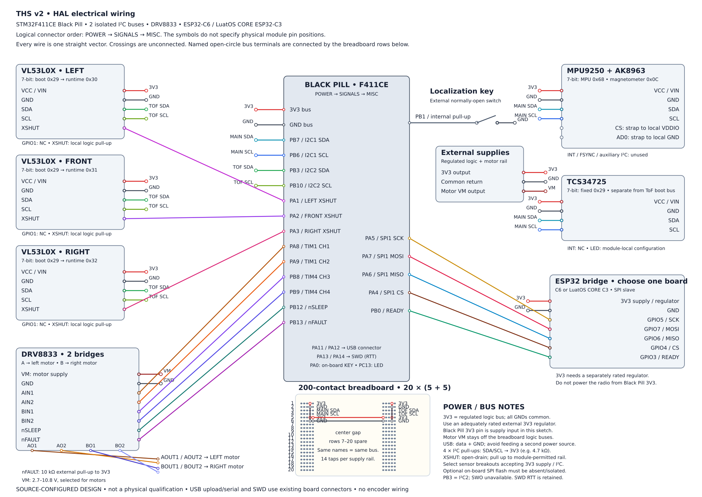

# Hardware wiring references

This page collects pin and connector assignments found in the repository. A
value described as an example or placeholder is not evidence of the assembled
robot's wiring. Confirm every example against the board variant, schematics,
and peripherals before connecting power. Firmware defaults that use `-1` are
intentionally unconfigured.

## ADR RWD drivetrain

User-specified wiring: E1/EM1 drives the left rear wheel; E2/EM2 drives the
right rear wheel. These map to the first and second `mbot2.drive_speed`
arguments respectively. The current firmware targets up to 100 RPM with onboard
PID regulating motor power, and retains its existing left +1/right −1 polarity settings. See
[ADR architecture](fw_adr_architecture.md) for controls and validation scope.
With `PID_BYPASS = True`, the same wheel order/signs apply to `drive_power`
with the separate percent-power limit, default 100%.

## THS v2 STM32F411CE Black Pill

The firmware now assigns every used HAL signal to a distinct pin. This is the
source-configured v2 design, awaiting physical continuity, voltage, and startup
checks. It is not evidence of the existing robot's wiring. The schematic uses
logical connector order **power → signals → miscellaneous**, as requested;
module symbols do not imply physical pin order. The Black Pill is shown as a
logical symbol too. Read the actual board labels when connecting leads.

[Open the SVG](diagrams/ths_hal_breadboard.svg). The small breadboard has exactly
20 rows of five connected contacts on each side of an isolated center gap:
200 contacts total. Every lead is a straight vector with two endpoints;
crossings have no junction. Named open-circle terminals denote shared buses,
whose physical distribution is through breadboard contacts, not spliced wires.

| Function | STM32 pin | Peripheral / connection |
|---|---|---|
| Main sensor SDA / SCL | PB7 / PB6 | I2C1, 100 kHz; MPU9250 + TCS34725 |
| ToF SDA / SCL | PB3 / PB10 | I2C2, 100 kHz; three VL53L0X sensors |
| Left / front / right XSHUT | PA1 / PA2 / PA3 | Independent open-drain shutdown outputs |
| Left motor AIN1 / AIN2 | PA8 / PA9 | TIM1 channels 1 / 2 |
| Right motor BIN1 / BIN2 | PB8 / PB9 | TIM4 channels 3 / 4 |
| DRV8833 nSLEEP / nFAULT | PB12 / PB13 | Output / active-low open-drain input |
| Bridge SCK / MOSI / MISO | PA5 / PA7 / PA6 | SPI1 master, mode 0, MSB first, 1 MHz |
| Bridge CS / READY | PA4 / PB0 | Master output / input |
| Localization key | PB1 | External normally-open switch to GND; internal pull-up |
| USB D− / D+ | PA11 / PA12 | Native USB CDC serial log sink |
| SWDIO / SWCLK | PA13 / PA14 | ST-Link programming/debugging and RTT |

The installed STM32duino Black Pill variant confirms PB3 AF9 + PB10 AF4 map
to **I2C2**, while PB7/PB6 map to **I2C1**. This is controller isolation, not
merely a second pair of pins on one controller. Its normal PWM pin map selects
TIM1 CH1/CH2 for PA8/PA9 and TIM4 CH3/CH4 for PB8/PB9. The application does not
allocate these timers separately; STM32duino FreeRTOS uses SysTick. The variant's
tone/servo defaults are TIM10/TIM11 and are unused by this firmware. Do not use
USART1 TX on PA9 while that pin drives the motor; the enabled serial sink is USB
CDC. All four motor input pins support hardware PWM in both travel directions.
The HAL uses open-loop PWM; there are no encoders to wire.

PA0 remains reserved for the Black Pill's on-board KEY switch, PC13 for its LED,
PC14/PC15 and PH0/PH1 for the oscillator functions. The external PB1 localization
switch is separate from the on-board PA0 button. PB3 is occupied by I2C2, so SWO
trace is unavailable; RTT uses SWD memory access and remains available.

The Black Pill optional external SPI flash footprint shares SPI1 signals
(including PA4 chip select). **That flash must be absent or electrically
isolated** when using this bridge connection. No external flash driver is enabled.
Board revisions differ in their optional flash MISO connection; changing the
MISO wire alone does not remove the shared-CS conflict.

### Sensor addresses and straps

All addresses below are **7-bit**, not shifted wire bytes.

| Controller | Device | Address | Miscellaneous connection |
|---|---|---|---|
| I2C1 | MPU9250 | `0x68` | CS to module VDDIO; AD0 to module GND; override permits `0x69` with AD0 high |
| I2C1 | AK8963 inside MPU9250 | `0x0C` | Accessed through MPU bypass; no separate external wires |
| I2C1 | LSM303DLHC acceleration (alternative build) | `0x19` | Replaces MPU9250/AK8963; same PB7 SDA / PB6 SCL; interrupts unused |
| I2C1 | LSM303DLHC magnetic field (alternative build) | `0x1E` | Same package/bus as its accelerometer; fixed silicon address |
| I2C1 | TCS34725 | `0x29` | INT unused; LED configuration is module-local |
| I2C2 | VL53L0X left | boot `0x29` → `0x30` | PA1 to XSHUT |
| I2C2 | VL53L0X front | boot `0x29` → `0x31` | PA2 to XSHUT |
| I2C2 | VL53L0X right | boot `0x29` → `0x32` | PA3 to XSHUT |

Startup holds all three XSHUT signals low and releases/readdresses one sensor
at a time. The TCS on the other controller cannot collide with their boot
address. MPU INT, TCS INT, and ToF GPIO1 are unused because acquisition polls
the devices. CS/AD0 straps are local module connections, not additional GPIOs.
Select breakouts explicitly accepting a 3.3 V supply and 3.3 V I2C logic. Bare
sensor IC supply limits differ from breakout VIN limits. XSHUT outputs are
open-drain: retain/add a pull-up to the **module-permitted logic rail**, commonly
its local 2.8 V rail on [VL53L0X carriers](https://www.pololu.com/product/2490); do not automatically pull a bare
XSHUT pin to 3.3 V. Multiple modules' onboard I2C pull-ups appear in parallel;
choose the resulting resistance for the actual wiring and 100 kHz bus.

The breadboard drawing depicts the default MPU9250 wiring. For the LSM303DLHC
build, substitute its module on the main bus; it has no gyro, MPU CS/AD0 straps,
or AK8963 bypass. Build selection and calibration live in the
[build guide](building.md#mutually-exclusive-ths-sensor-backends), and its
[sensor operation](fw_ths_architecture.md#selectable-motion-sensor-hal) describes
the MAG + ACCEL heading/rate contract. Verify the installed module's supply,
pull-ups and separate acceleration/magnetic mounting axes.

### Breadboard buses and power

| Row | Left five-contact strip | Right five-contact strip |
|---|---|---|
| 1 | 3V3 | 3V3 |
| 2 | GND | GND |
| 3 | MAIN SDA | TOF SDA |
| 4 | MAIN SCL | TOF SCL |
| 5 | 3V3 extension | 3V3 extension |
| 6 | GND extension | GND extension |
| 7–20 | Spare | Spare |

For each supply, jumper row 1→5 (3V3) or 2→6 (GND) on each side and jumper the
two extension strips across the center gap. These three separate jumpers
leave fourteen individual contacts for each supply. Give each module/supply
lead its own free contact. Do not join MAIN and TOF SDA/SCL strips. Each
I2C strip has capacity for its controller, attached devices and one pull-up:
ToF SDA and SCL each use five contacts; main SDA and SCL each use four.

Provide one effective pull-up from each of the four SDA/SCL nets to 3V3
(e.g. 4.7 kΩ if module pull-ups are absent), and a 10 kΩ pull-up from DRV8833
nFAULT to 3V3. Pull-ups are annotated in the schematic rather than drawn as
extra modules. nSLEEP is actively driven by PB12; `sleep_tied_high` stays false.
Provide driver-local bulk/decoupling capacitors as required by the selected
DRV8833 carrier. AOUT1/AOUT2 connect to the left motor; BOUT1/BOUT2 to the right;
verify physical polarity against the configured motor inversion before motion.

Use an adequately rated external regulated 3V3 supply for the logic bus and
ESP32 radio peaks. The diagram feeds Black Pill **3V3** from that rail; it does
not ask the Black Pill regulator to power the ESP32. Use a board revision that
permits this supply arrangement and avoid a simultaneous second supply through
USB/5V or a debugger. USB diagnostics require D+/D− and common GND; use an
appropriate power-isolated data connection when external 3V3 is active. SWD
requires SWDIO, SWCLK, common GND and the debugger's target-voltage reference;
its 3V3 reference is not another power source.

DRV8833 VM is a separate motor supply within its 2.7–10.8 V operating range and
the selected motors' ratings. Run motor supply/current directly to the driver,
not through the breadboard logic strips, and connect its return to common GND.
The sketch specifies electrical domains; it does not specify a battery or
regulator product. All bridge signals are 3.3 V logic.

### ESP32 bridge

| Signal | STM32F411 | ESP32-C6 / LuatOS CORE ESP32-C3 |
|---|---|---|
| SCK | PA5 | GPIO5 |
| MOSI | PA7 | GPIO7 |
| MISO | PA6 | GPIO6 |
| CS | PA4 | GPIO4 |
| READY | PB0 | GPIO3 |
| Ground | GND | GND |

Only one bridge is connected. Both bridge profiles select GPIO3–7 in
`generic_field_tool/esp32_multiboard/platformio.ini`; transfers are 256 bytes.
READY is asserted after the slave queues a transaction. The diagram uses
GPIO names and logical connectors rather than claiming a board header order.
On the LuatOS C3 board, GPIO4–7 also serve JTAG, so external JTAG cannot share
these wires. The C3 profile uses 4 MB external flash in DIO mode; see the
[manufacturer board reference](https://wiki.luatos.com/chips/esp32c3/board.html).

### Evidence and remaining qualification

Peripheral mappings were checked against the installed official STM32duino
`variant_BLACKPILL_F411CE.h` and `PeripheralPins_BLACKPILL_F411CE.c` in
`framework-arduinoststm32/variants/STM32F4xx/F411C(C-E)(U-Y)/`, and the
[upstream STM32duino variant](https://github.com/stm32duino/Arduino_Core_STM32/tree/main/variants/STM32F4xx/F411C(C-E)(U-Y)).
The manufacturer's [Black Pill hardware/revision notes](https://github.com/WeActStudio/WeActStudio.MiniSTM32F4x1/tree/master/Hardware)
and [pin diagram](https://raw.githubusercontent.com/WeActStudio/WeActStudio.MiniSTM32F4x1/master/images/STM32F4x1_PinoutDiagram_RichardBalint.png)
identify the on-board PA0 key and optional flash sharing. DRV8833 voltage and
fault behavior are specified in the [TI datasheet](https://www.ti.com/lit/ds/symlink/drv8833.pdf).

No flashing or physical board validation is implied. Sensor mounting axes,
magnetic calibration/cleanliness, tape thresholds, motor polarity/gains,
regulator capacity, actual pull-ups, scheduler timing and physical stopping
behavior still need qualification. Pin assignment alone does not enable a
qualified autonomous run; calibration gates remain in place.

## Where settings live

- Sensor pins and I2C addresses: `fw/autonomous/STM32_TINYRCP/include/hal/sensors_config.hpp`.
- Motor pins: `fw/autonomous/STM32_TINYRCP/include/board_motor_pins.hpp`.
- Telemetry CS/READY/key: `fw/autonomous/STM32_TINYRCP/platformio.ini`.
- ESP32 SPI pins: `generic_field_tool/esp32_multiboard/platformio.ini`.

The SVG is reproducible with `python3 docs/diagrams/ths_hal_breadboard.py`;
`--check` verifies reproduction, checks that the source assignments match the
sketch, and rejects duplicate default GPIO allocations across all 23 active or
reserved motor/sensor/SPI/key/USB/SWD pins. Build-flag overrides and actual
assembled wiring still require their own review. See the
[consolidated build guide](building.md#architecture-diagrams) for diagram and
firmware validation commands.
