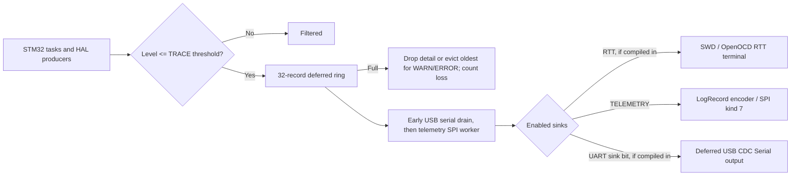
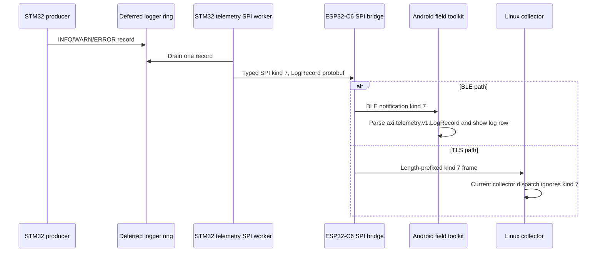

# STM32 tracing and log collection

This page describes the THS STM32 deferred logger, its sinks, and the current
collector paths. Component ownership is documented in
[THS firmware architecture](fw_ths_architecture.md) and
[field-tool architecture](field_tool_architecture.md). It follows the implementation in
`fw/autonomous/STM32_TINYRCP/src/logging/log.cpp` and the STM32 telemetry
adapter.

Vendor `clock()` tracing uses the same TIM5-based `hal_time_us()` domain as
sensor deadlines through the newlib `_times` hook. The outer record timestamp
uses FreeRTOS ticks. TIM5 is configured before logger/task startup and freezes
on debugger halt; it does not derive sub-tick time from Arduino `micros()`.

## Log levels and current producers

`robot_log::Level` values are ordered from least to most verbose:

| Level | Numeric value | Current use |
| --- | ---: | --- |
| ERROR | 0 | Bring-up failure; ToF API error or timeout; `stderr` |
| WARN | 1 | Terminal navigation states other than GOAL; FEATURE contradiction latch; FEATURE/EKF RHR entry; RHR PAUSED/FAULT transitions; invalid ToF range |
| INFO | 2 | Bring-up success; resolver state/candidate/selection changes; resolved map latch; GOAL; other RHR phase transitions; ToF lifecycle/configuration events; `stdout` |
| DEBUG | 3 | Vendor ToF debug detail in the tracing profile. |
| TRACE | 4 | Successfully enqueued motor commands, including zero-speed commands. |

The logger defaults to TRACE. `setup()` calls `robot_log::start()` before
creating bring-up: USB CDC `Serial` is initialized and `boot_log` drains the bounded
ring before telemetry exists. After the telemetry sink is attached successfully,
the SPI task owns draining. A failed HAL step stops bring-up, leaves motor
outputs stopped, and emits ERROR through the early USB serial path; no sensor,
key/start, navigation or telemetry service is started on that failure.
Initialization milestones use INFO, including main-bus readiness, IMU health,
ToF boot/address/calibration/configuration, and TCS setup. DRV8833's milestone
reports configured outputs only, without claiming power-on feedback.

MPU HAL lifecycle, configuration failures and rejected samples enter this same
deferred pipeline by default under `imu`, with the HAL error code and message.
API/configuration errors use ERROR, rejected samples and degraded readiness use
WARN, and lifecycle events use INFO. The existing HAL error rate limit remains
in effect. A custom `imu::Config::log` callback overrides this default route.
Neither path writes USB serial directly from the sensor producer.
MPU identity reads also emit DEBUG `imu` records with `CHIPID`, the seven-bit
address, observed `WHO_AM_I`, expected 0x71 and match/mismatch. A failed identity
read reports HAL status/error instead. These records observe the driver's
existing transaction, including failures during initialization; no extra probe
is added and identity validation is unchanged.

### BUP sensor snapshot

After the BUP summary, INFO records under `bup.sample` print a one-shot sensor
table: acceleration (m/s²), gyro (rad/s), native factory-adjusted AK8963 field
(µT), TCS raw R/G/B/clear counts and left/front/right ToF ranges (m).
The magnetic row is diagnostic and does not imply calibrated EKF readiness.

Sampling occurs before application service startup while BUP owns the buses;
only the retained values are printed afterward. Polling yields and ends after
500 ms, plus any in-flight HAL calls and scheduling. Failed, skipped, invalid,
or still-not-ready sensors print `N/A`, rather than a fabricated zero. Even an
early motor/settings failure prints an unavailable table without sensor I/O.

ToF prints `Inf` when a completed shot reports a distance beyond the configured
maximum and PAL status is valid (0), signal failure (2) or phase failure (4).
The latter two include no-return readings beyond the usable optical range.
Other failures, including sigma, minimum-range and hardware errors, remain
`N/A`. This is a diagnostic display classification only: navigation's valid
sample gate, fault isolation and finite-range requirements are unchanged.

### BUP I2C scan tables

Sensor startup emits separate INFO tables per physical controller, labelled
with controller, logical bus and startup phase. Every table line uses the
controller's log source (`i2c1`, `i2c2`, or `i2c3`), derived from the actual HAL
instance rather than assumed pin defaults. An unavailable/unrecognized
controller uses `i2c`. With default THS wiring, I2C1 is the main sensor bus and
I2C2 is the isolated ToF bus; their 0x29 bindings remain separate.
Rows bind seven-bit addresses to configured MPU9250, AK8963, TCS34725 and
left/front/right VL53L0X devices. ACK means an address responded, not that device
identity or physical position was verified. `no ACK` means the probe did not
succeed; `not probed` means the scan ended before reaching that address. Unknown
responders are labelled `unbound device`, with at most eight extra rows and a
total unbound count. A final scan result distinguishes completion, unavailable
bus, deadline, busy controller and timeout.

The HAL probes 0x08–0x77 once with a 2 ms timeout argument, yields one RTOS tick
per probe, and checks a 400 ms scan deadline before each probe. Busy/timeout
stops the scan immediately. HAL internal waits and task scheduling can extend
elapsed time past the deadline; this is not a hard real-time guarantee. Tables
also yield between device rows for deferred draining. No device registers,
address assignments or XSHUT pins are changed by the scan itself.

Both buses are scanned before IMU initialization; main is rescanned after IMU
success (or a deferred failure in diagnostic trace mode), and ToF after its
initialization attempt. AK8963 at 0x0c may not respond
before bypass setup. A ToF response at boot address 0x29 may represent several
devices; assigned 0x30/0x31/0x32 bindings become meaningful after ToF startup.
Scan findings are diagnostic and do not replace device HAL health checks.
The temporary trace mode keeps BUP FAILED after diagnostics and blocks all
application services; see [building](building.md#stm32f411ce-firmware) for its
flag and restoration instructions.

The `blackpill_f411ce_trace` build enables `AXI_VENDOR_TRACE_ENABLE` and
`VL53L0X_LOG_ENABLE`. ST function entry/exit and driver messages run at
`TRACE_LEVEL_ALL`; MPU vendor callbacks bypass the ordinary error rate limiter
and feed TRACE records to the common logger. LittleFS DEBUG/WARN/ERROR messages
are also enabled in that profile and enter through the existing newlib stdio
adapter. Vendor sources/signatures are unchanged. Build commands live in the
[build guide](building.md#stm32f411ce-firmware).

Producers remain bounded and may drop records during a burst. A WARN/ERROR
record displaces the oldest record when the ring is full so a fatal bring-up
report can still be queued. Serial writes run from the drain task and can wait
for USB transmit queue space while a host is connected; they never run in a HAL
producer. Startup does not wait for USB enumeration or an open host port.
Disconnected-host output is best-effort and is not replayed. USB enumeration,
stack use and sustained tracing throughput still need board validation.

The ToF HAL can emit valid samples when `Config::log_samples` is enabled; the
default is false. Invalid-range warnings are rate limited by
`Config::log_period_us`. Routine sensor polling does not generate log records.

## Debugger RTT sink

The `RTT` sink bit adds a text stream over the existing SWD connection, consumed
by OpenOCD and shown by Cortex-Debug's **THS logs** RTT terminal. It uses a
standard RTT control-block layout with one upstream and one downstream channel, implemented in the
project HAL without a vendor library. ETM instruction trace and ITM/SWO are
separate facilities; this sink does not use them or semihosting.

The deferred drain formats the same timestamp/level/source/message line used by
USB serial and copies it into a static 2048-byte ring. It attempts RTT before
USB output. The HAL writes at most one whole line, publishes the write offset
after a memory barrier and never waits for the host. The host owns only the read
offset. A brief task critical section serializes the boot-to-SPI drain handoff;
no sensor/control producer writes this ring directly and no new task is created.
A full ring drops new lines and increments its separate sink-drop counter.
Other sinks continue receiving the same log record. This does not change the
existing USB sink's possible wait for transmit space when a host is connected.

The 72-byte ARM control block is exported as `_SEGGER_RTT`; its initialized
signature and descriptor are available before bring-up. Unread early lines can
therefore survive until a later attach, within the ring's 2047-byte usable
capacity. A separate 512-byte downstream ring receives AT commands on channel 0.
RTT has no heap allocation, host-connection gate or per-line breakpoint. Removing `AXI_LOG_RTT_ENABLE` removes its buffer/control
block; the sink enum remains available for a custom callback.

Source: [RTT HAL](../fw/autonomous/STM32_TINYRCP/src/hal/rtt_log.cpp),
[deferred fanout](../fw/autonomous/STM32_TINYRCP/src/logging/log.cpp).
Build, deployment prerequisites and host-console commands are maintained in
[building](building.md#rtt-logs-over-st-link--swd).

## RTT AT commands

Channel 0 is bidirectional: host-to-target command bytes use the RTT **down**
ring; target-to-host replies share the **up** ring with ordinary log records.
Use the existing OpenOCD RTT TCP server or a debugger terminal that supports
RTT input. STM32 profiles retain float formatting support for numeric replies.
The AT parser runs in the SPI worker after successful bring-up and
requires `AXI_LOG_RTT_ENABLE` and `AXI_TELEMETRY_SPI_ENABLE` (enabled by normal
STM32 profiles). It is not an interrupt handler or a new task.

Six uppercase commands are accepted; terminate each with CR, LF or
CRLF. Send one command at a time and wait for its final `OK` or `ERROR` line.
Bare `AT`, echo/configuration commands and reset/reboot aliases are not supported.

| Command | Behavior |
| --- | --- |
| `AT+VER` | Returns THS firmware version label, AT protocol version, settings format and catalog signature. `THS_FIRMWARE_VERSION` can be supplied at compile time; its fallback is `unversioned`. |
| `AT+NVLISTITEMS` | Streams every catalog item as `+NVITEM:key,name,type,min,max,default,value,revision`, preceded by `+NVLISTITEMS:count`. Type is 0=float, 1=uint32, 2=bool. An unavailable store reports `nan` values. |
| `AT+NVLISTITEMSH` | Human-readable listing with a bordered ASCII table: key, group, item name, type, current/factory values, minimum, maximum and per-row revision. Types use names; booleans display `true`/`false`; unavailable values display `n/a`. |
| `AT+NVGETITEM=<key>` | Returns `+NVGETITEM:key,value,revision` for a decimal catalog key. |
| `AT+NVSETITEM=<key>,<value>[,<revision>]` | Validates and commits one item, then publishes settings. An explicit revision rejects stale writes; omission uses the current revision while holding the shared mutex. |
| `AT+FACTORYRESET[=<revision>]` | Atomically restores all catalog factory defaults, including calibration values, using the same optional revision rule. No MCU reboot or filesystem format occurs. |

Successful mutations and the end of a list return `+REV:revision` before `OK`.
A no-op write/reset does not touch flash or increase the revision. Numeric errors
use the existing store status codes: 1=INVALID, 2=CONFLICT, 3=BUSY, 4=IO_ERROR,
5=NOT_FOUND, 6=NOT_READY. Invalid syntax/unknown commands return `ERROR:SYNTAX`;
invalid input bytes or more than 95 command characters return
`ERROR:LINE_TOO_LONG` after the next line terminator. Floats must be finite.

Writes and factory reset share the local-key/SPI start mutex and become BUSY
permanently after first navigation start or a latched stop, even after GOAL or
cancel. Reads/listing remain available. A command is executed once after a full
line is received; an output-full condition retains the reply for retry without
repeating the mutation. List output is paced one item per worker iteration;
each row includes its own revision because SPI writes may occur between rows.
`AT+NVLISTITEMSH` uses the same pacing and backpressure handling, including its
header and border lines, and ends with `+REV:revision` followed by `OK`.
Log lines may appear between AT response lines.

The input parser uses a 96-byte command buffer and a 256-byte response buffer;
the RTT input ring is 512 bytes. Polling and output writes are bounded and do
not wait for a debugger. Ordinary logger overflow still drops log lines, while
AT responses retry without incrementing the lost-log counter. Flash commits use
the existing synchronous store path. Disconnecting a host does not stop the
robot; if its response remains pending, another AT command waits for it.

`AT+FACTORYRESET` requires a healthy current-catalog store and completed bring-up.
It cannot repair an incompatible old catalog or filesystem that prevented the
worker from starting. The expanded motor catalog requires deliberate
reprovisioning of older stores; see [storage architecture](fw_ths_architecture.md#remote-configuration-and-storage).
Implementation is in [AT parser](../fw/robot_sf/src/remote/at_cli.cpp) and
[RTT/transport integration](../fw/autonomous/STM32_TINYRCP/src/telemetry/adapter.cpp).
No tests, build or hardware command execution were performed for this change.

## Motor command enqueue events

`motor_set_wheel_speeds()` emits a TRACE record (source `motor`) after a
successful command mailbox overwrite. This also covers converted twist requests
and `motor_stop()` requests. Each record contains the requested left/right wheel
speeds in rad/s and the command's enqueue timestamp in microseconds:

```text
TRACE motor: enqueue L=1.000 R=1.000 rad/s t_us=123456
```

The record describes the queued request, not measured or applied motion.
Formatting occurs after the motor critical section, using the deferred ring;
filtered or dropped records do not change command acceptance. Rejected requests
and the internal terminal-stop queue reset do not emit enqueue records. The default TRACE threshold accepts these events; `robot_log::configure()`
can reduce verbosity at runtime.

## Resolver state and candidate events

The FEATURE task emits INFO records with source `resolver` when its symbolic
status, candidate set/count, or pose-tracking flag changes. It logs additions
and removals with the map quarter-turn and world cell. A selected candidate
also logs its confirming-frame count, score, and margin when the selection
changes or another startup confirmation arrives. Ordinary tracking frames do
not log score jitter or an increasing confirmation counter.

```text
INFO resolver: state=CONFIRMING candidates=1 tracking=0 fit_us=123456
INFO resolver: candidate add Q1 cell=(4,0)
INFO resolver: update Q1 cell=(4,0) confirmations=1 score=0.03 margin=20.00
INFO resolver: state=RESOLVED candidates=1 tracking=1 fit_us=223456
```

When more than eight cells change in one update, up to four `candidate set`
records replace individual cell records. Each gives exact `add=0x...` and
`remove=0x...` masks for one Q variant, using the bit mapping below. Including
state and selection, one update produces at most ten records.

`FeatureSnapshot::candidate_cells` contains four fixed 25-bit masks, one for
each Q1–Q4 variant, with bit `y*5+x` identifying a candidate world cell.
`candidate_epoch_us` is the oldest range timestamp of the last evaluated
distinct frame. Sensor-wait and duplicate frames retain that set and epoch;
they do not report candidates as removed. The portable matcher publishes these
diagnostics, and its STM32 task adapter owns logging. Records use the default
TRACE threshold and the same bounded, lossy deferred ring as other producers.
Unresolved states also emit a two-second heartbeat with the time in that state,
candidate count, and age of the last fitted range frame.

`excluded_ray_mask` uses bits 0/1/2 for L/F/R. A changed mask is logged at INFO.
During runtime fitting, a finite-endpoint, changing wall association, or beam
within 10 degrees of tangent can be excluded for a range mismatch only when
the other two stable, range-consistent wall returns observe both coordinate
axes. That pair is revalidated on each refit. The channel is
restored when its predicted return agrees again. Startup still requires all
three initial ray associations; an excluded ray alone never supplies position.

## Path judgments

The path task logs accepted/rejected plans and bounded chunks of route cells at
INFO. During an active goal it records phase/decision/waypoint changes and a
one-second heartbeat. Records include remaining distance along the leg, heading
error, swept diagonal clearance, requested linear/angular speeds, stop allowance
and whether it capped speed. Settle records explain the zero-PWM dwell, quiet
gyro, stable pose, fresh observations, and confirmation count. Pause records
include pose/motor ages; tape association and final center-proof waits are
logged explicitly.

`ExecuteDiagnostics` carries the portable executor's actual judgments to the
task logger. It does not integrate nominal movement or authorize commands.
A continuous active zero-speed request lasting five seconds emits one WARN,
reset after a nonzero request. This identifies a controller wait; it does not
measure wheel standstill. Terminal logs retain the last waypoint and judgment.
All records use the existing deferred, bounded, lossy ring.

Potentially unsafe path judgments (`WAIT_TURN_CLEARANCE`,
`REAPPROACH_CENTER`, `HEADING_RECOVERY`, `FRONT_BLOCKED`) emit WARN on entry or
waypoint change, including mapped pivot clearance, signed cross-track distance
and heading error relative to the route. While advancing, a deviation above
5 mm laterally or 10 degrees from the route emits a `veering off path` WARN.
It rearms below 3 mm and 7 degrees, or at a new waypoint, with at most one
veering warning per second. These thresholds are diagnostic only.

With the turn guard enabled, entering `LEAN` (unsafe clearance requiring
posture correction) or `BLOCKED` emits WARN with the measured L/R center-to-wall
clearances. Routine coast checks, intermediate recovery stages and successful
release remain INFO.

## Sampled pose and sensor readings

The FEATURE owner emits one `pose` record at TRACE per ten task updates
(500 ms at its 50 ms period). It includes measured X/Y/yaw, tracking status,
grid cell and uncertainty. The sensor owner emits one `sensors` TRACE record
per five updates (50 ms at its 10 ms period), containing the latest IMU, MAG
and L/F/R ToF readings. These counters sample publication loops, including held
sensor readings; they do not claim a new acquisition from every device.
Normal INFO state/candidate/path logs retain their existing thresholds.

## Navigation failsafe events

The path task emits a single WARN when it first sees the feature contradiction
latch and another WARN when a goal enters RHR. Cancel and new goals retain the
latch, so each subsequent RHR entry is logged, but the contradiction warning is
not repeated. Phase records are emitted only when the phase changes, including
IDLE on cancellation or handoff to the measured final approach. Entering PAUSED
or FAULT uses WARN; other transitions use INFO. Repeated paused/faulted task
iterations do not fill the log ring.

Example records (source `navigation`):

```text
WARN FEATURE contradiction latched: frames=3; RHR armed
WARN right-hand fallback: FEATURE contradiction
INFO right-hand phase=IDLE -> COAST reason=1
INFO right-hand phase=COAST -> DECIDE reason=1
INFO right-hand phase=DECIDE -> FOLLOW reason=1
WARN right-hand phase=FOLLOW -> PAUSED reason=1
```

The numeric reason is `FallbackReason`: 0=NONE, 1=FEATURE_CONTRADICTION,
2=EKF_FAILED, 3=EKF_CONTRADICTION, 4=FORCED_TEST, 5=STARTUP_WALL.
The guarded startup U-turn logs its unanimous candidate clearance, RHR phases,
and completion before waiting for a fresh pose confirmation.
The first contradiction latch freezes the feature trip
count/time for diagnostics; fresh matching can resume without erasing it.
The snapshot's reason describes the latched policy even while canceled or in
the guarded final approach. The `fallback` flag indicates active RHR execution.
These events use the same bounded, lossy ring and telemetry path described below;
they do not add a polling task or perform direct UART/SPI I/O.

## Path pause and fault diagnostics

The path task logs each PAUSED transition at WARN with waypoint, tracking,
symbolic FEATURE resolver status, and candidate count. It logs a failed goal
once at ERROR, including the executor's typed reason, waypoint, elapsed leg
time, last pose age/cell, motor status/duty, and all three current TOF ranges.
These records use existing snapshots and the deferred ring; no additional
sensor reads or direct UART/SPI calls occur in the path task.

The seed-1234 supplied-map diagnostic replay with `--entrance 0 --heading 2`
to the fixed goal `(0,3)` produces:

```text
path PAUSED wp=3 tracking=0 resolve=AMBIGUOUS candidates=1
PATH FAULT reason=LEG_TIMEOUT wp=3 leg_ms=30020
pose tracking=0 age_ms=27391 cell=(4,2) resolve=AMBIGUOUS
motor=0 pwm=0.000/0.000 tof=0.034/0.146/0.032
```

Here the tasks are still running: FEATURE cannot accept the current wall
feature, the executor pauses translation, and its 30-second leg timer expires.
The FAULT status and `execution_fault` stay visible until cancel or a new goal;
the shared run remains RUNNING until its original deadline or another terminal
request. This retains the failure cause without authorizing unlocalized motion.
The Vulkan diagnostics panel displays the named fault reason as well.

`ExecuteFault` names are `NONE`, `INVALID_START`, `LEG_TIMEOUT`, `MOTOR_FAULT`,
`UNEXPECTED_CELL`, `TARGET_PASSED`, and `SETTLE_DRIFT`. The reason describes the
portable path executor; RHR stops are identified separately by the RHR source,
phase, and motor snapshot. A later run terminal state has its own existing log.

## Deferred logger and sinks

Producers format a bounded record with an RTOS timestamp, level, source tag,
and message. The logger filters by level and puts accepted records into a
32-entry ring protected by a short critical section. Producers do not perform
UART or SPI operations. A full ring drops INFO/DEBUG/TRACE records; WARN/ERROR
replace its oldest entry. Either case increments the drop counter.



`robot_log::start()` enables UART, TELEMETRY and the compiled-in RTT sink before bring-up. Every
supported STM32 profile compiles serial output with `AXI_LOG_SERIAL_ENABLE`
and selects USB CDC with `PIO_FRAMEWORK_ARDUINO_ENABLE_CDC`. STM32duino maps
`Serial` to `SerialUSB`; the existing `UART` sink enum/bit remains the serial
sink identifier for compatibility. Deferred stdout/stderr uses this same sink.
Connection and monitor commands live in the [build guide](building.md#stm32f411ce-firmware).
`boot_log` drains early records, including errors when hardware bring-up fails.
After successful application startup registers the telemetry callback, the SPI
worker checks the logger before forwarding a queued EKF pose.

At the bottom of `bup_task_entry()`, after the final result and before task
deletion, a compact box-drawn summary is submitted entirely at DEBUG. It lists
DRV8833 output configuration, settings, sensor HALs, application services and
the overall BUP result. Failed steps are marked `failed`; later steps remain
`skipped`. The DRV row says `configured` rather than claiming power feedback.
INFO and lower thresholds suppress the table; DEBUG and TRACE accept it.
UTF-8 box-drawing lines fit the fixed message buffer.

The callback copies timestamp, numeric level, source, message, and cumulative
drop count into the `axi.telemetry.v1.LogRecord` protobuf, then wraps it as
typed SPI kind 7. The ring capacity is 32 and each record has fixed-size source
and message buffers, so long text is truncated to fit those fields.

## Trace sink and collector paths



On the ESP32-C6, kind 7 is placed in the one-entry `latest` mailbox shared
with kind 1 EKF pose telemetry. BLE publishes kind 7 directly when TLS is not
connected. The TLS worker reads that shared mailbox and sends the next packet
as a length-prefixed kind/payload frame. Since the mailbox holds only one
packet, a newer kind 1 or kind 7 packet can replace a packet that has not yet
been forwarded. This is a lossy live stream, not a durable log queue.

The Android `RobotSession` recognizes kind 7, parses `LogRecord` using the
loaded telemetry schema, and presents the resulting JSON in its log view. Its
log pause control affects display; it does not configure the STM32 threshold.

The Linux `fw/telemetry_bridge/host/collector.py` currently decodes only kind 1
`EkfLog` payloads and kind 3 acknowledgments. Its `dispatch()` ignores kind 7,
so Linux collection does not currently display or write STM32 log records to
JSONL. The collector's `log on` and `log off` commands only control display of
the records it already understands. Kind 7 support requires adding a
`LogRecord` decoder/dispatch path to the collector.

## Useful source files

- [Logger API](../fw/autonomous/STM32_TINYRCP/include/logging/log.hpp)
- [Logger ring and sinks](../fw/autonomous/STM32_TINYRCP/src/logging/log.cpp)
- [STM32 telemetry adapter](../fw/autonomous/STM32_TINYRCP/src/telemetry/adapter.cpp)
- [ESP32-C6 SPI routing and TLS/BLE output](../generic_field_tool/esp32_multiboard/src/main.c)
- [Android telemetry frame parser](../generic_field_tool/android/app/src/main/java/dev/ra/remote/RobotSession.kt)
- [Linux collector](../fw/telemetry_bridge/host/collector.py)
